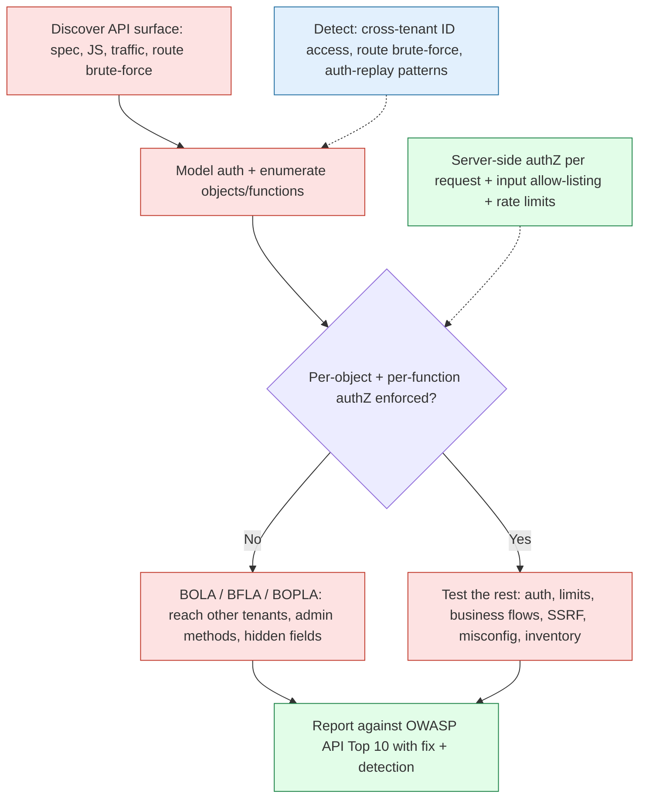

# OWASP API Security Top 10 (2023) Testing Guide

## Summary

An API penetration test follows the same arc as a web-app test but is weighted toward **authorization** rather than rendered-page flaws. The reference map for what to test is the **OWASP API Security Top 10 (2023)**. This file is a study-oriented walkthrough of all ten risks: for each one, what it is, how it works, a **vulnerable vs fixed** code example, how to test it with concrete requests against placeholder hosts, how to detect the traffic it generates, and how to defend against it. It closes with an ATT&CK/CWE mapping and a one-glance cheat sheet.

It builds on the concepts in [API Security Fundamentals for Pentesters](api-security-fundamentals-for-pentesters.md) (read that first if the HTTP/JSON/JWT/OAuth parts are new) and complements [API Penetration Testing Methodology and Tooling](api-penetration-testing-methodology-and-tooling.md), which covers the end-to-end engagement and the toolchain.

> Everything here is for APIs you own or are explicitly authorized to test, within agreed hosts, versions and request rates. All hosts (`api.example.com`), IDs and tokens are made up. No denial-of-service testing unless it is explicitly in scope — for resource-consumption items, demonstrate the *missing limit* with a handful of requests and a calculation of impact, never by exhausting the service.

## Why API testing is mostly authorization testing

A browser-rendered web app hides a lot of its logic behind pages; an API exposes a raw list of operations and trusts the client to send the right IDs, fields and function calls. The server's one non-negotiable job is to re-check, on **every** request, that this caller may touch this exact object and perform this exact action. Three of the ten risks (API1, API3, API5) are direct authorization failures, and they are the highest-yield findings on almost every engagement. Ask for **at least two test users per role, plus one admin** — most of these bugs are only visible when you compare what one user can do to another user's data.

## The ten risks as a test map

| ID | Risk | The one-line test |
|---|---|---|
| API1 | Broken Object Level Authorization (BOLA) | Swap object IDs across accounts; does the server check ownership? |
| API2 | Broken Authentication | Token validation, brute-force resistance, expiry/revocation. |
| API3 | Broken Object Property Level Authorization (BOPLA) | Mass assignment (extra writable fields) and over-returned sensitive properties. |
| API4 | Unrestricted Resource Consumption | Missing rate limits, paging and size caps. |
| API5 | Broken Function Level Authorization (BFLA) | Call admin/privileged methods as a low-priv user. |
| API6 | Unrestricted Access to Sensitive Business Flows | Automatable abuse of a valuable flow at scale. |
| API7 | Server-Side Request Forgery | API fetches attacker-supplied URLs. |
| API8 | Security Misconfiguration | Verbose errors, CORS, missing hardening, defaults. |
| API9 | Improper Inventory Management | Shadow/old API versions, undocumented endpoints. |
| API10 | Unsafe Consumption of APIs | Blind trust of data from upstream/third-party APIs. |



---

## API1:2023 — Broken Object Level Authorization (BOLA)

**What it is.** The API lets a caller access an object by ID without checking the caller is allowed to access *that* object. The most common and most impactful API bug.

```http
GET /api/v2/orders/5001      ← user A's token, user A's order: 200 (correct)
GET /api/v2/orders/5002      ← user A's token, user B's order: 200 (BOLA)
```

```python
# Vulnerable: looks up by ID alone
order = db.orders.get(order_id)
return order

# Fixed: scope every lookup to the caller
order = db.orders.get(id=order_id, owner_id=current_user.id)
if not order:
    return 404
```

**How to test.** Log in as user A and user B. Capture an A request that contains an object ID (path, query, JSON body, or header). Replay it with B's token. A Burp authz-comparison extension such as Autorize, or a second session in Repeater, makes this systematic. Test every method separately (`GET`, `PUT`, `DELETE`) — the read path may be protected while delete is not. Note whether IDs are sequential integers (every object reachable) or random UUIDs (harder to guess, but still not access control: IDs leak in other responses, URLs and logs).

**Detect.** One identity accessing many distinct object IDs it does not own; sequential or parameter-swept IDs from a single session; a high ratio of 403/404 on object endpoints — provided logs record user ID *and* object ID.

**Defend.** Enforce object-level authorization server-side on every request, ideally in one policy layer every handler uses, and scope the database query to the caller. Return 404 (not 403) so existence is not confirmed.

---

## API2:2023 — Broken Authentication

**What it is.** Weaknesses in how the API confirms identity: no brute-force protection on login or OTP, weak token validation, tokens that never expire, credentials in URLs, abusable password-reset flows.

| Vulnerable | Fixed |
|---|---|
| `/login` accepts unlimited attempts | Lockout or progressive delay, plus credential-stuffing monitoring |
| JWT signature not verified, or `alg` taken from the token | Library pinned to a fixed algorithm and key |
| 6-digit OTP with no attempt limit | Attempt limit per code and per account, short expiry |
| Reset token never expires | Short-lived, single-use reset token |

**How to test.** Map every auth endpoint (login, register, refresh, reset, OTP, logout). Check token expiry and revocation on logout; look for error-message differences that enable user enumeration ("user not found" vs "wrong password"); test rate limiting within agreed limits. For JWTs, run the checks in [API Security Fundamentals](api-security-fundamentals-for-pentesters.md#jwt-weaknesses-worth-being-able-to-explain): is `alg: none` rejected, is an edited claim rejected, are expired/wrong-`aud` tokens rejected.

**Detect.** Many failed logins across accounts from one source (spraying/stuffing), spikes of 401, OTP endpoints hit repeatedly per account.

**Defend.** Rate-limit and monitor authentication endpoints; pin token algorithm and validate `exp`/`iss`/`aud`; short-lived tokens with server-side revocation; identical responses for valid and invalid usernames.

---

## API3:2023 — Broken Object Property Level Authorization (BOPLA)

**What it is.** Merges two older items: **excessive data exposure** (reading properties you should not see) and **mass assignment** (writing properties you should not set).

```http
PATCH /api/v2/users/1043
{"displayName": "Venu", "role": "admin"}       ← extra property the UI never sends
```

```python
# Vulnerable: binds every field from the request onto the model
user.update(**request.json)

# Fixed: explicit allow-list of writable fields
allowed = {"displayName", "email"}
user.update(**{k: v for k, v in request.json.items() if k in allowed})
```

**How to test.** For exposure, compare response fields with what the UI shows. For assignment, take property names from responses, OpenAPI schemas or JS (`role`, `isAdmin`, `ownerId`, `balance`), add them to a write request on your own test object, then re-read the object to see if they stuck.

**Detect.** Write requests carrying fields the client never sends; sensitive fields appearing in responses to low-privilege callers.

**Defend.** Allow-list writable properties on input and returned properties on output (use explicit DTOs/serializers, not whole-object binding). `readOnly` in an OpenAPI schema is documentation, not enforcement. See OWASP's Mass Assignment Cheat Sheet.

---

## API4:2023 — Unrestricted Resource Consumption

**What it is.** No limits on how much a caller can consume: request rate, page size, upload size, query complexity, or paid third-party actions (SMS, email) the API triggers.

| Vulnerable | Fixed |
|---|---|
| `GET /items?limit=1000000` honoured | Server-side maximum page size |
| GraphQL with no depth/complexity limit | Depth, complexity and timeout limits |
| `POST /send-otp` with no limit, each call costs an SMS | Per-user and per-number limits, spend alerts |

**How to test.** Look for `limit`/`page`/`size` parameters, upload endpoints and cost-generating actions. Show the *missing* limit with a small number of requests and a calculation of impact — do **not** actually exhaust the service. DoS is almost always out of scope.

**Detect.** Single endpoints hit at high volume; oversized `limit` values; expensive GraphQL queries; bursts against OTP/email endpoints.

**Defend.** Server-side caps on page size, payload size and query depth/complexity; gateway rate limits and quotas per user and per action; spend alerts on paid actions.

---

## API5:2023 — Broken Function Level Authorization (BFLA)

**What it is.** A normal user can call an *administrative function* (as opposed to someone else's object, which is BOLA).

```http
GET    /api/v2/users/1043          ← normal user function
DELETE /api/v2/admin/users/1044    ← admin function; 200 with a normal user's token = BFLA
```

**How to test.** Collect admin endpoints from docs, JS bundles, or the admin account's traffic. Replay them with a normal user's token. Try method changes on normal endpoints (`GET` → `DELETE`, `POST`).

> **BOLA vs BFLA.** BOLA: the right *function*, the wrong *object* (someone else's order). BFLA: the wrong *function* for your role (an admin action you should not have at all).

**Detect.** A low-privilege token repeatedly calling admin-only methods — a run of 403s followed by a 200 is the signal.

**Defend.** Enforce function-level authorization server-side for every privileged operation; deny by default, grant by role; never rely on the client hiding a button or route.

---

## API6:2023 — Unrestricted Access to Sensitive Business Flows

**What it is.** A legitimate flow (buy, book, sign up, post, redeem a referral) can be automated at a scale that hurts the business, even though each single request is valid. OWASP's examples include buying all stock of a limited item or spamming referral sign-ups.

**How to test.** Identify flows with business value and ask: what stops a script doing this 10,000 times? Check for device fingerprinting, CAPTCHA, per-account limits, and anti-automation on the **API itself**, not only on the web UI. Demonstrate with a handful of requests and describe the scale risk.

**Detect.** A single account or source driving a business flow far faster or more often than a human would; many fresh accounts funnelling into one referral/promo.

**Defend.** Rate and velocity limits per business action, bot detection, human verification on high-value flows, and business-side monitoring. (OWASP maps no single CWE here — it is a design issue.)

---

## API7:2023 — Server-Side Request Forgery (SSRF)

**What it is.** The API fetches a URL the caller supplies (webhook, avatar URL, import-from-URL, PDF generator) without restricting where it may go, so the server can be made to reach internal systems.

```json
POST /api/v2/webhooks
{"url": "https://hooks.example.net/callback"}
```

**How to test.** Find every parameter that takes a URL or hostname. In the lab, point it at an out-of-band listener you control to confirm the server makes the request; check whether it follows redirects. Internal and cloud-metadata targets are tested only if explicitly in scope — see [Server-Side Request Forgery and the Cloud Metadata API](../../cloud/web-security/ssrf-and-cloud-metadata-api.md).

**Detect.** Outbound requests from app servers to internal/metadata ranges; webhook or import features resolving to private IPs.

**Defend (OWASP SSRF Prevention Cheat Sheet).** Allow-list destinations; resolve DNS and validate the resulting IP; block private, loopback and link-local ranges; disable redirects; on AWS, require IMDSv2.

---

## API8:2023 — Security Misconfiguration

**What it is.** Anything set up insecurely: verbose errors (stack traces, SQL errors, framework versions), missing TLS, permissive CORS, unneeded HTTP methods, default credentials, missing security headers, debug endpoints left on.

**How to test.** Review response headers, error responses, CORS behaviour (does the server reflect an arbitrary `Origin` with `Allow-Credentials: true`?), TLS configuration, and `OPTIONS` responses. Templated scanners (e.g. nuclei with exposure/misconfig tags) find known issues quickly.

**Detect.** Requests probing config paths and methods; `OPTIONS`/`TRACE` activity; errors leaking internals in responses.

**Defend.** Generic client-facing errors with detail only in server logs; a hardened, repeatable configuration baseline; least-privilege CORS; disable unused methods and debug endpoints.

---

## API9:2023 — Improper Inventory Management

**What it is.** The organisation does not know all its APIs: old versions still running (`/v1` next to `/v3`), staging hosts exposed, undocumented endpoints, unclear data flows to third parties.

**How to test.** Compare `servers` in docs with DNS and certificate-transparency results (in scope only), try older version prefixes, and run content discovery. A common real pattern: `/v3` checks authorization, `/v1` of the same endpoint does not.

**Explain it simply.** The restaurant renovated the front door but the old side door is still unlocked.

**Detect.** Traffic to deprecated versions or staging hosts; requests to endpoints absent from the current spec.

**Defend.** Maintain an API inventory generated from gateways and code, with owners and versions; retire old versions; document data flows to third parties.

---

## API10:2023 — Unsafe Consumption of APIs

**What it is.** The API trusts data from *third-party* APIs more than it trusts user input: no validation, following redirects blindly, no TLS, no timeouts.

**How to test.** Identify integrations (payment, address lookup, shipping, enrichment). If you can influence what the third party returns (for example by storing data there through your own account), check whether the target API validates it before use. Mostly a design and code-review item.

**Detect.** App servers following redirects to unexpected hosts; integration responses consumed without schema validation.

**Defend.** Treat third-party responses as untrusted input: validate and encode, use TLS, set timeouts and size limits, and do not follow redirects blindly.

---

## ATT&CK mapping

| ATT&CK ID | Name | Where it fits |
|---|---|---|
| T1190 | Exploit Public-Facing Application | Exploiting any API flaw for access |
| T1078 | Valid Accounts | Using legitimate or obtained credentials / tokens |
| T1110.003 / T1110.004 | Brute Force: Password Spraying / Credential Stuffing | Login endpoints without limits (API2) |
| T1595.003 | Active Scanning: Wordlist Scanning | Route/parameter discovery with ffuf, Kiterunner, Arjun |
| T1528 | Steal Application Access Token | OAuth token theft (e.g. redirect-URI flaws) |
| T1550.001 | Use Alternate Authentication Material: Application Access Token | Replaying a stolen bearer token |
| T1606 | Forge Web Credentials | Forging tokens when signing is weak |
| T1552.005 | Unsecured Credentials: Cloud Instance Metadata API | SSRF to cloud metadata (API7) |
| T1499.003 | Endpoint Denial of Service: Application Exhaustion Flood | Impact of unbounded resource consumption (API4) — the impact, not something to perform |

## CWE mapping

CWE IDs below are exactly those the OWASP API Security Top 10 (2023) lists for each risk. Names are the current CWE 5.0 names, which differ slightly from older labels. A note is added where CWE's own "vulnerability mapping" guidance discourages or prohibits using that ID as a root-cause tag (usually because it is a high-level Class or a Grouping/Category) — use the more specific Base weakness in a report where one applies.

| OWASP API 2023 | CWE(s) as listed by OWASP | Note |
|---|---|---|
| API1 BOLA | CWE-639 (Authorization Bypass Through User-Controlled Key); CWE-285 (Improper Authorization) | CWE-285 is a Class (mapping *discouraged*); prefer CWE-639. |
| API2 Broken Authentication | CWE-204 (Observable Response Discrepancy); CWE-307 (Improper Restriction of Excessive Authentication Attempts) | Both Base weaknesses. |
| API3 BOPLA | CWE-213 (Exposure of Sensitive Information Due to Incompatible Policies); CWE-915 (Improperly Controlled Modification of Dynamically-Determined Object Attributes) | CWE-915 is the mass-assignment weakness. |
| API4 Resource Consumption | CWE-770 (Allocation of Resources Without Limits or Throttling); CWE-400 (Uncontrolled Resource Consumption); CWE-799 (Improper Control of Interaction Frequency) | CWE-400 is a Class (*discouraged*); prefer CWE-770. |
| API5 BFLA | CWE-285 (Improper Authorization) | Class; *discouraged* as a precise tag. |
| API6 Business Flows | — | OWASP maps no single CWE; design issue. |
| API7 SSRF | CWE-918 (Server-Side Request Forgery) | Base weakness. |
| API8 Misconfiguration | CWE-209 (Error Message with Sensitive Info); CWE-319 (Cleartext Transmission); CWE-444 (Inconsistent Interpretation of HTTP Requests); CWE-942 (Permissive Cross-domain Security Policy with Untrusted Domains); plus CWE-16/CWE-2/CWE-388 | CWE-16, CWE-2 and CWE-388 are Grouping/Category entries — *prohibited* for mapping; use a specific Base (e.g. CWE-209, CWE-942). |
| API9 Inventory | CWE-1059 (Insufficient Technical Documentation) | *Prohibited* for mapping (Class/documentation entry); cite the risk, not the CWE, in findings. |
| API10 Unsafe Consumption | CWE-20 (Improper Input Validation); CWE-200 (Exposure of Sensitive Information); CWE-319 (Cleartext Transmission) | CWE-20 and CWE-200 are Classes (*discouraged*); prefer a specific Base weakness. |

## Cheat sheet: first check per situation

| Situation | First check |
|---|---|
| Any object ID in a request | Replay with a second user's token (BOLA) |
| Any write request | Add fields seen in responses/schema (`role`, `isAdmin`, `ownerId`) (BOPLA) |
| Any response | More fields than the UI shows? (BOPLA exposure) |
| Admin endpoint found | Call it with a normal user token (BFLA) |
| JWT present | Decode; check `alg`, `kid`, `aud`, `iss`, `exp`, sensitive data; is an edited claim rejected? |
| OAuth flow | Exact `redirect_uri` match, `state`, PKCE `S256`, no implicit grant |
| GraphQL endpoint | Introspection on? Field suggestions? Depth/batching limits? Resolver authz? |
| URL/host parameter | SSRF: out-of-band callback in lab; are redirects followed? (API7) |
| Error responses | Stack traces, versions, user-enumeration differences (API8) |
| CORS headers | Arbitrary `Origin` reflected with `Allow-Credentials: true`? (API8) |
| Login / OTP / reset | Limits, lockout, token expiry (API2/API4) |
| Docs `servers` list | Old versions and staging hosts (API9) |
| `limit` / `page` / upload | Server-side maximum enforced? (API4) |

## Explanation

The OWASP API Top 10 is really one question asked ten ways: *will the server let me touch something that isn't mine, or do something I'm not allowed to?* Three of the ten (BOLA, BOPLA, BFLA) are that question about objects, fields and functions, and they are where most real findings live, which is why you ask for two users per role and spend most of the test comparing them. The rest cover the edges: proving identity (API2), not drowning the service (API4, API6), not being tricked into fetching internal URLs (API7), not shipping a sloppy configuration or forgotten old version (API8, API9), and not blindly trusting an upstream API (API10). For each, the fix is small and specific, and so is the detection signal — which is why every finding in a report should carry both.
