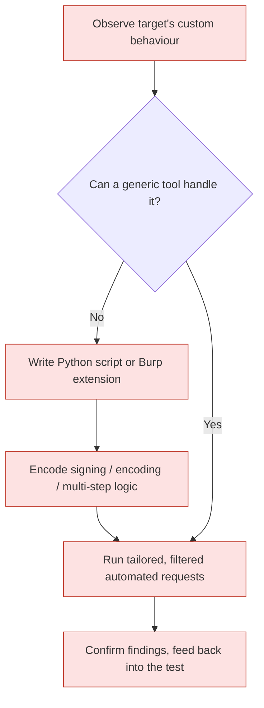

# Python Web Attack Tooling and Burp Extensions

## Summary

Off-the-shelf scanners miss bugs that depend on an application's own logic: a custom signature, a multi-step flow, an unusual encoding. Writing small **Python tools** and **Burp Suite extensions** lets a tester encode the target's specific behaviour into automation — reproducing a signing step, decoding a bespoke token, or chaining requests. This is the difference between running a tool and building the one the target needs. It is a methodology and skill topic rather than a single attack, so no ATT&CK technique maps to it directly; the resulting activity falls under whichever technique the custom tool exercises.

## What custom tooling is for

| Need | Why generic tools fall short |
|---|---|
| **Custom auth/signing** | Each request needs an HMAC or token the scanner cannot compute |
| **Multi-step logic** | The bug only appears across a sequence of requests with carried state |
| **Bespoke encoding** | Parameters are serialized in a non-standard format the scanner cannot fuzz |
| **Response parsing** | The signal of success is buried in custom JSON/HTML the tool will not read |
| **Scale with precision** | Thousands of tailored requests, filtered by a target-specific rule |

Common building blocks: Python with `requests` (or `httpx`) for scripted HTTP, and Burp extensions (Java, or Python via the Montoya/legacy APIs) to transform requests and responses inside the proxy — for example auto-signing every request, or decoding a token in the UI.

## Where it fits in a test

## Detection

Custom tooling produces traffic like any other automated client, so defenders detect it the same way:

- Abnormal request volume or timing from one source, or sequences that reproduce a privileged flow rapidly.
- Requests that are well-formed for the app's custom scheme yet come far faster than a human could drive the UI.
- Valid signatures/tokens used at machine speed, which rate and anomaly monitoring can still flag.

## Defense

- **Do not rely on custom encodings or client-side signing as a security control**; a tester can and will reimplement them. Enforce authorization and validation server-side regardless of how a request is formatted.
- **Rate-limit and monitor** by account and behaviour, not by tool fingerprint, since custom tools blend in.
- **Treat every endpoint as directly reachable**: anything the official client can do, a script can do.
- For defenders, the same skill is an asset — building tailored test harnesses and detections for your own app finds these issues before an attacker scripts them.

## ATT&CK mapping

No single ATT&CK technique; this is tooling and methodology. The activity maps to whichever technique the custom tool is built to exercise (for example T1190 for exploiting an endpoint, or T1110 for scripted credential attacks).

## Explanation

A scanner is a set of standard lock-picks that work on standard locks. Some targets fit a custom lock — an odd keyway, a two-step turn, a code that changes each try. For those you file your own pick, and Python plus a Burp extension is the file and vice. For the defender the lesson is blunt: a lock whose only trick is an unusual shape can always be copied, so the real security must be in checks the picked lock cannot bypass.
