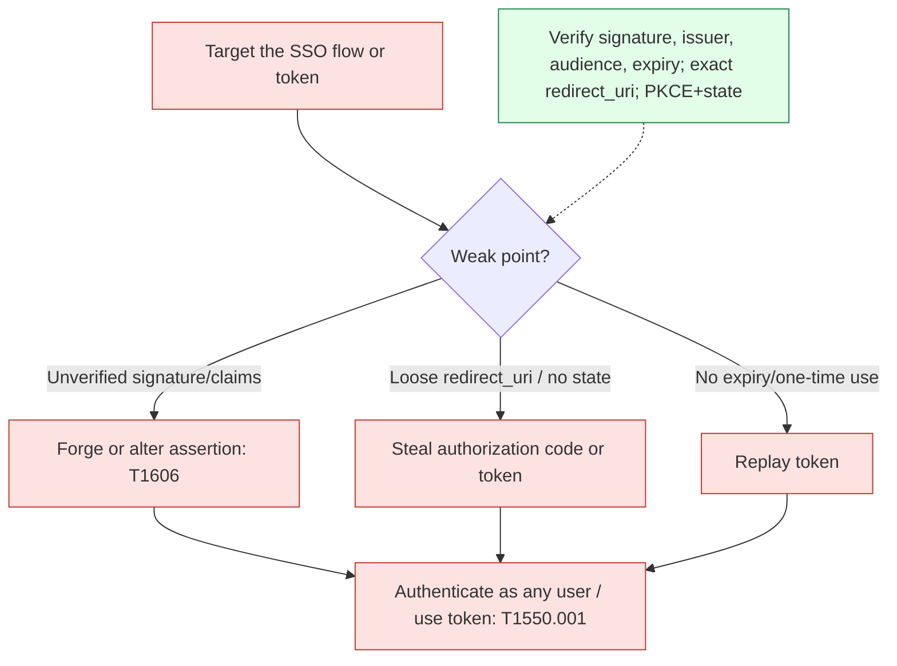

# Single Sign-On Security Issues

## Summary

Single sign-on (SSO) lets a user authenticate once with an identity provider (IdP) and access many applications (relying parties) using tokens, built on protocols like SAML, OAuth 2.0 and OpenID Connect (OIDC). SSO concentrates trust in those tokens and the flows that issue them, so the security issues are about token validation, flow integrity, and trust configuration. A forged or mishandled token can impersonate any user (ATT&CK T1606, Forge Web Credentials; T1550.001, Application Access Token).

## Where SSO goes wrong

| Issue | What happens |
|---|---|
| **Weak token validation** | A relying party does not properly verify the token's signature, issuer, audience or expiry, so a forged or altered token is accepted |
| **SAML signature flaws** | XML signature wrapping or not verifying the assertion signature lets an attacker change the asserted identity |
| **Audience/issuer confusion** | A token issued for one app or IdP is accepted by another (token reuse across trust boundaries) |
| **Loose `redirect_uri`** | An open or wildcard OAuth redirect lets an attacker capture authorization codes or tokens (see [Open Redirects](open-redirects.md)) |
| **Missing state/PKCE** | No CSRF protection (`state`) or no PKCE on public clients enables code interception and login CSRF |
| **Replay** | A token or assertion without proper expiry/one-time use is replayed |
| **IdP-mix / confused deputy** | Trusting an attacker-controlled IdP, or mixing up which IdP a response came from |

## Attack flow

## Detection

- Tokens accepted with invalid or missing signatures, wrong audience/issuer, or past expiry (instrument the relying party's validation).
- OAuth authorization requests with unexpected `redirect_uri` values, or missing `state`/PKCE.
- Logins for a user from an IdP or assertion that does not match expected configuration.
- Replays: the same assertion/code presented more than once.

## Defense

- **Validate tokens fully** at every relying party: signature against the IdP's current keys, plus `issuer`, `audience`, `expiry` and `nonce` where applicable. For SAML, verify the assertion signature and guard against XML signature wrapping.
- **Exact-match `redirect_uri`** against pre-registered values; no wildcards or open redirects.
- **Use `state` and PKCE** for OAuth/OIDC authorization-code flows; prefer authorization code over implicit.
- **Enforce short expiry and one-time use** for assertions/codes to prevent replay.
- **Pin trusted IdPs and keys**; rotate and validate signing keys.
- Protect the IdP heavily, since compromising it compromises every connected app.

## ATT&CK mapping

| ID | Name | Tactic |
|---|---|---|
| T1606 | Forge Web Credentials | Credential Access |
| T1550.001 | Use Alternate Authentication Material: Application Access Token | Lateral Movement |

## Explanation

SSO replaces many passwords with one trusted stamp of identity. The risk moves to that stamp: if an app does not check the stamp carefully — its signature, who issued it, who it is for, whether it has expired — an attacker who can forge or steal one walks into every app as anyone. Good SSO is relentless about verifying the stamp and about never sending it to the wrong address.
