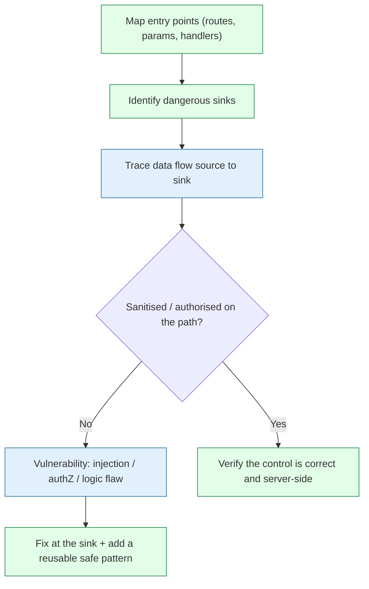

# Source Code Review for Web Vulnerabilities

## Summary

Black-box testing finds what is reachable from outside; **source code review** finds the cause and the bugs no request happened to trigger. Reading the code traces how data flows from an entry point (a request parameter) to a dangerous operation (a query, a command, an HTML response) and checks whether it is made safe along the way. It is the most thorough way to find injection, access-control and logic flaws, and it is a core defensive practice. It maps to no single ATT&CK technique; it is how defenders remove the weaknesses other techniques would exploit.

## The method: sources, sinks and the path between

| Term | Meaning |
|---|---|
| **Source** | Where untrusted data enters: query/body/header params, cookies, uploads, imported data |
| **Sink** | A dangerous operation: SQL query, OS command, HTML output, file path, deserializer, redirect |
| **Taint flow** | The path from source to sink; the bug is a sink reached by tainted data without proper handling |
| **Sanitiser/validator** | Code that neutralises data on the path (parameterization, encoding, allow-listing) |
| **Control check** | Where authentication and authorization are (or should be) enforced |

A finding is a source reaching a sink with no adequate sanitiser or missing authorization check in between.

## Review workflow

## What to look for

- **Injection sinks**: string-built SQL/NoSQL, `exec`/`system`, template rendering of user data, dynamic file paths.
- **Output without context-aware encoding** (reflected or stored data placed into HTML/JS/attributes).
- **Missing or client-side-only authorization**: an object/function reached without an ownership or role check.
- **Deserialization** of untrusted data, and unsafe use of reflection or dynamic code.
- **Secrets in code**, weak crypto, and disabled framework protections (CSRF tokens off, auto-escaping disabled).
- **Error/logging gaps** that leak details or hide attacks.

## Using tools well

- **SAST** (static analysis) scales the search for tainted flows but produces false positives and misses logic/authorization bugs; treat its output as leads, not conclusions.
- **Manual review** confirms findings, understands intent, and catches the context a scanner cannot — especially access control and business logic.
- Combine both, and review security-relevant code (auth, access control, input handling) with priority.

## Defense value

Fixing a flaw in source removes it everywhere it is reachable, not just where a tester poked. Encoding safe patterns as shared, reusable functions (a single parameterized-query helper, one output-encoding layer) prevents the class from recurring. Integrate review into code review and CI so new code is checked continuously.

## ATT&CK mapping

No single ATT&CK technique; this is a defensive review process that removes the weaknesses exploited by techniques such as T1190 and T1059.

## Explanation

Black-box testing is rattling a building's doors from the street. Source review is walking the architect's blueprints with a highlighter, following every pipe (input) to see whether it reaches the gas main (a query or command) through a shut-off valve (sanitiser) or straight through. You find leaks nobody has triggered yet, and you fix the plumbing once at the valve instead of mopping each room.
