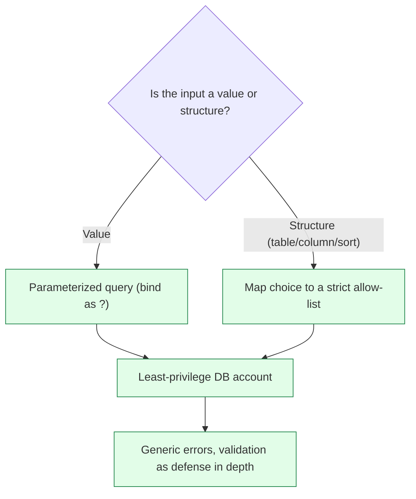

# SQL Injection Prevention and Defensive Solutions

## Summary

SQL injection is prevented by never letting untrusted input change the structure of a query. The one primary defense is **parameterized queries**; everything else is defense in depth. This file is the defender's companion to [SQL Injection](../exploitation/sql-injection.md).

## Primary defense: parameterized queries

A parameterized query (prepared statement) sends the query text and the values to the database **separately**. Placeholders (`?` or named parameters) mark where values go, and the driver binds them so they are always treated as data.

Unsafe (concatenation):
```
"SELECT * FROM accounts WHERE name = '" + name + "'"
```
Safe (parameterized):
```
"SELECT * FROM accounts WHERE name = ?"   // bind: name
```

This works because the query plan is fixed before the value is supplied, so no value can become SQL syntax. OWASP's Query Parameterization Cheat Sheet shows the pattern in Java, .NET, Ruby, PHP, Perl, Rust and others.

## Structural parts: allow-lists

Table names, column names and sort direction **cannot** be parameterized (they are part of the query structure, not values). For these, do not insert input directly. Instead map the user's choice to a **strict allow-list** of fixed, application-owned strings:

```
order = (userSort == "newest") ? "created_at DESC" : "created_at ASC";
```

The user picks an option; the application chooses the SQL. Input never reaches the query text.

## Supporting defenses

| Defense | Role |
|---|---|
| Least-privilege DB account | The app's database user has only the rights it needs, so a successful injection does less. Separate accounts per app, read-only where possible. |
| Stored procedures | Safe **only** if they use parameters and do not build dynamic SQL from input. |
| Input validation | Enforce expected type, length and format. Useful in depth, but **not** a substitute for parameterization. |
| WAF | Catches some payloads; bypassable; never the primary control. |
| Error handling | Return generic errors so database messages do not leak structure to attackers. |

## What not to do

- **Do not manually escape** untrusted values into a SQL string. OWASP strongly discourages it: escaping is error-prone, differs by database, and fails in cases such as numeric contexts and certain encodings.
- Do not rely on blocklists of "bad" keywords; attackers bypass them.

## Defense flow



## Detection

Audit code for any query built by string concatenation with input; those are the findings. Static analysis and code review catch most cases. At runtime, SQL errors and anomalous queries in logs indicate attempts.

## Defense (summary)

Parameterize every dynamic value, allow-list every structural choice, run the database account at least privilege, return generic errors, and treat validation and WAFs as extra layers, never the fix.

## ATT&CK mapping

None specific; this is the defensive counterpart to T1190 (Exploit Public-Facing Application).

## Explanation

The whole defense is one idea: keep the recipe and the ingredients apart. Parameterized queries hand the database a fixed recipe with labelled slots for ingredients, so no ingredient can rewrite the recipe. For the few parts of the recipe a user may choose (which table, which sort), the application picks from a short menu rather than letting the user write the step.
