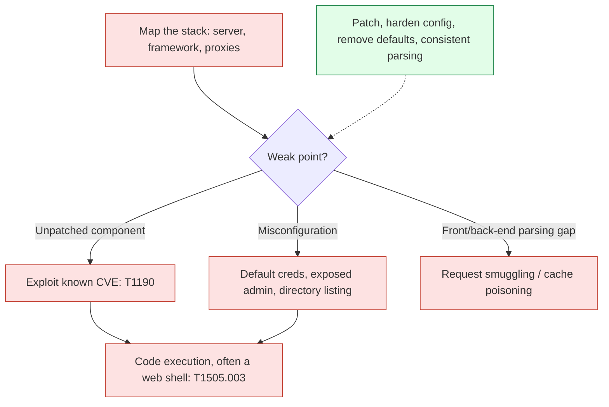

# Web Application Architecture and Web Server Attacks

## Summary

A web application is a stack: a client (browser), one or more servers (web server, application server, APIs), and back-end data stores, often with proxies, load balancers and caches in between. Many attacks target not the application code but the **infrastructure that runs it**: the web server, its configuration, and the components around it. Understanding the architecture shows where those weak points are.

## The typical architecture

```
Browser  ->  CDN / WAF  ->  Reverse proxy / LB  ->  Web server  ->  App server / APIs  ->  Databases, caches, queues
```

Each tier is a potential target, and the seams between tiers (how they parse and forward requests) are a target in their own right.

## Web server and infrastructure attacks

| Attack | What it exploits |
|---|---|
| **Security misconfiguration** | Default credentials, enabled sample/admin apps, directory listing, verbose errors, unnecessary services (OWASP A02) |
| **Known-vulnerability exploitation** | Unpatched server/framework/library with a public CVE, reached via T1190 |
| **Web shell upload** | A file-upload or RCE flaw used to plant a web shell for persistence (T1505.003) |
| **HTTP request smuggling** | Front-end and back-end disagree on request boundaries, letting an attacker sneak a hidden request past controls |
| **Reverse proxy / cache misconfig** | Cache poisoning or cache deception serving attacker or victim content to others |
| **Exposed management interfaces** | Admin consoles, actuator/debug endpoints, or server-status pages reachable publicly |
| **TLS misconfiguration** | Weak protocols/ciphers (see [Web Server HTTPS and TLS Hardening](web-server-https-and-tls-hardening.md)) |

## Attack flow



## Detection

- New or unexpected files in web roots (possible web shells), and scripts executing from upload directories.
- Requests for default/admin paths, server-status, actuator or debug endpoints.
- Anomalies that indicate request smuggling (desynchronised responses) or cache poisoning (wrong content served).
- Version banners and error pages revealing unpatched components.

## Defense

- **Patch** the web server, app server, framework and libraries promptly.
- **Harden configuration** (OWASP A02): remove defaults and sample apps, change default credentials, disable directory listing and verbose errors, and expose no management interface publicly.
- **Minimise the footprint**: only the components you need, only the ports you need.
- **Validate file uploads** and store them outside the web root without execute permission, to prevent web shells.
- **Keep front-end and back-end parsing consistent** to prevent request smuggling, and configure caches to not cache sensitive or user-specific responses.
- Harden TLS.

## ATT&CK mapping

| ID | Name | Tactic |
|---|---|---|
| T1190 | Exploit Public-Facing Application | Initial Access |
| T1505.003 | Server Software Component: Web Shell | Persistence |

## Explanation

The application is one tenant in a building of servers, proxies and caches. Attackers often skip picking the tenant's lock and instead exploit the building: an unpatched boiler (a CVE), a propped-open service door (a misconfiguration), or two doormen who disagree about who is allowed in (request smuggling). Securing the app means hardening the whole building, not just the front door of the code.
