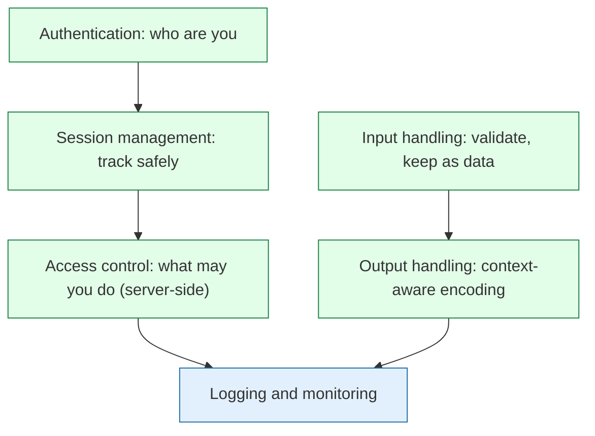

# Web Application Core Defense Mechanisms and Technologies

## Summary

Most web applications defend themselves with the same small set of mechanisms. Understanding them as a framework makes individual vulnerabilities easier to place: nearly every web flaw is one of these mechanisms missing, weak, or enforced in the wrong place (the client instead of the server). This is the defensive backbone the rest of the Web section builds on.

## The core mechanisms

| Mechanism | Purpose | Common failure |
|---|---|---|
| **Handling user input** | Treat all input as untrusted; validate, and keep it as data | Trusting input, or validating only on the client |
| **Authentication** | Verify who the user is | Weak passwords, no MFA, user enumeration |
| **Session management** | Track the authenticated user safely | Weak/exposed session IDs, no regeneration |
| **Access control (authorization)** | Enforce what each user may do | Missing or client-side-only checks |
| **Output handling** | Render data as data, not code | Missing context-aware output encoding (XSS) |
| **Error handling** | Fail safely without leaking | Verbose errors and stack traces |
| **Logging and monitoring** | See and respond to attacks | No logs, or no alerting |
| **Administering the application** | Manage it securely | Exposed admin interfaces, default creds |

### Where to enforce
The single most important rule: **security controls must be enforced on the server.** The browser is attacker-controlled, so client-side validation and hidden fields are usability aids, not controls (see [Client-Side Control Bypass](client-side-control-bypass.md)).

## Supporting technologies

- **HTTPS/TLS** for confidentiality and integrity in transit.
- **Security headers**: `Content-Security-Policy` (limits script/framing), `Strict-Transport-Security` (forces HTTPS), `X-Content-Type-Options: nosniff`, `frame-ancestors`/`X-Frame-Options` (anti-clickjacking), and `SameSite`/`HttpOnly`/`Secure` cookie attributes.
- **WAFs** as an additional layer, never a replacement for secure code.
- **Frameworks**: modern frameworks provide default output encoding, CSRF tokens and parameterized queries; using them correctly prevents whole vulnerability classes.

## How the mechanisms relate

## Detection

Logging and monitoring is itself a core mechanism: without it, attacks are invisible. Log authentication events, access-control denials, input-validation rejections and errors, and alert on anomalies.

## Defense

Apply all the mechanisms, enforced server-side, and lean on a maintained framework's built-in protections (output encoding, CSRF tokens, parameterized queries). Add TLS and security headers. Treat each specific vulnerability in this section as a failure of one of these mechanisms and fix it at that mechanism.

## ATT&CK mapping

No single ATT&CK technique; this is the defensive framework underlying the web attack techniques elsewhere in this section.

## Explanation

Think of a web app's defenses as a checklist a building needs: check IDs at the door (authentication), give visitors a badge (session), check which rooms each badge opens (authorization), treat everything visitors hand you as unopened mail (input handling), print notices as text not commands (output encoding), and keep a log of who did what. Almost every web vulnerability is one of these items skipped, or done only at the unguarded front desk of the browser.
