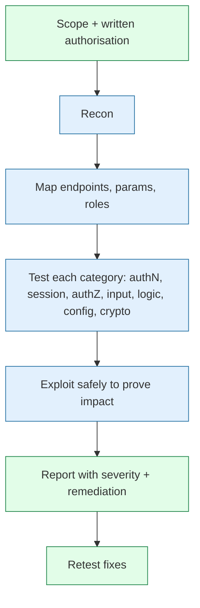

# Web Application Penetration Testing Methodology

## Summary

A web application penetration test is a structured, authorised assessment that finds and demonstrates security weaknesses before attackers do. A methodology keeps it repeatable and complete, so coverage does not depend on the tester's memory. The OWASP Web Security Testing Guide (WSTG) is the common reference framework. The defining rule is **scope and authorisation**: testing systems without explicit written permission is illegal.

## Phases

| Phase | What happens |
|---|---|
| **Scoping and rules of engagement** | Agree targets, allowed techniques, timing, data handling, and get written authorisation |
| **Reconnaissance** | Passive and active information gathering, technology fingerprinting |
| **Mapping / content discovery** | Enumerate pages, endpoints, parameters and roles (see [Mapping and Content Discovery](../discovery/web-application-mapping-and-content-discovery.md)) |
| **Vulnerability analysis** | Test each area: authentication, session management, access control, input handling (injection, XSS), business logic, configuration, cryptography |
| **Exploitation** | Safely prove impact without causing damage or exceeding scope |
| **Post-exploitation / impact** | Show what the finding allows (data access, privilege) within the rules |
| **Reporting** | Clear findings with severity, reproduction steps, evidence and remediation |
| **Retest** | Verify fixes |

The vulnerability-analysis phase typically follows the WSTG or OWASP Top 10 categories so no class is skipped.

## Flow

## Testing coverage checklist

- Authentication and session management
- Authorization (horizontal and vertical access control)
- Input handling: SQL/NoSQL/command injection, XSS, XXE, SSTI, file upload
- Business logic and race conditions
- Configuration and deployment (defaults, headers, TLS, error handling)
- Client-side issues (CSRF, clickjacking, CORS)
- Cryptography (storage and transport)
- APIs (REST and GraphQL authorization)

## Value for defenders

A methodology-driven test gives defenders a prioritised, reproducible list of real weaknesses and a retest to confirm fixes. It complements, but does not replace, secure development, code review and automated scanning.

## ATT&CK mapping

No single ATT&CK technique; this is an assessment process that exercises many techniques under authorisation.

## Explanation

A penetration test is a fire drill with a checklist: agree the rules, walk every corridor in a fixed order so none is missed, prove which doors actually open, and hand back a report of what to fix and how serious each is. The checklist matters because security coverage should not depend on whether the tester happened to remember a particular attack that day.
