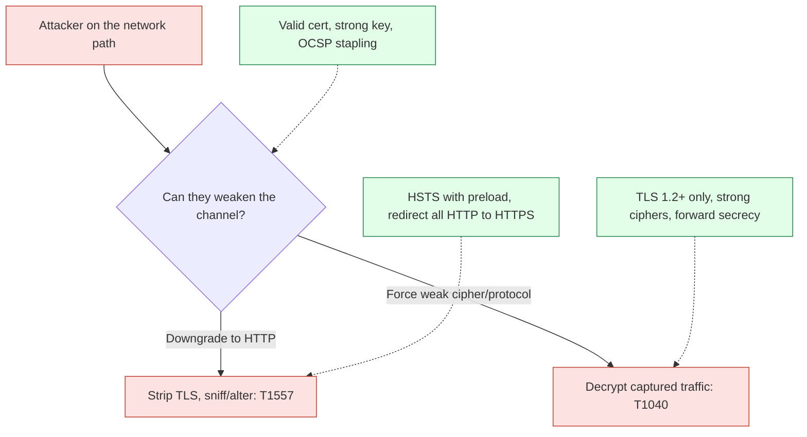

# Web Server HTTPS and TLS Hardening

## Summary

TLS (Transport Layer Security) protects web traffic in transit: it gives confidentiality, integrity and server authentication so a network attacker cannot read or tamper with requests and responses. Hardening TLS means removing the weak options a server will otherwise accept. A misconfigured HTTPS endpoint can still be downgraded, intercepted or impersonated, so "has a padlock" is not the same as "configured safely". The threat it defends against is a network position between client and server used for sniffing (T1040) or adversary-in-the-middle (T1557).

## What weak TLS lets an attacker do

| Weakness | Consequence |
|---|---|
| **Obsolete protocols** (SSLv3, TLS 1.0/1.1) | Known attacks (POODLE, BEAST) and no modern cipher guarantees |
| **Weak ciphers** (RC4, 3DES, export, NULL, anonymous) | Traffic decryptable or unauthenticated |
| **No forward secrecy** | One stolen private key decrypts all past captured sessions |
| **No HSTS** | First request can be stripped to HTTP and intercepted (T1557) |
| **Mixed content** | HTTPS page loads scripts over HTTP, reopening the channel |
| **Bad certificate** (expired, wrong name, weak key, untrusted CA) | Users trained to click through warnings; impersonation easier |

## Hardened configuration

## Detection

- TLS scanners (such as `testssl.sh` or `sslyze`) reporting enabled legacy protocols, weak ciphers or missing forward secrecy.
- Clients negotiating TLS 1.0/1.1 in server logs, indicating old or attacker-forced sessions.
- Certificate monitoring: upcoming expiry, unexpected issuance (certificate transparency logs), or name mismatches.
- Missing `Strict-Transport-Security` header in responses.

## Defense

- **Enable only TLS 1.2 and TLS 1.3**; disable SSLv2/v3 and TLS 1.0/1.1.
- **Use strong cipher suites with forward secrecy** (ECDHE key exchange, AEAD ciphers such as AES-GCM or ChaCha20-Poly1305); disable RC4, 3DES, export, NULL and anonymous suites.
- **Send HSTS**: `Strict-Transport-Security: max-age=31536000; includeSubDomains; preload`, and redirect all HTTP to HTTPS.
- **Use a valid certificate** from a trusted CA with a strong key (RSA 2048+ or ECDSA P-256+), automate renewal, and enable OCSP stapling.
- **Eliminate mixed content**; serve every sub-resource over HTTPS.
- **Re-scan after changes** and track the configuration so it does not drift.

## ATT&CK mapping

| ID | Name | Tactic |
|---|---|---|
| T1557 | Adversary-in-the-Middle | Credential Access, Collection |
| T1040 | Network Sniffing | Credential Access, Discovery |

## Explanation

HTTPS is an armoured pipe between the browser and the server. Just fitting the pipe is not enough: if the server still accepts rusted old sections (obsolete protocols), thin walls (weak ciphers), or lets a caller start in plain pipe before switching (no HSTS), someone standing on the line can still listen in or splice themselves in. Hardening is insisting on one modern, thick-walled pipe, always, with a verified nameplate on the far end.
