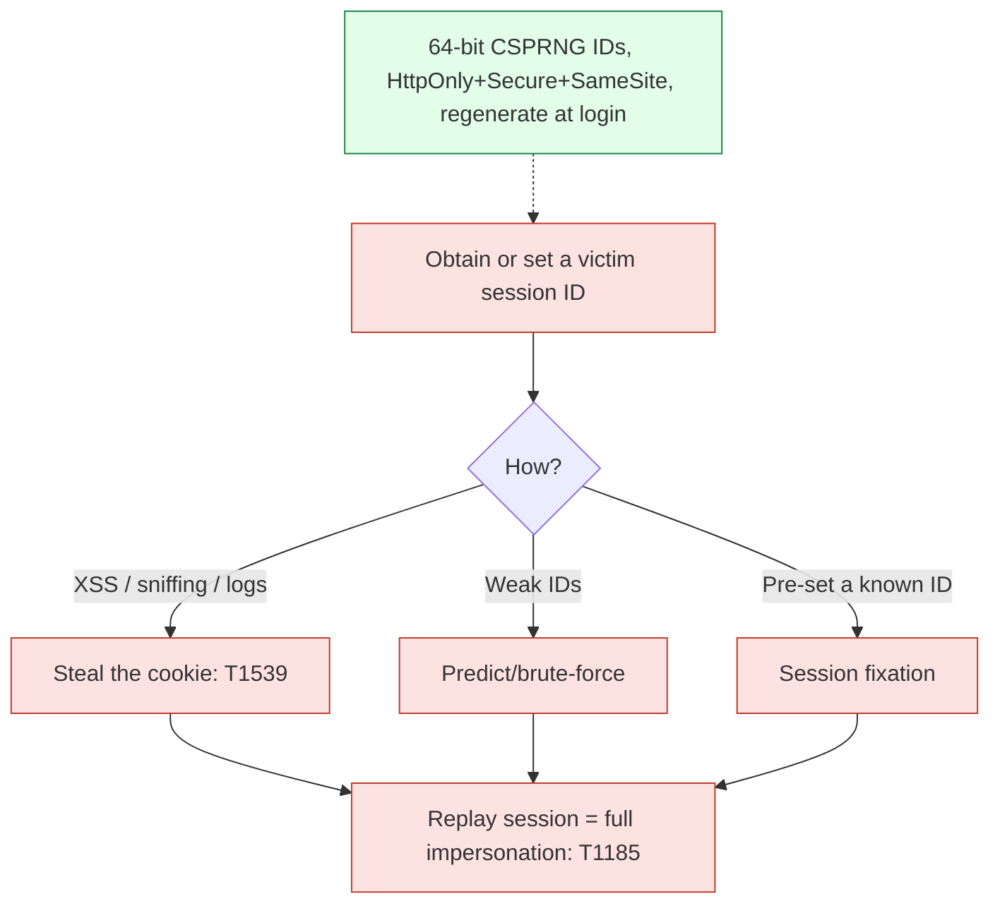

# Web Session Management Attacks

## Summary

After a user logs in, the application tracks them with a **session identifier** (usually a cookie). That token is, for the rest of the session, as good as the password. Session management attacks aim to obtain, predict, or fix a victim's session ID and thereby fully impersonate them (session hijacking). The defenses are about generating strong IDs, transporting them safely, and managing their lifecycle.

## How sessions are attacked

| Attack | What happens |
|---|---|
| **Session hijacking (theft)** | The attacker obtains a valid session ID (via XSS, network sniffing, logs, or the `Referer` header) and replays it. Stealing a session cookie is ATT&CK T1539. |
| **Session prediction / brute force** | Weak or low-entropy IDs are guessed. OWASP requires at least **64 bits of entropy** from a CSPRNG; with 64 bits, guessing is infeasible (OWASP's example: ~585 years at 10,000 guesses/second with 100,000 active sessions). |
| **Session fixation** | The attacker sets a known session ID in the victim's browser before login; if the app does not issue a new ID at login, the attacker knows the now-authenticated ID. |
| **Insecure transport / exposure** | IDs sent over HTTP, or placed in the URL, leak via sniffing, logs, history, bookmarks and the `Referer` header. |

## Attack flow

## Detection

- The same session ID used from multiple IPs, user agents or geographies at once.
- Session IDs appearing in URLs, logs or referers.
- Many requests probing sequential or similar session IDs (prediction attempts).
- A session that remains valid long after logout or beyond its intended lifetime.

## Defense

Per OWASP's session management guidance:

- **Generate IDs with a CSPRNG and at least 64 bits of entropy**; the whole ID must be random (a fixed portion reduces effective entropy).
- **Exchange the ID via cookies**, not URLs, and do not accept a session ID supplied through a URL parameter (a defense against fixation).
- Set cookie attributes: **`HttpOnly`** (script cannot read it, limiting XSS theft), **`Secure`** (sent only over HTTPS), and **`SameSite`** (limits cross-site sending).
- **Regenerate the session ID at login** and at privilege changes, to defeat fixation.
- **Enforce idle and absolute timeouts**, and **invalidate the session server-side on logout** (not just clear the cookie).
- Serve the whole authenticated area over HTTPS so IDs are never sent in clear text.
- Consider storing a one-way verifier of the token rather than the raw token if read-only disclosure of the session store is in your threat model.

## ATT&CK mapping

| ID | Name | Tactic |
|---|---|---|
| T1539 | Steal Web Session Cookie | Credential Access |
| T1185 | Browser Session Hijacking | Collection |

## Explanation

A session ID is a wristband that says "already paid" for the rest of the night. If the wristband is easy to copy, easy to guess, or the club lets someone pick their own number before you arrive, a stranger can wear your band. Strong random bands, handed over only on the secure channel, reissued when you enter, and cut off when you leave, keep the band yours.
