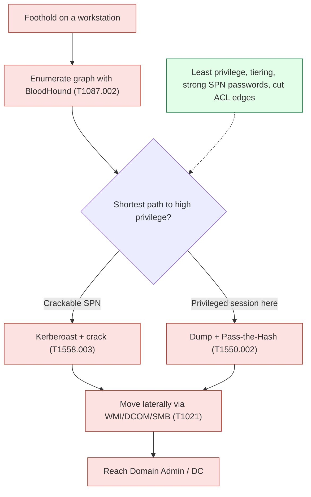

# Active Directory Attack Paths (BloodHound, SPNs, Pass-the-Hash, DCOM)

## Summary

An Active Directory attack path is a chain of permissions, credentials and sessions that leads from an attacker's initial foothold to high-value control (typically Domain Admin). Because AD permissions form a graph, attackers use tools like **BloodHound** to find the shortest such chain, then walk it using techniques like Kerberoasting (SPNs), Pass-the-Hash, and remote execution over DCOM/SMB/WMI (remote services, T1021; pass the hash, T1550.002). Defenders use the same graph view to find and cut those edges before an attacker does.

## Components of a path

| Component | Role in the path |
|---|---|
| **Enumeration (BloodHound)** | Collect users, groups, ACLs, sessions and compute reachable paths (T1087.002) |
| **SPNs / Kerberoasting** | Request service tickets for accounts with SPNs and crack them offline (T1558.003) |
| **Pass-the-Hash** | Reuse an NTLM hash to authenticate without the plaintext password (T1550.002) |
| **Session hunting** | Find where privileged users are logged in to steal their credentials |
| **Remote execution** | Move laterally via DCOM, WMI, SMB or WinRM (T1021) |
| **ACL abuse** | Exploit dangerous rights (GenericAll, WriteDacl) to take over objects |

The attacker stitches these together: compromise one host, find a privileged session or a crackable SPN, reuse the credential, and repeat until reaching a path to the top.

## A typical path

## Detection

- BloodHound-style collection: heavy LDAP queries, session enumeration, and SAMR/LSARPC lookups.
- Kerberoasting: bursts of TGS-REQ for many SPNs, especially with RC4 (event 4769).
- Pass-the-Hash and lateral movement: NTLM logons (event 4624 type 3) from unusual hosts, remote service/WMI/DCOM execution.
- Logons of privileged accounts to unexpected or lower-tier systems.

## Defense

- **Tier administration** so Domain Admin credentials never land on workstations an attacker can reach.
- **Reduce the graph**: audit and remove dangerous ACL edges and excessive group memberships; run BloodHound yourself and fix the shortest paths.
- **Harden Kerberos**: strong, long service-account passwords (or gMSAs) to defeat Kerberoasting; AES instead of RC4.
- **Contain credential reuse**: Credential Guard, LAPS for local admin passwords, and restrict where privileged accounts log on.
- **Monitor** for enumeration, Kerberoasting and lateral-movement patterns above.

## ATT&CK mapping

| ID | Name | Tactic |
|---|---|---|
| T1021 | Remote Services | Lateral Movement |
| T1550.002 | Use Alternate Authentication Material: Pass the Hash | Lateral Movement |
| T1558.003 | Steal or Forge Kerberos Tickets: Kerberoasting | Credential Access |
| T1087.002 | Account Discovery: Domain Account | Discovery |

## Explanation

Think of the domain as a city map where each one-way street is a permission or a reusable key. The attacker does not wander; they load the whole map into a routing app (BloodHound) and ask for the quickest route from where they stand to the mayor's office. The streets are things like "this account's password can be cracked from a service ticket" or "this admin is logged in on a machine I own." Defenders win by deleting streets — tightening permissions and keeping top admins off reachable machines — so the routing app returns "no path."
