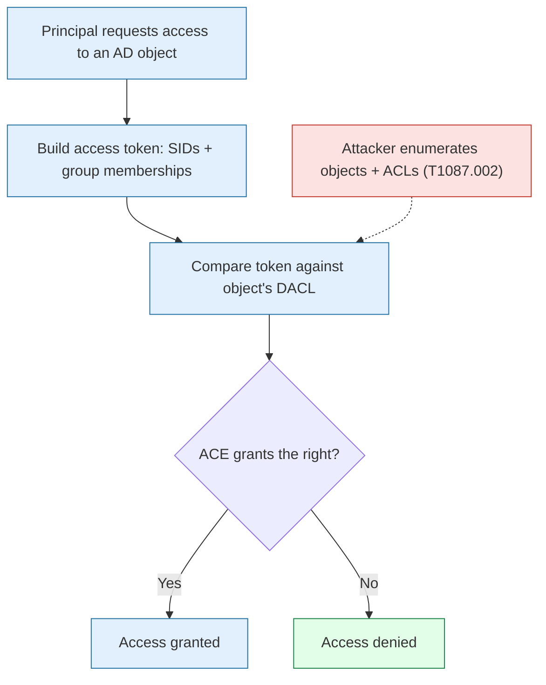

# Active Directory Security Model (Objects, Schema, Access Checks)

## Summary

Active Directory (AD) is the identity and access backbone of most Windows enterprises: a distributed database of objects (users, groups, computers, organizational units) governed by a schema and protected by access-control checks. Understanding its model is the foundation for both attacking and defending a domain, because almost every AD attack is really an abuse of how objects relate and how permissions are evaluated. Enumerating those objects and relationships is a core discovery step (domain account discovery, T1087.002).

## The building blocks

| Element | Role |
|---|---|
| **Objects** | Users, groups, computers, GPOs, OUs — each a security principal or container |
| **Schema** | Defines object classes and their attributes (what can exist and what properties it has) |
| **Distinguished Name (DN)** | The object's unique path in the directory tree |
| **Security descriptor** | Owner, DACL (who may do what) and SACL (what is audited) on each object |
| **Access check** | The evaluation of a principal's token against an object's DACL |
| **Trusts** | Relationships letting principals in one domain/forest access another |

The security boundary is the **forest**, not the domain: within a forest, control of one domain can often be leveraged against others.

## How access is decided

Attackers map this graph (who has rights over whom) to find a path from a low-privileged account to Domain Admin, because a chain of individually "normal" permissions can add up to full control.

## Detection

- Bulk LDAP enumeration of users, groups, ACLs and SPNs (tools like BloodHound's collectors).
- Reads of sensitive attributes or directory-wide queries from non-administrative accounts.
- Changes to high-value object DACLs, group memberships, or schema.
- Replication-related access from unexpected principals (precursor to credential theft).

## Defense

- **Apply least privilege on objects**: review DACLs, especially dangerous rights (GenericAll, WriteDacl, WriteOwner) over users, groups and computers.
- **Tier administration**: separate Domain Admin accounts from daily-use and workstation-admin accounts so one compromise does not reach the top tier.
- **Audit ACL and membership changes** (SACLs on sensitive objects) and alert on additions to privileged groups.
- **Map your own attack paths** with the same tools attackers use, and remove the dangerous edges.
- **Protect the forest boundary**: understand that domain compromise can cross to the forest, and secure trusts accordingly.

## ATT&CK mapping

| ID | Name | Tactic |
|---|---|---|
| T1087.002 | Account Discovery: Domain Account | Discovery |

## Explanation

Active Directory is the building's master key system and personnel file rolled into one: every door (object) has a list of who may open it (the DACL), and every employee carries a badge listing the groups they belong to (their token). Access is decided by checking the badge against the door's list. Attackers rarely forge a master key; they trace the list of who-can-open-what until they find a chain of ordinary permissions that quietly leads to the master key cabinet. The defence is to keep those lists tight, split the top keys from the everyday ones, and watch who edits the lists.
