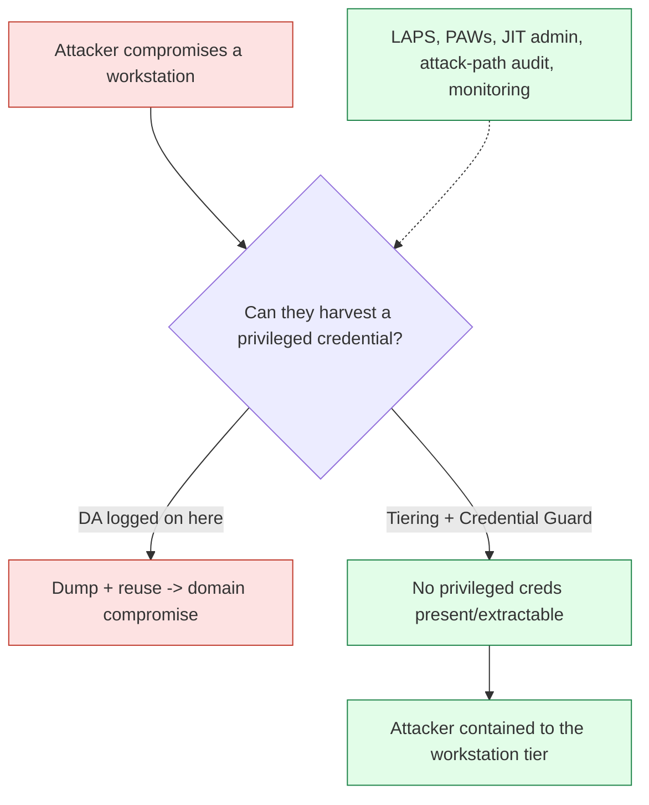

# Defending the Windows Domain

## Summary

Defending Active Directory is less about any single control and more about an architecture that assumes attackers will get a foothold and denies them the path from there to domain dominance. The recurring theme across AD attacks — Kerberoasting, Pass-the-Hash, delegation abuse, Golden Tickets — is credential theft and reuse climbing a privilege ladder. Domain defence is built to break that ladder: isolate the most powerful credentials, prevent their theft, and detect movement. It is a defensive architecture, so no single ATT&CK technique maps to it; it counters many at once.

## Pillars of domain defence

| Pillar | What it does |
|---|---|
| **Administrative tiering** | Separate admin accounts by tier (DCs, servers, workstations) so high-value credentials never touch low-trust hosts |
| **Credential protection** | Credential Guard, Protected Users, and disabling credential caching to stop theft from memory |
| **Privileged access management** | Just-in-time/just-enough admin, PAWs (privileged access workstations), no daily use of DA accounts |
| **Local admin control** | LAPS for unique, rotated local admin passwords to stop lateral reuse |
| **Attack-path reduction** | Audit ACLs, group memberships and delegation; remove dangerous edges |
| **Monitoring** | Alert on Kerberos anomalies, privileged logons, replication, and group changes |

The single most important idea is **tiering**: a Domain Admin credential must never be exposed on a machine an attacker can compromise, because that is how local compromise becomes domain compromise.

## How the pillars break the attack ladder

## Detection

- Privileged account logons to lower-tier systems (a tiering violation and a strong alert).
- Kerberos anomalies (RC4 roasting, forged-ticket indicators), DCSync/replication from non-DCs, and Golden-Ticket signs.
- Additions to privileged groups, delegation changes, and new accounts with elevated rights.
- LSASS access attempts and credential-dumping tool behaviour on endpoints.

## Defense

- **Implement administrative tiering** and privileged access workstations; never use Domain Admin accounts for daily work or on workstations.
- **Protect credentials**: enable Credential Guard, add sensitive accounts to Protected Users, and mark them non-delegatable.
- **Deploy LAPS** so every machine has a unique, rotating local admin password.
- **Reduce attack paths**: run BloodHound against your own domain and cut the dangerous ACL, membership and delegation edges.
- **Monitor and respond**: centralise DC and endpoint logs, alert on the indicators above, and have a DC-rebuild / krbtgt-rotation plan ready.
- **Patch and harden DCs**, limit who can log on to them, and keep them minimal.

## ATT&CK mapping

No single ATT&CK technique; this is the defensive architecture that counters AD credential-theft and lateral-movement techniques (T1003, T1550, T1558, T1134 and others).

## Explanation

Almost every domain takeover is the same story told with different tools: steal a credential here, reuse it to reach there, repeat until you hold the keys to everything. Defending the domain is engineering that story to dead-end early. You keep the master keys (Domain Admin) locked in a vault that daily work never opens, you make each room's local key unique so a stolen one opens only that room (LAPS), and you watch for anyone carrying a key where they should not be. Done well, a break-in stays a break-in instead of becoming a coronation.
