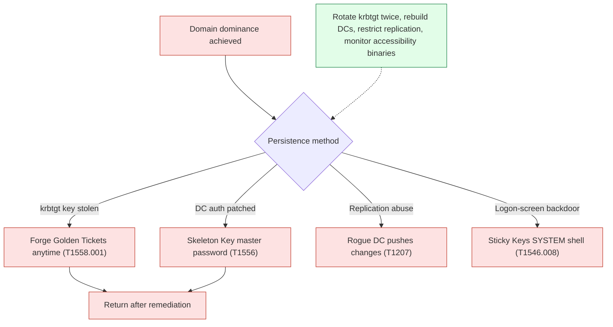

# Domain Persistence (Golden Ticket, Skeleton Key and Sticky Keys)

## Summary

Once an attacker achieves domain dominance, they plant persistence that survives password resets and reboots, so they can return even after partial remediation. These techniques abuse Kerberos and Windows authentication internals: a **Golden Ticket** forges TGTs from the stolen krbtgt key (T1558.001); a **Skeleton Key** patches the DC's authentication to accept a master password (modify authentication process, T1556); a **Rogue Domain Controller** injects changes via replication (T1207); and accessibility-feature backdoors like **Sticky Keys** give SYSTEM shells at the logon screen (event-triggered execution: accessibility features, T1546.008). All are post-compromise persistence, and the only full cure is often a trustworthy rebuild.

## The techniques

| Technique | What it does | ATT&CK |
|---|---|---|
| **Golden Ticket** | Forge arbitrary TGTs using the stolen krbtgt key — impersonate anyone | T1558.001 |
| **Silver Ticket** | Forge a service ticket using a service account key — access one service quietly | T1558 |
| **Skeleton Key** | Patch LSASS on the DC so a master password authenticates as any user | T1556 |
| **Rogue/DCShadow** | Register a fake DC to push malicious directory changes via replication | T1207 |
| **Sticky Keys / accessibility** | Replace an accessibility binary so the logon screen yields a SYSTEM shell | T1546.008 |

Golden Tickets are the archetype: because the krbtgt key signs all TGTs, a copy of it lets the attacker mint tickets for any user with any group membership, bypassing password changes.

## Persistence flow

## Detection

- Golden/Silver Tickets: TGTs with anomalous lifetimes, missing or inconsistent PAC data, or logons for accounts that never authenticated normally.
- Skeleton Key: LSASS patched (unexpected modules), DCs authenticating with a universal password, RC4 downgrades.
- Rogue DC / DCShadow: unexpected replication (DRSUAPI) from non-DC hosts, new server/DC objects.
- Sticky Keys: modified accessibility binaries (sethc.exe, utilman.exe) or debugger registry keys on them; SYSTEM shells from the logon screen.

## Defense

- **Rotate the krbtgt password twice** (with the required interval) to invalidate Golden Tickets after a suspected DC compromise.
- **Rebuild compromised DCs** from trusted media; assume full compromise if the krbtgt key or LSASS was tampered with.
- **Restrict and monitor replication** to legitimate DCs to prevent rogue-DC attacks.
- **Protect accessibility binaries** and monitor for their modification or Image File Execution Options debugger keys.
- **Tier admin and protect DCs** so attackers cannot reach the krbtgt key in the first place.

## ATT&CK mapping

| ID | Name | Tactic |
|---|---|---|
| T1558.001 | Steal or Forge Kerberos Tickets: Golden Ticket | Credential Access |
| T1207 | Rogue Domain Controller | Defense Impairment |
| T1556 | Modify Authentication Process | Credential Access, Defense Impairment, Persistence |
| T1546.008 | Event Triggered Execution: Accessibility Features | Privilege Escalation, Persistence |

## Explanation

Having taken over the kingdom, an attacker does not want to lose it when the locks are changed. A Golden Ticket is stealing the royal seal so they can forge a pass for anyone forever; a Skeleton Key is bribing the gatekeeper to also accept one secret password from everyone; a rogue DC is smuggling in a fake clerk who can edit the official records; and a Sticky Keys backdoor is wedging a hidden master key behind the front door. Because these outlast password resets, the honest fix is often to re-forge the seal (rotate krbtgt) and rebuild the gatehouse (the domain controllers) from scratch.
