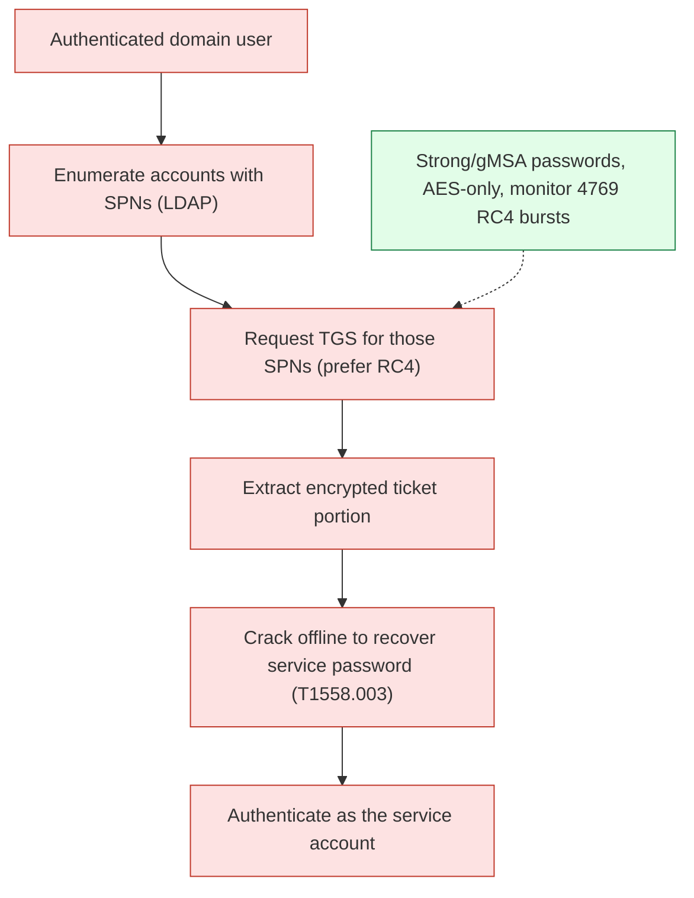

# Kerberoasting

## Summary

Kerberoasting is a credential-access technique that extracts crackable password hashes for service accounts, usually without any special privileges. Any authenticated domain user can request a Kerberos service ticket (TGS) for an account that has a Service Principal Name (SPN); part of that ticket is encrypted with the service account's password-derived key. The attacker takes the ticket offline and brute-forces the password (steal or forge Kerberos tickets: Kerberoasting, T1558.003). It is popular because it is quiet, needs only normal user rights, and service accounts often have weak, non-expiring passwords.

## Why it works

| Factor | Effect |
|---|---|
| **SPNs are enumerable** | Any user can list accounts with SPNs via LDAP |
| **TGS available to any user** | Requesting a service ticket is normal Kerberos behaviour, not an alarm by itself |
| **Ticket encrypted with the account key** | The encrypted portion is a crackable oracle for the service account password |
| **RC4 weakness** | RC4-encrypted tickets crack faster than AES; attackers often request RC4 |
| **Weak service passwords** | Human-set service passwords are often short and never rotated |

## Attack flow

## Detection

- Bursts of TGS requests (event 4769) for many distinct SPNs from one account, especially requesting RC4 (encryption type 0x17).
- Service-ticket requests for accounts that are rarely used, or from users who have no reason to access those services.
- Offline cracking is invisible, so detection focuses on the anomalous request pattern at the DC.

## Defense

- **Use strong service-account passwords**: 25+ random characters, or better, **group Managed Service Accounts (gMSAs)** with automatic long random passwords.
- **Prefer AES**: disable RC4 for Kerberos so tickets are far harder to crack, and remove RC4-only legacy dependencies.
- **Minimise SPNs**: remove unnecessary SPNs, and avoid putting SPNs on highly privileged accounts.
- **Monitor event 4769** for RC4 requests and high-volume SPN enumeration.
- **Rotate** service-account passwords and audit which accounts carry SPNs.

## ATT&CK mapping

| ID | Name | Tactic |
|---|---|---|
| T1558.003 | Steal or Forge Kerberos Tickets: Kerberoasting | Credential Access |

## Explanation

Every service account in the domain hands out a sealed sample of its password to anyone who asks for a ticket — that is just how Kerberos works. Kerberoasting is collecting those sealed samples and cracking them open at leisure, offline, where no alarm can hear you. It needs no admin rights, only a normal account, which is what makes it so common. The cure is to make the samples uncrackable: give service accounts enormous random passwords (ideally machine-managed) and use strong encryption, so a cracked sample is worthless.
