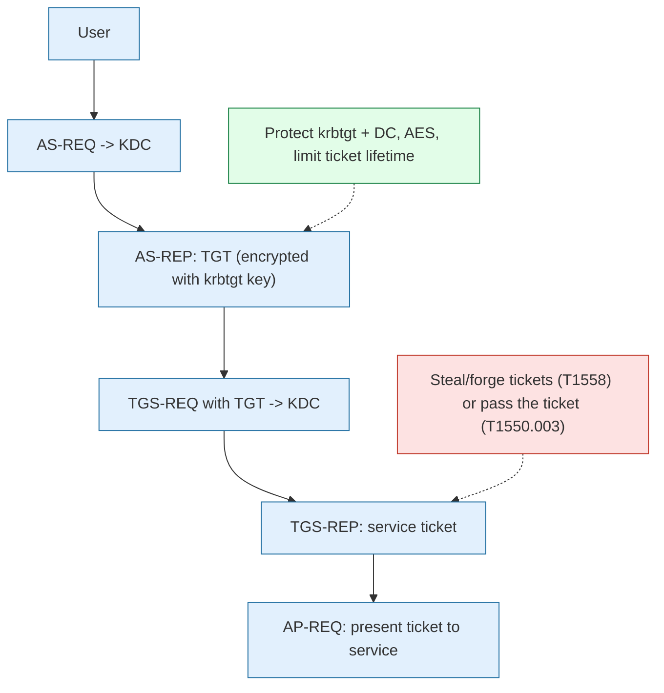

# Kerberos Authentication

## Summary

Kerberos is the primary authentication protocol in an Active Directory domain. Instead of sending passwords to each service, a user proves their identity once to a Key Distribution Center (KDC, run on domain controllers) and receives tickets that grant access to services. The design avoids transmitting reusable secrets, but the tickets themselves become the target: steal or forge a ticket and you can impersonate a user or service (steal or forge Kerberos tickets, T1558; pass the ticket, T1550.003). Understanding the ticket flow is the basis for understanding Kerberoasting, Golden Tickets, delegation abuse and Pass-the-Ticket.

## The ticket flow

| Step | What happens |
|---|---|
| **AS-REQ / AS-REP** | The user authenticates to the KDC and receives a Ticket Granting Ticket (TGT), encrypted with the krbtgt key |
| **TGS-REQ / TGS-REP** | The user presents the TGT to request a service ticket (TGS) for a specific service |
| **AP-REQ** | The user presents the service ticket to the service, which validates it and grants access |
| **PAC** | The ticket carries a Privilege Attribute Certificate describing the user's groups/privileges |

The TGT is the master credential: because it is encrypted with the krbtgt account's key, anyone who steals that key can forge TGTs for anyone (a Golden Ticket).

## Authentication flow

## Detection

- Ticket requests with weak encryption (RC4) where AES is expected (event 4768/4769), a sign of roasting or downgrade.
- TGTs or service tickets used from hosts or at times inconsistent with the user (possible Pass-the-Ticket).
- Anomalous ticket lifetimes or tickets for accounts that should not be active.
- Replication or DC-sync-style access to the krbtgt key (precursor to Golden Tickets).

## Defense

- **Protect domain controllers and the krbtgt account**: DC compromise means total Kerberos compromise; rotate the krbtgt password periodically (twice, carefully) to invalidate forged TGTs.
- **Use AES encryption types** and disable RC4 where possible to blunt roasting and downgrade.
- **Limit ticket lifetimes** and enforce strong service-account passwords/gMSAs.
- **Monitor Kerberos events** (4768/4769/4770) for anomalies and enable protections like Protected Users and Credential Guard.
- **Tier admin accounts** so high-privilege TGTs are not minted on reachable hosts.

## ATT&CK mapping

| ID | Name | Tactic |
|---|---|---|
| T1558 | Steal or Forge Kerberos Tickets | Credential Access |
| T1550.003 | Use Alternate Authentication Material: Pass the Ticket | Lateral Movement |

## Explanation

Kerberos works like a theme park: at the gate you show ID once and get a wristband (the TGT). To ride a specific attraction you swap the wristband for a ride ticket (a service ticket), which the attraction checks without ever seeing your ID again. The whole scheme rests on the master stamp that makes wristbands genuine (the krbtgt key); anyone who copies that stamp can print wristbands for anyone and ride everything. So the defence centres on guarding that stamp — the domain controllers and the krbtgt account — above all else.
