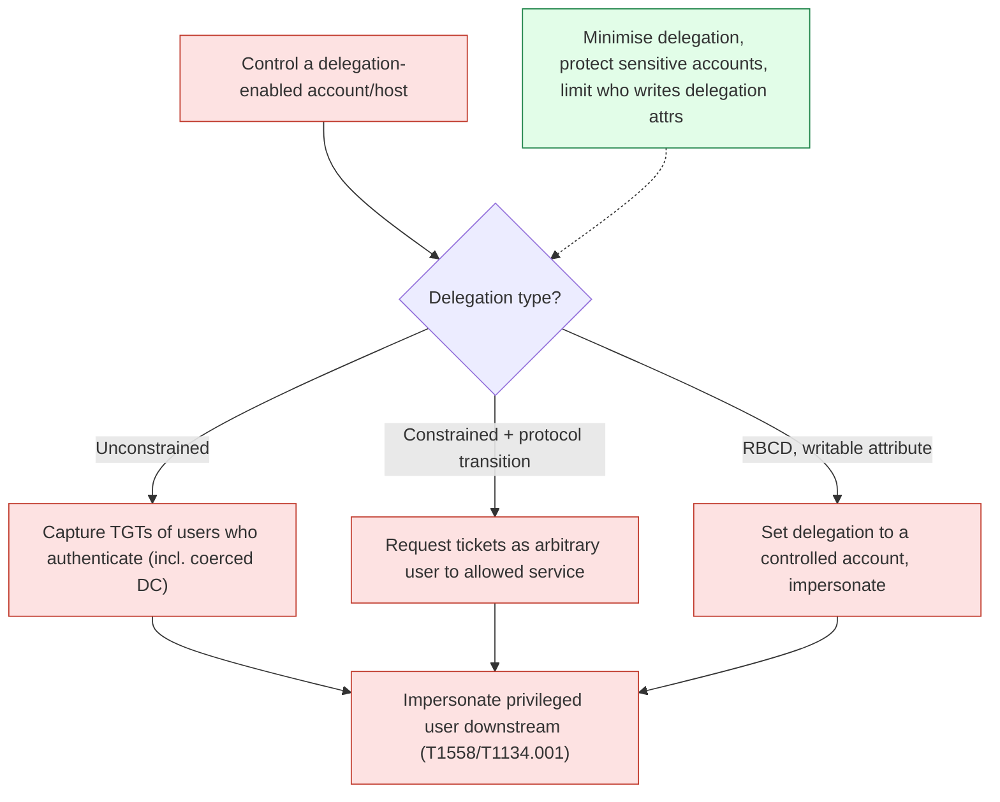

# Kerberos Delegation

## Summary

Kerberos delegation lets a service act on behalf of a user to reach a second service — for example a web server fetching a database record as the logged-in user. It is a legitimate feature, but misconfigured delegation is a powerful privilege-escalation and lateral-movement primitive: an attacker who controls a delegation-enabled account can impersonate other users, including privileged ones, to downstream services (steal or forge Kerberos tickets, T1558; token impersonation, T1134.001). The risk scales with how unconstrained the delegation is.

## Types of delegation

| Type | Behaviour | Risk |
|---|---|---|
| **Unconstrained** | The service receives and can reuse the user's full TGT to any service | Highest: capture a Domain Admin's TGT and impersonate them anywhere |
| **Constrained (KCD)** | The service may impersonate users only to a specified list of services | Lower, but abusable if the allowed targets are sensitive (and protocol transition widens it) |
| **Resource-Based (RBCD)** | The target resource defines which accounts may delegate to it | Abusable if an attacker can write the resource's delegation attribute |

Unconstrained delegation is especially dangerous: any user who authenticates to such a host leaves their TGT there, so an attacker who controls the host (or coerces a DC to authenticate to it) can capture a privileged TGT.

## Abuse flow

## Detection

- Accounts or computers configured for unconstrained delegation, especially non-DC hosts.
- Authentication coercion patterns (forcing a machine/DC to authenticate to an attacker-controlled host).
- Writes to `msDS-AllowedToDelegateTo` or `msDS-AllowedToActOnBehalfOfOtherIdentity` attributes (RBCD setup).
- Service tickets requested on behalf of privileged users from unexpected services (S4U patterns in 4769).

## Defense

- **Minimise delegation**: avoid unconstrained delegation entirely; prefer constrained or resource-based, scoped tightly.
- **Protect sensitive accounts**: mark Domain Admins and other high-value accounts as "sensitive and cannot be delegated" and add them to Protected Users.
- **Control delegation attributes**: restrict who can write the delegation attributes that enable RBCD.
- **Audit delegation configuration** regularly and remove what is not needed.
- **Monitor** for coercion and anomalous S4U ticket requests.

## ATT&CK mapping

| ID | Name | Tactic |
|---|---|---|
| T1558 | Steal or Forge Kerberos Tickets | Credential Access |
| T1134.001 | Access Token Manipulation: Token Impersonation/Theft | Stealth, Privilege Escalation |

## Explanation

Delegation is giving a concierge permission to act in your name at other desks in the hotel, so you do not have to visit each one. Done narrowly ("the concierge may book the spa for you"), it is convenient. Done broadly ("the concierge may do anything, as anyone, anywhere"), it is a disaster: whoever controls that concierge can walk up to the vault claiming to be the manager. The fixes are to let concierges act only at named desks, and to flag the most important guests as "no one may ever act on their behalf."
