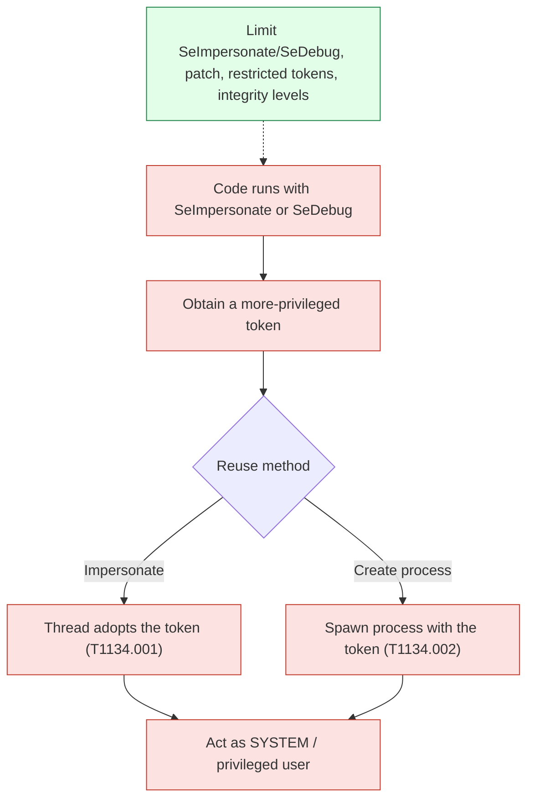

# Access Tokens, Impersonation and Restricted/Sandbox Tokens

## Summary

A Windows access token is the object that represents a user's security context: their SID, group memberships and privileges. Every process and thread carries one, and the system checks it on every access. Tokens can be **impersonated** (a thread temporarily adopts another user's context) and **restricted** (a sandboxed token with privileges and SIDs stripped out). Attackers abuse impersonation to steal and reuse the context of more privileged users (access token manipulation, T1134; token impersonation/theft, T1134.001; create process with token, T1134.002). Defenders use restricted tokens to sandbox risky code.

## Token concepts

| Concept | Meaning |
|---|---|
| **Primary token** | The token attached to a process, defining its security context |
| **Impersonation token** | Lets a thread act as another user (e.g. a service serving a client) |
| **Privileges** | Rights like SeDebugPrivilege, SeImpersonatePrivilege that enable powerful actions |
| **Restricted/sandbox token** | A token with SIDs and privileges removed to limit what code can do |
| **Integrity level** | Low/Medium/High/System labels that gate access alongside the DACL |

Key privilege for attackers: **SeImpersonatePrivilege** (held by many service accounts) allows adopting the token of a connecting privileged client — the basis of "potato"-style local privilege escalation.

## Abuse flow

## Detection

- Processes created with a token belonging to a different, more privileged user (parent/child context mismatch).
- Use of SeDebugPrivilege or SeImpersonatePrivilege by unexpected processes.
- Service accounts suddenly spawning SYSTEM processes (potato-style escalation).
- Threads impersonating SYSTEM shortly after a local service interaction.

## Defense

- **Minimise dangerous privileges**: grant SeImpersonate/SeAssignPrimaryToken/SeDebug only where required; review service account rights.
- **Patch** local privilege-escalation vectors that feed privileged tokens to low-privileged code.
- **Sandbox risky code** with restricted tokens, low integrity levels and AppContainers.
- **Apply least privilege and tiering** so a stolen SYSTEM context on one host yields little.
- **Monitor** token manipulation and anomalous privileged process creation.

## ATT&CK mapping

| ID | Name | Tactic |
|---|---|---|
| T1134 | Access Token Manipulation | Stealth, Privilege Escalation |
| T1134.001 | Access Token Manipulation: Token Impersonation/Theft | Stealth, Privilege Escalation |
| T1134.002 | Access Token Manipulation: Create Process with Token | Stealth, Privilege Escalation |

## Explanation

A token is the badge Windows checks at every door: it says who you are, which groups you are in, and which special privileges you hold. Impersonation is a feature that lets a clerk temporarily wear a customer's badge to fetch something on their behalf — useful, but if an attacker can grab a passing manager's badge and keep wearing it, they become the manager. Certain privileges (notably "may impersonate") make that grab easy, which is why they are the prize in local escalation. The defences are to hand out those powerful privileges sparingly and to make risky code wear a stripped-down badge (a restricted token) that opens almost nothing.
