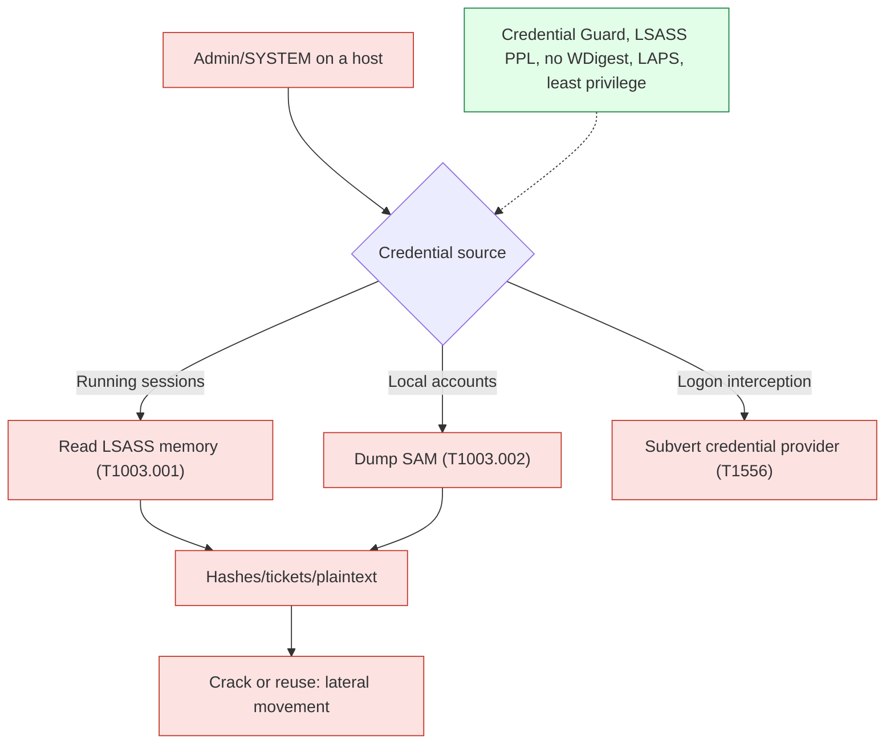

# Credential Dumping (Hash Dumping and GINA Interception)

## Summary

Credential dumping is the extraction of account secrets — password hashes, Kerberos tickets, or plaintext passwords — from a Windows system so they can be cracked or reused. It is the engine of lateral movement: one compromised host yields credentials that unlock others. Sources include the LSASS process memory, the local SAM database, and interception of the logon flow (OS credential dumping, T1003, with sub-techniques for LSASS memory T1003.001 and the SAM T1003.002). Historically, GINA (and its successor, credential providers) could be subverted to capture passwords at logon (modify authentication process, T1556).

## Where credentials live

| Source | What it yields | ATT&CK |
|---|---|---|
| **LSASS memory** | Cached hashes, Kerberos tickets, sometimes plaintext (legacy/WDigest) | T1003.001 |
| **SAM database** | Local account NT hashes | T1003.002 |
| **LSA secrets** | Service account passwords, cached domain credentials | T1003.004 |
| **NTDS.dit (on DCs)** | All domain account hashes | T1003.003 |
| **GINA / credential provider** | Plaintext passwords intercepted at logon | T1556 |

Dumping usually requires local administrator or SYSTEM, which is why privilege escalation and credential dumping go hand in hand.

## Attack flow

## Detection

- Process access to LSASS with read rights (Sysmon event 10), especially from non-system tools.
- Known dumping-tool behaviour and signatures (procdump on lsass, comsvcs minidump, registry hive exports of SAM/SECURITY).
- Shadow-copy or raw-disk access to extract NTDS.dit on domain controllers.
- New or modified credential providers / LSA packages.

## Defense

- **Enable Credential Guard** to isolate secrets in virtualization-based security, and run **LSASS as a protected process (PPL)**.
- **Disable WDigest** so plaintext is not cached in memory, and keep systems patched.
- **Limit local admin** with LAPS and tiering so dumped local credentials cannot be reused widely.
- **Protect domain controllers** (NTDS.dit) and restrict who can log on to them.
- **Monitor LSASS access** and SAM/hive export behaviour; alert on dumping indicators.

## ATT&CK mapping

| ID | Name | Tactic |
|---|---|---|
| T1003 | OS Credential Dumping | Credential Access |
| T1003.001 | OS Credential Dumping: LSASS Memory | Credential Access |
| T1003.002 | OS Credential Dumping: Security Account Manager | Credential Access |
| T1556 | Modify Authentication Process | Defense Impairment, Persistence, Credential Access |

## Explanation

When you log into Windows, the system keeps your keys in a few well-known drawers so it can prove who you are to other services without asking you again. Credential dumping is prying open those drawers — chiefly the LSASS process, where live sessions keep their keys — and walking away with copies to try on the locks next door. It needs admin rights to reach the drawers, which is why it follows privilege escalation. The defences wall the drawers off behind hardware-backed isolation (Credential Guard), stop the worst drawer from caching plaintext (disable WDigest), and make sure a stolen local key fits only one door (LAPS).
