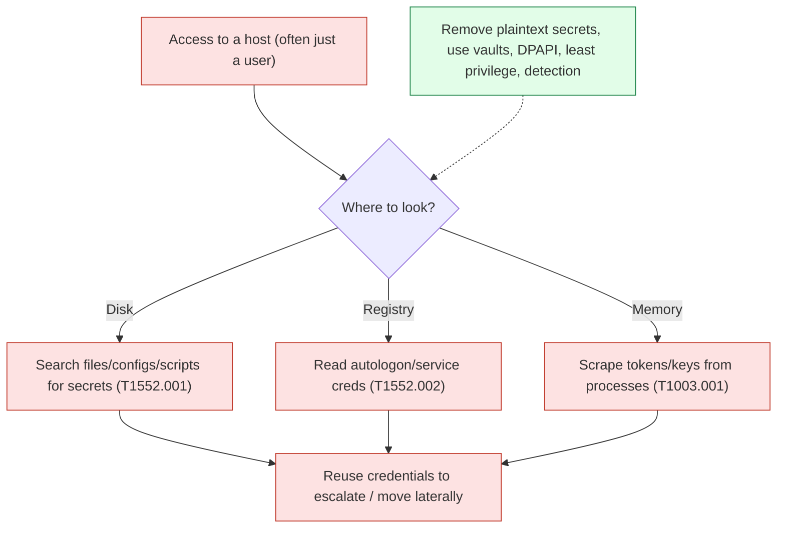

# Credential Hunting in Files, Processes and Memory

## Summary

Beyond dumping the OS credential stores, attackers hunt for secrets that users and applications leave lying around: passwords in configuration files, scripts, and documents; API keys and tokens in process memory; and cached credentials in browsers and tools. This is often the easiest win because these secrets are plaintext and unprotected (unsecured credentials: credentials in files T1552.001, in the registry T1552.002; and secrets extracted from process memory, related to T1003.001). The lesson for defenders is that credential hygiene across the whole environment matters as much as hardening LSASS.

## Where secrets hide

| Location | Examples |
|---|---|
| **Files** | `web.config`, `unattend.xml`, scripts, `.ps1`/`.bat`, password spreadsheets, backups (T1552.001) |
| **Registry** | Autologon passwords, service account passwords, stored creds (T1552.002) |
| **Process memory** | Tokens, API keys, decrypted secrets held by running applications (T1003.001-adjacent) |
| **Browser stores** | Saved passwords and cookies/session tokens |
| **Credential managers / vaults** | Windows Credential Manager, DPAPI-protected blobs |
| **Command history / logs** | Credentials passed on command lines or logged |

## Hunting flow

## Detection

- Recursive searches for secret-like patterns (password, apikey, connectionstring) across file shares and disks.
- Reads of known credential-bearing registry keys and files (unattend files, autologon).
- Process memory access to browsers and credential-holding applications.
- Access to the same leaked credential from multiple hosts shortly after discovery (reuse).

## Defense

- **Eliminate plaintext secrets**: scan code, configs, shares and scripts for credentials and remove them; use a secrets manager or vault.
- **Use proper secret storage**: DPAPI, Windows Credential Manager, managed identities, and gMSAs instead of embedding passwords.
- **Avoid secrets on command lines** and in logs; disable autologon password storage.
- **Apply least privilege** so a found credential unlocks little, and rotate credentials that may have been exposed.
- **Scan proactively** with the same secret-finding tools attackers use, and monitor for bulk secret searches.

## ATT&CK mapping

| ID | Name | Tactic |
|---|---|---|
| T1552.001 | Unsecured Credentials: Credentials In Files | Credential Access |
| T1552.002 | Unsecured Credentials: Credentials in Registry | Credential Access |
| T1003.001 | OS Credential Dumping: LSASS Memory | Credential Access |

## Explanation

People leave keys under doormats: a password in a setup file, an API token hard-coded in a script, a saved login in a browser. Credential hunting is simply checking all the usual doormats, and it often beats cracking a safe because the key is just sitting there in plain sight. It frequently needs no special privilege at all. The defence is boring but decisive: stop leaving keys around. Put them in a proper key box (a vault or DPAPI), scan your own doormats regularly, and make sure any key that does leak opens as little as possible.
