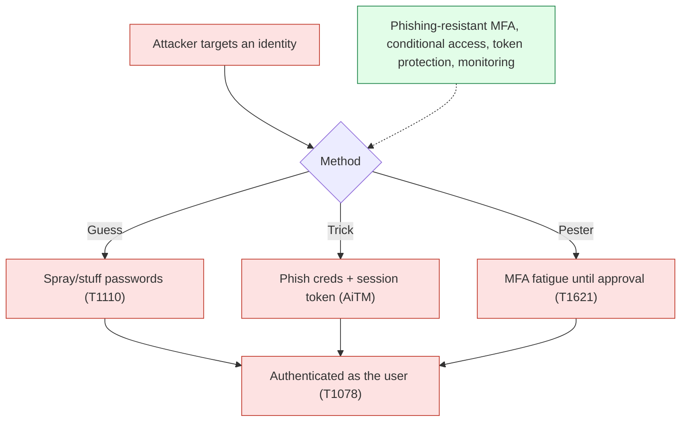

# Identity as the New Perimeter and User Identity Attacks

## Summary

As organisations move to cloud and remote work, the network edge no longer defines the security boundary — **identity does**. A valid credential, from anywhere, grants access regardless of location, so attackers increasingly target identities directly rather than breaching a network perimeter (valid accounts, T1078; brute force and spraying, T1110; MFA fatigue/bypass, T1621). Defending identity — strong authentication, conditional access, and monitoring — is now the primary perimeter. This concept reframes Windows and cloud defence around protecting who can authenticate, not just what is on the network.

## How identities are attacked

| Attack | Description |
|---|---|
| **Password spraying / brute force** | Try common passwords across many accounts, or guess one account (T1110) |
| **Credential stuffing** | Reuse credentials leaked elsewhere against the organisation |
| **Phishing / AiTM** | Steal credentials and session tokens, even past MFA, via proxy phishing |
| **MFA fatigue / bombing** | Spam push prompts until the user approves one (T1621) |
| **Token theft** | Steal session/refresh tokens to bypass authentication entirely |
| **Valid-account abuse** | Use legitimately obtained credentials to blend in (T1078) |

The shift is that none of these require touching the corporate network first; the identity provider is the front door.

## Attack and defence view

## Detection

- Impossible-travel and anomalous-location sign-ins, and sign-ins from unusual devices/IPs.
- Spraying patterns: many accounts, one password, low-and-slow timing; spikes in failed MFA.
- Repeated MFA push prompts followed by an approval (fatigue), and sign-ins using tokens without a fresh auth.
- Valid-account use that deviates from a user's normal behaviour baseline.

## Defense

- **Deploy phishing-resistant MFA** (FIDO2/Windows Hello for Business) rather than SMS or simple push; use number matching to blunt fatigue.
- **Enforce conditional access**: restrict by device compliance, location, and risk level; block legacy authentication.
- **Protect tokens**: short lifetimes, token-binding/protection, and revoke on risk.
- **Ban common/breached passwords** and monitor for spraying and stuffing.
- **Baseline and monitor identities**: alert on anomalous sign-ins and risky behaviour, and respond fast.

## ATT&CK mapping

| ID | Name | Tactic |
|---|---|---|
| T1078 | Valid Accounts | Stealth, Persistence, Privilege Escalation, Initial Access |
| T1110 | Brute Force | Credential Access |
| T1621 | Multi-Factor Authentication Request Generation | Credential Access |

## Explanation

The old model guarded a castle wall: get inside the network and you were trusted. But when work happens from anywhere and data lives in the cloud, there is no single wall — the thing that actually gates access is proof of identity. So attackers skip the wall and go straight for the proof: guessing passwords, phishing logins and the one-time codes with them, or nagging users until they tap "approve." Treating identity as the perimeter means making that proof hard to steal (phishing-resistant MFA), checking the context of every sign-in (conditional access), and watching for logins that do not fit the person.
