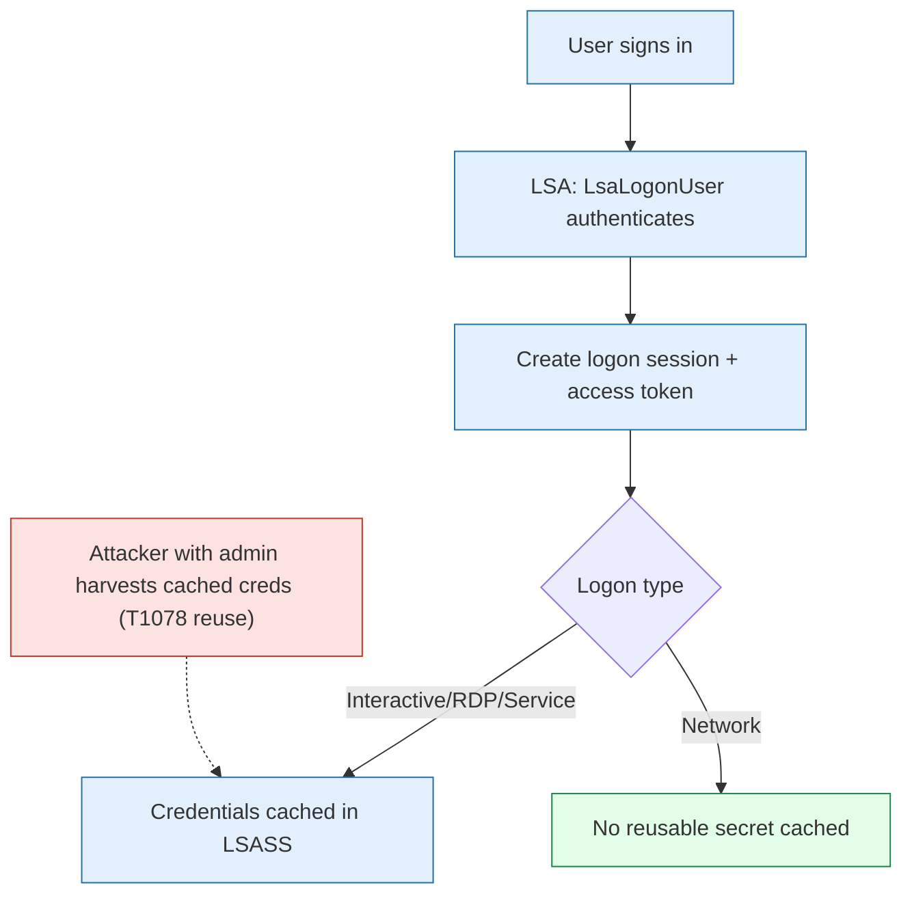

# Interactive Logon (LsaLogonUser and Logon Sessions)

## Summary

When a user signs in to Windows, the Local Security Authority (LSA) authenticates them and creates a **logon session** holding their credentials and access token. The API at the heart of this is `LsaLogonUser`. Understanding logon sessions and their types explains where credentials are cached, why some logon types leave reusable secrets in memory, and how valid-account abuse works (valid accounts, T1078). It is foundational for both credential-theft understanding and detection, because the logon type recorded in events tells defenders how an account was used.

## Logon types and their meaning

| Logon type | Scenario | Credential exposure |
|---|---|---|
| **Interactive (2)** | Local console sign-in | Credentials cached for the session |
| **Network (3)** | Accessing a share/service over the network | Typically no reusable secret cached on the target |
| **Batch (4) / Service (5)** | Scheduled task / service | Credentials may be stored and cached |
| **RemoteInteractive (10)** | RDP | Credentials cached (unless Restricted Admin/remote Credential Guard) |
| **NetworkCleartext (8)** | Some auth (e.g. basic) | Plaintext may be present |

The security point: logon types that cache credentials (interactive, RDP, service) leave secrets an attacker with admin can harvest, while network logons generally do not — which is why where privileged accounts log on interactively matters so much.

## Logon flow

## Detection

- Logon events (4624) with the logon type and account: privileged accounts with interactive/RDP logons on lower-tier hosts are a red flag.
- Service/batch logons for accounts that should not run services, or new logon sessions for dormant accounts.
- Credential-caching logon types on sensitive systems where network logon was expected.
- Valid-account abuse: legitimate credentials used from unusual hosts, times or geolocations.

## Defense

- **Restrict where privileged accounts log on interactively** (tiering); use network logons for admin access where possible.
- **Use Restricted Admin mode / Remote Credential Guard for RDP** so credentials are not cached on the target.
- **Enable Credential Guard** and disable WDigest to limit what cached logons expose.
- **Monitor logon types** per account and alert on tiering violations and anomalous valid-account use.
- **Limit service/batch logon rights** to the accounts that need them.

## ATT&CK mapping

| ID | Name | Tactic |
|---|---|---|
| T1078 | Valid Accounts | Stealth, Persistence, Privilege Escalation, Initial Access |

## Explanation

Signing in creates a logon session — a locker where Windows keeps your keys for as long as you are "in." Different ways of signing in fill that locker differently: sitting at the keyboard or using remote desktop stuffs it with reusable keys, while merely reaching a file share over the network usually leaves it nearly empty. Attackers who already have admin raid these lockers, so the big lesson is to never let a powerful account sit "logged in" on a machine that attackers can reach — and to use the modes that leave the locker empty when remote access is unavoidable.
