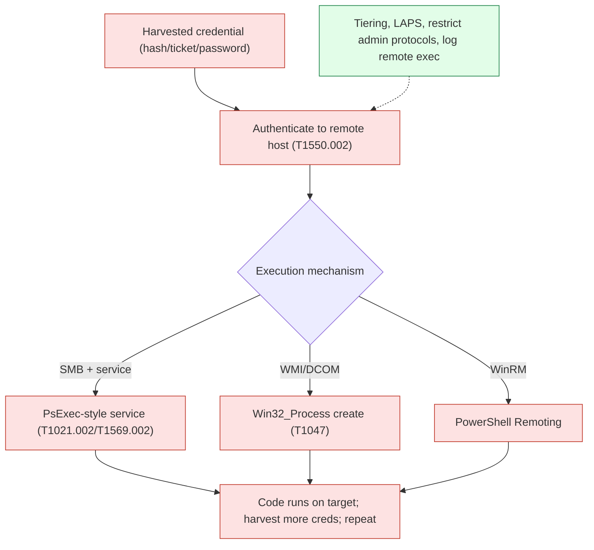

# Lateral Movement with PsExec, WMI and Stolen Credentials

## Summary

Lateral movement is how an attacker turns access to one Windows host into access across many, using credentials harvested along the way. The classic tooling uses built-in administrative mechanisms so it blends in: **PsExec** creates and runs a service over SMB (SMB/Windows admin shares, T1021.002; service execution, T1569.002), and **WMI** executes commands remotely (T1047). Both typically authenticate with stolen hashes or passwords (Pass-the-Hash, T1550.002). Because these are legitimate admin tools, the defender's challenge is distinguishing malicious use from normal administration.

## Common techniques

| Technique | Mechanism |
|---|---|
| **PsExec** | Copy a service binary to ADMIN$, create and start a service to run it (T1021.002, T1569.002) |
| **WMI (wmic / Win32_Process)** | Invoke process creation remotely over DCOM/WMI (T1047) |
| **WinRM / PowerShell Remoting** | Run commands over WS-Management |
| **Scheduled tasks (schtasks)** | Create a remote task to execute code |
| **Service creation (sc)** | Install and start a remote service |
| **Stolen credentials** | Hashes/tickets/passwords reused to authenticate (T1550.002) |

The pattern: authenticate to the remote host with a reused credential, drop or invoke execution via a built-in mechanism, run a payload, harvest more credentials, repeat.

## Attack flow

## Detection

- Remote service creation (event 7045) and PsExec artifacts (PSEXESVC service/named pipe) on targets.
- WMI process creation (event 4688 with wmiprvse.exe parent) and WMI/DCOM remote activity logs.
- Network logons (4624 type 3) followed immediately by remote execution, especially from non-admin hosts.
- Administrative protocol use (SMB admin shares, WinRM) between workstations, which is rarely legitimate.

## Defense

- **Tiering and LAPS**: ensure reusable admin credentials are not available on reachable hosts, and local admin passwords are unique.
- **Restrict lateral protocols**: limit SMB admin-share access, WinRM and WMI to designated management hosts; host-firewall workstation-to-workstation admin traffic.
- **Credential protection**: Credential Guard and disabling WDigest to reduce harvestable secrets.
- **Log and alert** on remote service creation, WMI execution and anomalous admin logons; baseline normal admin activity.
- **Just-in-time / just-enough admin** to shrink the window and scope of privileged access.

## ATT&CK mapping

| ID | Name | Tactic |
|---|---|---|
| T1021.002 | Remote Services: SMB/Windows Admin Shares | Lateral Movement |
| T1047 | Windows Management Instrumentation | Execution |
| T1569.002 | System Services: Service Execution | Execution |
| T1550.002 | Use Alternate Authentication Material: Pass the Hash | Lateral Movement |

## Explanation

Once inside, an attacker spreads by using the building's own service corridors rather than smashing new holes in walls. PsExec is like filing a maintenance work-order on a remote floor that quietly runs the attacker's errand; WMI is picking up the internal phone and telling that floor to launch a program. Both are legitimate facilities-management tools, which is exactly why they are favoured — they look like admin work. The credentials that authorise them are the ones harvested a step earlier. Defenders cannot ban the corridors, so they restrict who may use them and from where, keep reusable master keys off reachable floors, and watch the work-order log for jobs that do not belong.
