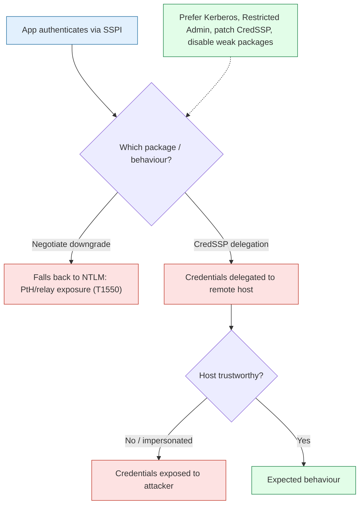

# Negotiate, CredSSP and Other Security Packages

## Summary

Windows authentication is pluggable: applications call the Security Support Provider Interface (SSPI), and underlying **security packages** do the actual protocol work. **Negotiate** picks Kerberos or falls back to NTLM; **CredSSP** delegates credentials to a remote server (used by RDP); and others (Schannel for TLS, Digest) cover specific cases. Understanding these packages matters because their fallback and delegation behaviours create risk — downgrade to NTLM, or credential delegation that exposes secrets (use alternate authentication material, T1550). Hardening often means constraining what these packages are allowed to do.

## The key packages

| Package | Purpose | Risk |
|---|---|---|
| **Negotiate (SPNEGO)** | Chooses Kerberos, else NTLM | Silent downgrade to weaker NTLM |
| **Kerberos** | Ticket-based domain auth | Ticket theft/forgery (see Kerberos files) |
| **NTLM** | Challenge-response fallback | Pass-the-Hash and relay |
| **CredSSP** | Delegates credentials to a remote host (RDP, WinRM) | Remote host receives reusable credentials; past CVEs allowed MITM code exec |
| **Schannel** | TLS/SSL | Weak protocol/cipher configuration |
| **Digest** | HTTP digest auth | Legacy, weak |

CredSSP is the notable risk: by design it hands your credentials to the remote server so it can act as you, which is convenient for RDP but means a compromised or impersonated server receives your secret.

## How package behaviour creates risk

## Detection

- NTLM used where Kerberos was expected (Negotiate downgrade) in authentication logs.
- CredSSP/RDP connections delegating credentials to unexpected or untrusted hosts.
- Legacy packages (Digest, NTLMv1, weak Schannel ciphers) in use.
- Authentication to systems that then reuse the delegated credential elsewhere.

## Defense

- **Prefer Kerberos** and restrict NTLM fallback; monitor for downgrades.
- **Use Restricted Admin / Remote Credential Guard** for RDP so CredSSP does not hand reusable credentials to the remote host.
- **Keep CredSSP patched** (the 2018 MITM RCE class) and apply the enforced-encryption settings.
- **Harden Schannel** (modern TLS, strong ciphers) and disable legacy packages like Digest and NTLMv1.
- **Audit SSPI usage** to find and remove weak-package dependencies.

## ATT&CK mapping

| ID | Name | Tactic |
|---|---|---|
| T1550 | Use Alternate Authentication Material | Lateral Movement |

## Explanation

Windows does not hard-wire one way to prove identity; it keeps a drawer of interchangeable "authentication adapters" (security packages) and picks one per situation. Two behaviours cause most trouble: the adapter that quietly swaps a strong method for a weaker one when the strong one is unavailable (Negotiate falling back to NTLM), and the adapter that, to be helpful, posts a copy of your keys ahead to the remote office (CredSSP delegation) — fine if that office is honest, dangerous if it has been taken over. Hardening is insisting on the strong adapter and telling the helpful one to stop mailing your keys around (Restricted Admin mode).
