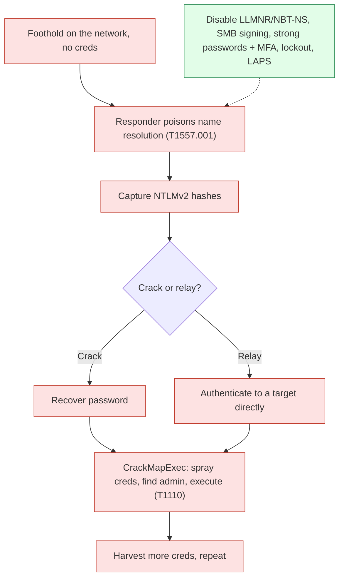

# Network Compromise: Responder, CrackMapExec and Credential Capture

## Summary

This is the practical toolkit for turning a foothold on a Windows network — often with no credentials at all — into captured hashes and footholds on more machines. **Responder** poisons broadcast name-resolution (LLMNR/NBT-NS/mDNS) to capture NTLM authentication, and **CrackMapExec** (and similar) sweeps the network to validate credentials, enumerate shares, and execute commands at scale. Together they implement name-resolution poisoning and relay (T1557.001), sniffing (T1040), and credential spraying (T1110). It is a staple of internal penetration tests and a common real-world intrusion pattern.

## The toolkit

| Tool / step | Role |
|---|---|
| **Responder** | Answer LLMNR/NBT-NS/mDNS queries as the target, capturing NTLMv1/v2 hashes (T1557.001) |
| **Hash cracking** | Crack captured NTLMv2 offline, or relay it live |
| **CrackMapExec / NetExec** | Spray credentials across hosts, enumerate shares/sessions, check admin access, execute |
| **Password spraying** | Try one common password against many accounts to avoid lockout (T1110) |
| **Share/session hunting** | Find sensitive files and where privileged users are logged in |

The loop is: capture or guess a credential, validate it everywhere, find where it is admin, harvest more credentials, repeat.

## Attack flow

## Detection

- LLMNR/NBT-NS/mDNS answers from unexpected hosts (Responder's signature), and injected name-resolution responses.
- Many failed logons for one password across many accounts (spraying), or one account authenticating to many hosts quickly.
- SMB enumeration sweeps and remote execution (service creation, WMI) across the estate from a single source.
- NTLM network logons from unusual hosts following name-resolution poisoning.

## Defense

- **Disable LLMNR, NBT-NS and mDNS** where not required to remove Responder's poisoning channel.
- **Enforce SMB signing** (and LDAP signing/EPA) to prevent relaying captured authentications.
- **Strong passwords + MFA** and account-lockout/throttling to defeat spraying; ban common passwords.
- **Deploy LAPS and tiering** so a captured local or user credential cannot be reused widely or reach admin.
- **Monitor** for the poisoning, spraying and lateral-execution patterns above.

## ATT&CK mapping

| ID | Name | Tactic |
|---|---|---|
| T1557.001 | Adversary-in-the-Middle: Name Resolution Poisoning and SMB Relay | Credential Access, Collection |
| T1040 | Network Sniffing | Credential Access, Discovery |
| T1110 | Brute Force | Credential Access |

## Explanation

When a Windows machine cannot find a name the normal way, it shouts the question to the whole subnet. Responder is the attacker quietly answering every such shout with "that's me — authenticate to me," harvesting the proofs that come back. CrackMapExec is then the master-key tester, trying each recovered credential on every door in the building and noting which ones it opens as admin. The whole pattern often starts with zero credentials. The defences are to stop machines shouting (disable LLMNR/NBT-NS), make doors verify the real caller (SMB signing), and ensure a single stolen key never fits many doors (LAPS, strong unique passwords, MFA).
