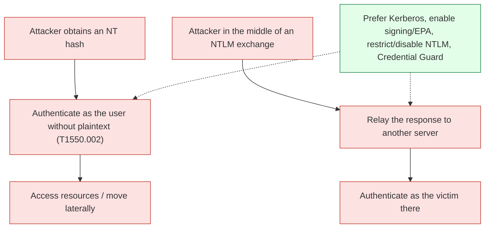

# NTLM Authentication

## Summary

NTLM is Windows's older challenge-response authentication protocol, still widely present for backward compatibility and for cases Kerberos cannot cover (such as authenticating by IP address or across certain trusts). It never sends the password, but its reliance on the password's NT hash creates two enduring weaknesses: the hash itself is a reusable credential (Pass-the-Hash, T1550.002), and the challenge-response exchange can be relayed to another server. Understanding NTLM is essential because these flaws underpin a large share of Windows lateral movement.

## How NTLM works

| Step | What happens |
|---|---|
| **Negotiate** | Client and server agree to use NTLM |
| **Challenge** | Server sends a random challenge (nonce) |
| **Response** | Client encrypts the challenge with a key derived from the user's NT hash and returns it |
| **Verify** | Server (or the DC via Netlogon) checks the response against the stored hash |

The NT hash is an unsalted MD4 of the password: it does not change unless the password does, and possessing it is as good as possessing the password for NTLM authentication — no cracking required for Pass-the-Hash.

## Why NTLM is risky

## Detection

- NTLM authentication where Kerberos is expected (event 4624/4776 with NTLM), especially to servers by IP.
- Pass-the-Hash indicators: NTLM network logons (type 3) for an account from unusual hosts, no preceding interactive logon.
- High volumes of NTLM authentication, or NTLM to many hosts from one source (lateral movement).
- Relay indicators: authentications arriving via an intermediary (covered in [NTLM Relay Attack](ntlm-relay-attack.md)).

## Defense

- **Prefer Kerberos**; audit and then restrict or disable NTLM (especially NTLMv1) via Group Policy, allowing only where truly required.
- **Enable SMB/LDAP signing and channel binding (EPA)** to defeat relaying.
- **Protect hashes**: Credential Guard, LSASS PPL, no WDigest, and LAPS so a stolen hash is limited in reach.
- **Add privileged accounts to Protected Users**, which blocks NTLM for them.
- **Monitor** NTLM usage to find and remove legacy dependencies.

## ATT&CK mapping

| ID | Name | Tactic |
|---|---|---|
| T1550.002 | Use Alternate Authentication Material: Pass the Hash | Lateral Movement |

## Explanation

NTLM proves you know your password by solving a puzzle that only your password's fingerprint (the NT hash) can solve — without ever sending the password. The catch is that the fingerprint never changes and solving the puzzle is all that counts, so a thief who copies your fingerprint can answer every future puzzle as you, no cracking needed. That is Pass-the-Hash. And because the puzzle-answer can be forwarded, a middleman can pass your answer to a different guard. The fixes are to use the newer protocol (Kerberos) where possible, make guards verify they are talking to the real client (signing and channel binding), and keep fingerprints out of attackers' hands.
