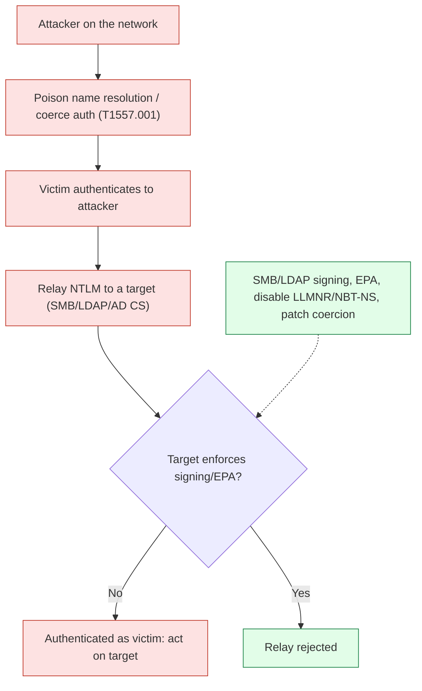

# NTLM Relay Attack

## Summary

An NTLM relay attack abuses the fact that NTLM authenticates the exchange, not the channel: an attacker in the middle forwards a victim's authentication to a different server and is accepted there as the victim. Crucially, the attacker never needs to crack anything — they relay the challenge-response in real time. Combined with techniques to coerce authentication (poisoning name resolution, or forcing a machine to authenticate), relaying turns one unauthenticated position on the network into authenticated access elsewhere (adversary-in-the-middle: name resolution poisoning and SMB relay, T1557.001).

## How relaying works

| Step | What happens |
|---|---|
| **Coerce / capture** | Poison LLMNR/NBT-NS/mDNS or coerce a host (e.g. via RPC) so it authenticates to the attacker |
| **Relay** | The attacker forwards the victim's NTLM messages to a chosen target server |
| **Accepted** | The target completes authentication, believing the attacker is the victim |
| **Act** | The attacker uses that session: access shares, LDAP, AD CS, or run code |

Relaying to high-value services is especially damaging: relaying to LDAP can modify AD objects; relaying to AD Certificate Services can mint a certificate for the victim; relaying to SMB can execute code.

## Attack flow

## Detection

- LLMNR/NBT-NS/mDNS responses from unexpected hosts (poisoning), and spikes of name-resolution failures.
- Authentication coercion patterns (unexpected RPC calls like those abusing the print or EFS interfaces).
- NTLM logons where the source and the authenticating identity are inconsistent, or authentications to LDAP/AD CS from unusual relays.
- New certificates issued via AD CS for accounts that did not request them.

## Defense

- **Enforce signing and channel binding**: SMB signing, LDAP signing and LDAP channel binding, and Extended Protection for Authentication (EPA) on HTTP/AD CS endpoints — these break relaying.
- **Disable legacy name resolution** (LLMNR, NBT-NS, mDNS where unneeded) to remove the poisoning foothold.
- **Reduce and restrict NTLM**; prefer Kerberos and add privileged accounts to Protected Users.
- **Patch authentication-coercion vectors** and harden AD CS templates/enrollment.
- **Monitor** for poisoning, coercion and anomalous relayed authentications.

## ATT&CK mapping

| ID | Name | Tactic |
|---|---|---|
| T1557.001 | Adversary-in-the-Middle: Name Resolution Poisoning and SMB Relay | Credential Access, Collection |

## Explanation

NTLM checks that you can answer a challenge, but not who you hand the answer to. A relay attacker stands between you and the system you meant to reach, takes your correct answer, and walks it over to a different, more valuable door, where the guard — seeing a valid answer — lets "you" in. The attacker never learned your password; they just couriered your proof to the wrong place. The defences make each guard insist on talking directly to the real client (signing and channel binding) and remove the tricks that lure you to the attacker in the first place (disabling LLMNR/NBT-NS).
