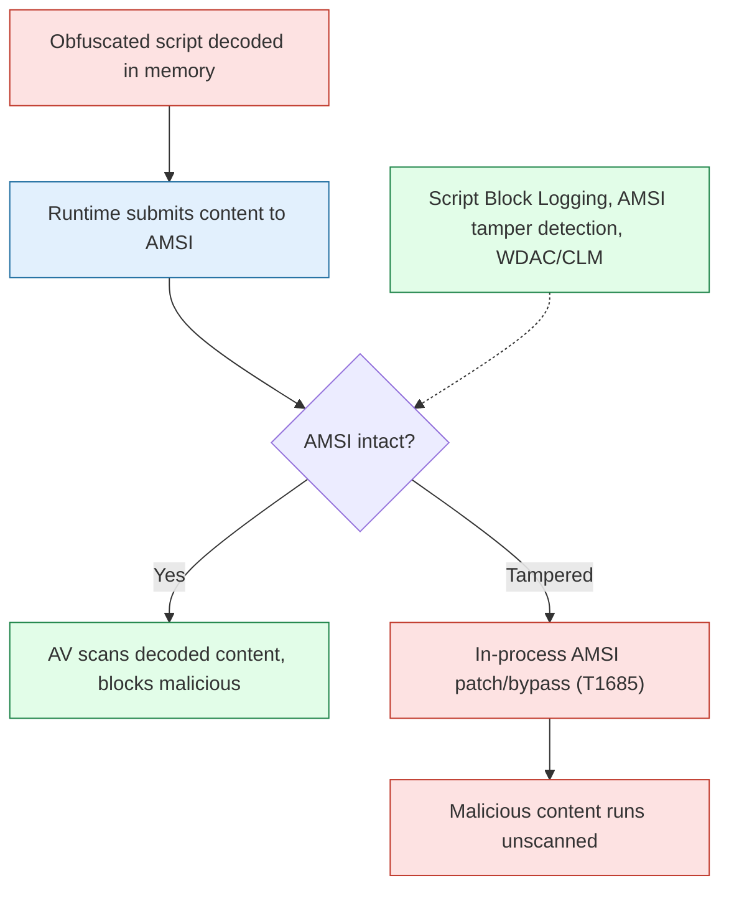

# Antimalware Scan Interface (AMSI)

## Summary

The Antimalware Scan Interface (AMSI) is a Windows feature that lets applications submit content to the installed antivirus for scanning at the moment it is used — crucially, after it has been decrypted or deobfuscated. It closes the gap that lets obfuscated scripts slip past on-disk scanning: PowerShell, VBScript, JScript, Office macros and .NET all feed their runtime content to AMSI. Because AMSI is a powerful defender, attackers invest heavily in bypassing it, usually by tampering with the AMSI components in their own process (impair defenses: disable or modify tools, T1685). Understanding AMSI is key to both detection and evasion analysis.

## How AMSI helps

| Aspect | Detail |
|---|---|
| **In-memory scanning** | Content is scanned as-executed, so obfuscation that only hid it on disk is defeated |
| **Integrated providers** | PowerShell, WSH, Office VBA, .NET, and others call AMSI before running content |
| **AV as the scanner** | AMSI forwards content to the registered antimalware provider (e.g. Defender) |
| **Result** | Malicious content is blocked at execution, even if freshly decoded in memory |

## How attackers bypass it, and defenders respond

Common bypasses patch `amsi.dll` functions in memory, corrupt the AMSI context, or force an error so scanning is skipped — all within the attacker's own process, which is why they are hard to prevent but detectable.

## Detection

- AMSI bypass strings and patch patterns in Script Block Logging (even failed/obfuscated attempts are logged).
- In-memory modification of `amsi.dll` (patched `AmsiScanBuffer`), or AMSI returning errors unexpectedly.
- PowerShell/WSH activity with AMSI disabled or throwing in a specific process.
- Known bypass one-liners and their obfuscated variants in telemetry.

## Defense

- **Enable PowerShell Script Block Logging and Module Logging**, which capture content independently of AMSI and record bypass attempts.
- **Use Constrained Language Mode and WDAC** to restrict the script capabilities that bypasses rely on.
- **Keep Defender/AV and AMSI providers updated**; vendors add detection for new bypasses.
- **Detect AMSI tampering** (patched `amsi.dll`, forced errors) via EDR.
- **Reduce script attack surface**: application control, signed-script policies, and least privilege.

## ATT&CK mapping

| ID | Name | Tactic |
|---|---|---|
| T1685 | Disable or Modify Tools | Defense Impairment |

## Explanation

Obfuscation hides malware on disk, but to run it must eventually reveal its true form in memory. AMSI is a checkpoint placed exactly at that moment of revelation: just before a script or macro runs, its decoded content is handed to the antivirus. That is why AMSI is so effective and why attackers work so hard to neutralise it — typically by quietly breaking the checkpoint inside their own process so it waves everything through. Defenders keep a second, independent camera rolling (script block logging) that records what was about to run even when the checkpoint is sabotaged, and they watch for the sabotage itself.
