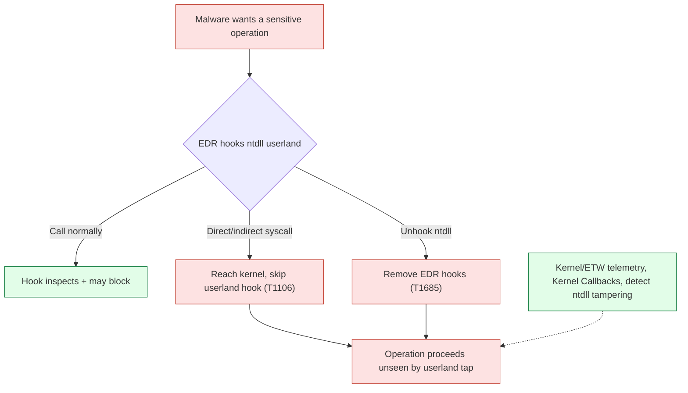

# Direct Syscalls and EDR Bypass (Userland Hook Evasion)

## Summary

Many endpoint detection products monitor malware by placing **inline hooks** on sensitive functions in user-mode libraries like `ntdll.dll`, so that calls (for example to allocate memory in another process) are inspected first. Direct syscalls and related techniques bypass this by invoking the kernel without going through the hooked userland function, so the EDR's userland tap never sees the call (impair defenses: disable or modify tools, T1685; invoking the native API directly, T1106). It is a cat-and-mouse evasion that motivates defenders to collect telemetry from the kernel and ETW rather than from hookable user-mode code.

## Evasion variants

| Technique | What it does |
|---|---|
| **Direct syscalls** | Execute the `syscall` instruction with the right service number, skipping `ntdll` entirely |
| **Indirect syscalls** | Jump to the real `syscall` instruction inside `ntdll` to look legitimate while bypassing the hook |
| **Unhooking** | Restore the original, unhooked bytes of `ntdll` from a clean copy (T1685) |
| **Hardware breakpoint / halos-gate** | Resolve syscall numbers dynamically to survive differing OS versions |

All share one aim: reach the kernel to do sensitive work (memory allocation, thread creation) without tripping the EDR's user-mode hook.

## Evasion flow

## Detection

- `syscall` instructions executed from outside `ntdll`'s expected code region (unusual return/call stacks).
- In-memory `ntdll` code that differs from the on-disk image where the EDR's hooks should be (unhooking).
- Sensitive operations observed by kernel/ETW telemetry but absent from userland hook logs (a coverage gap signal).
- Processes mapping fresh copies of `ntdll` or reading it from disk to rebuild clean syscalls.

## Defense

- **Collect telemetry below userland**: kernel callbacks (process/thread/image), ETW (including ETW-TI), and Microsoft-Windows-Threat-Intelligence events that direct syscalls cannot avoid.
- **Detect `ntdll` tampering and anomalous syscall stacks** rather than relying only on user-mode hooks.
- **Use PPL/anti-tamper** for the EDR agent so attackers cannot disable it.
- **Application control (WDAC)** to stop untrusted code from running in the first place.
- **Correlate** multiple weak signals (unbacked memory, odd call stacks, unhooking) since any single one is evadable.

## ATT&CK mapping

| ID | Name | Tactic |
|---|---|---|
| T1685 | Disable or Modify Tools | Defense Impairment |
| T1106 | Native API | Execution |

## Explanation

Picture a security guard who checks everyone at the lobby turnstile (the EDR's userland hooks in `ntdll`). Direct syscalls are taking the freight elevator straight to the floor you want, never passing the turnstile; unhooking is briefly removing the turnstile altogether. Either way the lobby guard records nothing. The counter is obvious once stated: do not rely only on the lobby. Put sensors in the building's core infrastructure — the kernel and ETW — where every floor access is logged no matter which route was taken, and alarm if anyone tampers with the turnstile itself.
