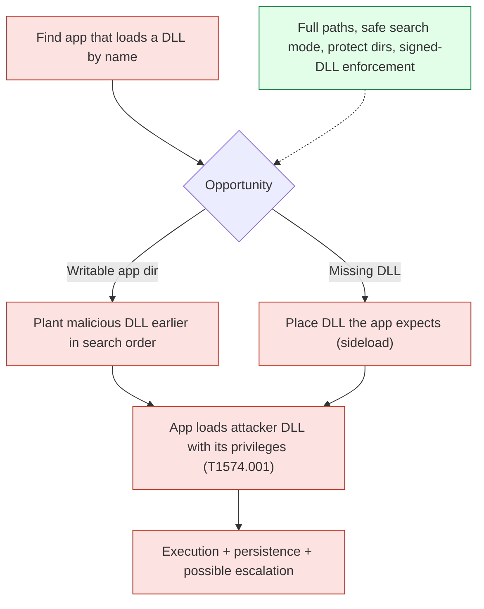

# DLL Search Order Hijacking

## Summary

When a program loads a DLL by name without a full path, Windows searches a defined sequence of directories to find it. DLL search order hijacking plants a malicious DLL earlier in that search sequence than the legitimate one, so the application loads the attacker's code — with the application's privileges and under its trusted identity (hijack execution flow: DLL, T1574.001). It yields execution, persistence, and privilege escalation at once, and is especially potent when a privileged or auto-started program is tricked into loading an attacker DLL from a writable directory.

## Why it works

| Factor | Effect |
|---|---|
| **Name-only loads** | Apps that `LoadLibrary("foo.dll")` without a path trigger the search |
| **Search order** | Directories are searched in sequence; a DLL found earlier wins |
| **Writable app directory** | If the app's folder is writable, a planted DLL there is found before system dirs |
| **Missing DLLs (sideloading)** | An app references a DLL that is not present, so any placed copy loads |
| **Privileged target** | Hijacking a service or elevated app inherits its privileges |

"DLL sideloading" is the common variant: a signed, trusted executable is placed next to a malicious DLL it will load, lending the malware the trusted process's reputation.

## Attack flow

## Detection

- DLLs loaded from unusual or user-writable locations by trusted or privileged processes.
- A signed executable loading an unsigned DLL from its own directory (sideloading).
- New DLLs appearing next to application binaries, or matching names of known-missing DLLs.
- Module-load events (Sysmon event 7) where the loaded path differs from the expected system path.

## Defense

- **Developers**: load DLLs by full path, call `SetDefaultDllDirectories`/use safe DLL search mode, and set up `KnownDLLs` protections.
- **Restrict directory permissions** so application and system folders are not writable by standard users.
- **Enforce signed-DLL loading** via WDAC/Code Integrity so unsigned planted DLLs cannot load.
- **Monitor module loads** from non-standard paths, especially by privileged processes.
- **Patch applications** known to be vulnerable to sideloading and remove unneeded auto-start programs.

## ATT&CK mapping

| ID | Name | Tactic |
|---|---|---|
| T1574.001 | Hijack Execution Flow: DLL | Stealth, Execution |

## Explanation

When a program asks for a part by name — "fetch me widget.dll" — Windows checks a list of storerooms in order and grabs the first matching part it finds. Search-order hijacking is slipping a counterfeit part into a storeroom that gets checked first, so the trusted program unknowingly builds itself with the attacker's component and runs it as its own. If that program is privileged or starts automatically, the attacker gains its power and a foothold that returns on every launch. The fixes are to have programs ask for parts by exact location, and to lock the storerooms so no one can plant counterfeits.
