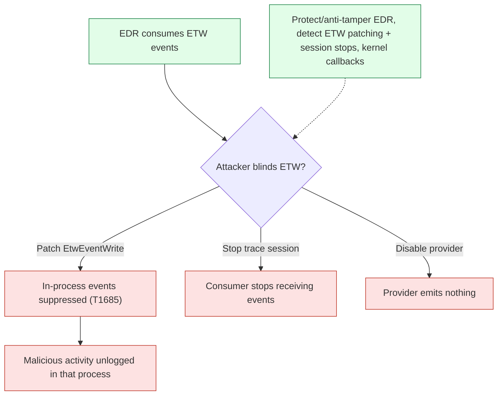

# Event Tracing for Windows (ETW) and Windows Error Reporting

## Summary

Event Tracing for Windows (ETW) is the high-performance, system-wide logging and instrumentation framework that underpins much of Windows telemetry and many EDR products: providers emit events, sessions consume them. Because so much detection depends on ETW, attackers try to blind it — patching the functions that emit events, disabling providers, or killing trace sessions (impair defenses: disable or modify tools, T1685). Windows Error Reporting (WER) is a related subsystem that, besides collecting crash data, has been abused both to capture secrets (e.g. LSASS dumps) and as an execution vector. Understanding ETW is essential to both building and evading detection.

## ETW and its abuse

| Aspect | Detail |
|---|---|
| **Providers** | Components emit structured events (process, image load, DNS, .NET, threat-intel) |
| **Sessions / consumers** | EDR and tools subscribe to providers to receive events |
| **ETW-TI** | The Threat-Intelligence provider surfaces sensitive operations EDR relies on |
| **Blinding ETW** | Patch `EtwEventWrite`/provider state in-process, or stop/disable trace sessions (T1685) |
| **WER abuse** | Harvest crash dumps (secrets) or abuse WER for persistence/execution |

Patching ETW in the attacker's own process silences the events that process would generate, so detection built only on ETW loses visibility there.

## Blinding flow

## Detection

- In-memory patches to ETW emit functions (e.g. `EtwEventWrite`/`NtTraceEvent`) — code differing from disk.
- Trace sessions being stopped or reconfigured, and security-relevant providers being disabled.
- Gaps in expected ETW streams (a process that should emit events going silent).
- WER abuse: unexpected LSASS dumps, or WER configured to run attacker payloads.

## Defense

- **Do not rely solely on in-process ETW**: combine it with kernel callbacks and protected, anti-tamper EDR agents.
- **Detect ETW tampering**: monitor for patched emit functions, stopped sessions, and disabled providers.
- **Protect ETW-TI and security providers**, and alert when they go quiet.
- **Restrict and monitor WER configuration** and treat unexpected LSASS/crash dumps as suspicious.
- **Application control and least privilege** to prevent untrusted code from reaching these internals.

## ATT&CK mapping

| ID | Name | Tactic |
|---|---|---|
| T1685 | Disable or Modify Tools | Defense Impairment |

## Explanation

ETW is the building's intercom and logbook system: nearly every department announces what it is doing over it, and the security office listens in. An attacker who wants to act unseen does not argue with the security office — they quietly cut the intercom wire in their own room (patching the event-writing function) or switch off the recorder (stopping a trace session), so their room simply stops being heard. The defence is to not depend on one intercom: keep an independent recorder in the building's foundations (the kernel), protect the security office from being switched off, and treat sudden silence from a room as an alarm in itself.
