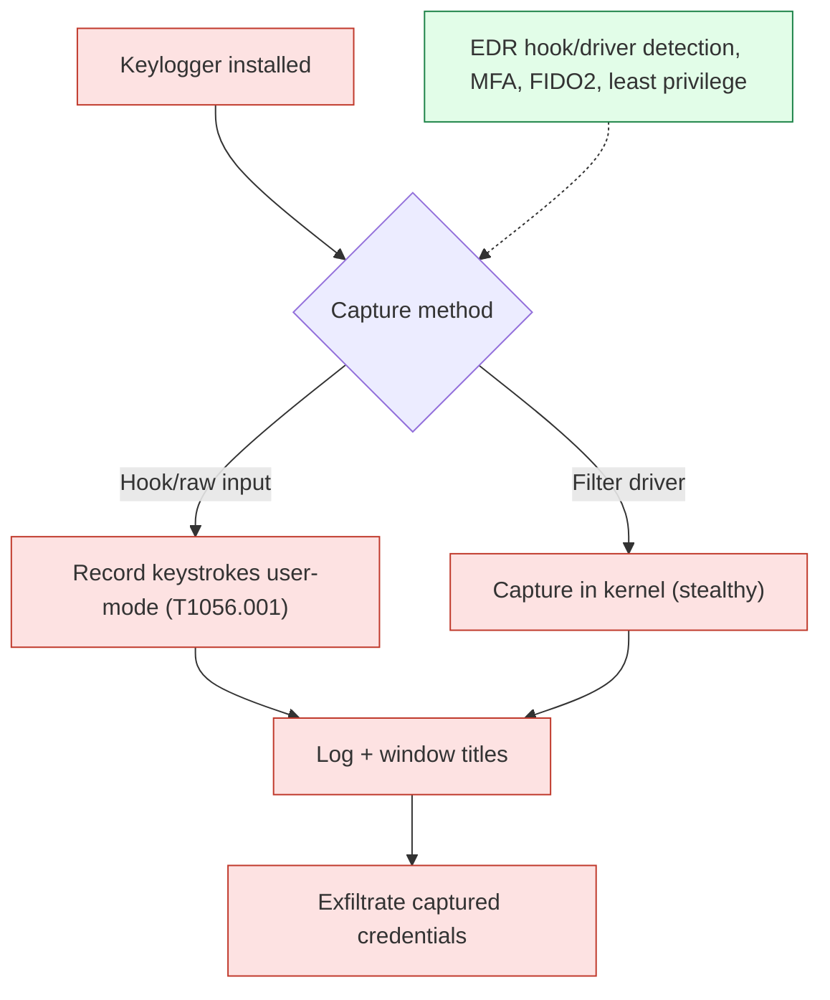

# Keylogging

## Summary

Keylogging records a user's keystrokes to capture passwords, messages and other sensitive input (input capture: keylogging, T1056.001). On Windows there are several ways to do it — polling key state, installing input hooks, reading raw input, or capturing at the kernel/driver level — each with different stealth and privilege requirements. Keyloggers are a staple of credential theft because they capture secrets at the point of entry, before any encryption or hashing, defeating strong password storage entirely.

## Keylogging methods

| Method | Mechanism | Notes |
|---|---|---|
| **GetAsyncKeyState polling** | Repeatedly query key state | Simple, user-mode, noisy |
| **Low-level hook** | `SetWindowsHookEx(WH_KEYBOARD_LL)` | Sees session-wide keystrokes (see [Hook Injection](../injection/hook-injection-setwindowshookex.md)) |
| **Raw Input / DirectInput** | Register for raw input events | Captures input many apps use |
| **Kernel / filter driver** | Keyboard filter driver | Stealthy, requires driver loading |
| **Hardware** | Physical inline device | Invisible to software defenses |

Captured keystrokes are usually logged locally and exfiltrated later, often alongside window titles to attribute input to applications.

## Flow

## Detection

- Installation of low-level keyboard hooks or keyboard filter drivers by untrusted software.
- Processes continuously reading keyboard state or raw input, and writing keystroke-like logs.
- New or unsigned keyboard filter drivers, and unexpected modules in input-handling paths.
- Exfiltration of log files correlated with input-capture behaviour.

## Defense

- **EDR detection** of input hooks, keyboard filter drivers, and keystroke-logging behaviour.
- **Phishing-resistant MFA (FIDO2/Windows Hello)**: even captured passwords are not enough to authenticate.
- **Application control (WDAC)** and driver signature enforcement to block malicious loggers and drivers.
- **Least privilege** so loggers cannot install at kernel level, and protect privileged credential entry.
- **User awareness and endpoint hygiene**, including checking for physical hardware loggers on sensitive systems.

## ATT&CK mapping

| ID | Name | Tactic |
|---|---|---|
| T1056.001 | Input Capture: Keylogging | Collection, Credential Access |

## Explanation

Password storage can be flawless — salted, hashed, guarded — and still be bypassed if the attacker simply reads the password as you type it. That is keylogging: tapping the keyboard's wire, whether via a software hook, a driver, or a physical gadget, to catch secrets at the one moment they exist in plain form. Because it strikes before any protection applies, the most effective defence is to make a stolen password worthless: pair it with something the keylogger cannot capture, like a hardware security key (FIDO2), so typed credentials alone open nothing.
