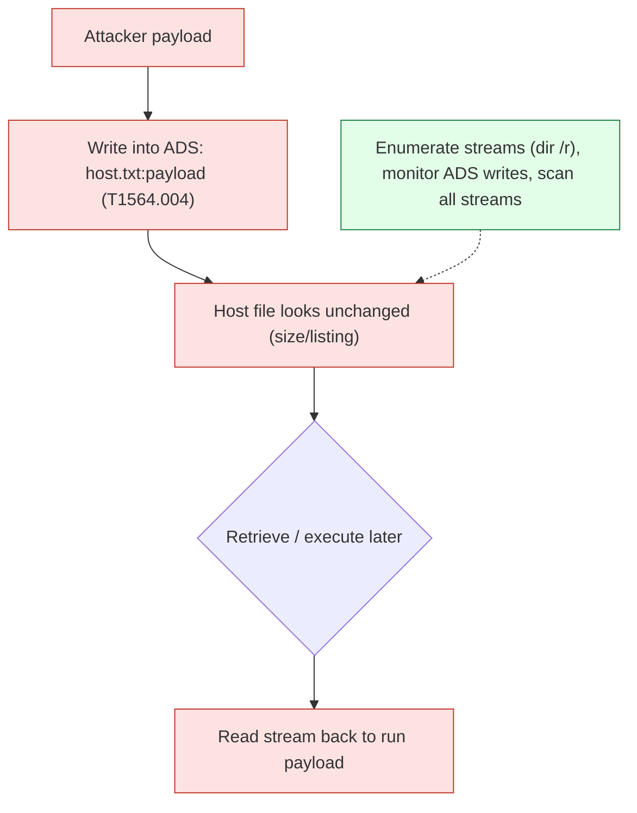

# NTFS Alternate Data Streams (ADS)

## Summary

On NTFS, a file can hold more than its main content: it can carry additional named streams, called Alternate Data Streams (ADS). The main data is the unnamed stream; extra data lives in `file.txt:streamname`. Attackers use ADS to hide payloads, scripts or configuration attached to innocuous files, because the hidden stream does not change the file's visible size and is not shown by default directory listings (hide artifacts: NTFS file attributes, T1564.004). Windows itself uses ADS legitimately (for example the `Zone.Identifier` mark-of-the-web), so defenders must distinguish benign from malicious streams.

## How ADS is used

| Use | Detail |
|---|---|
| **Hiding payloads** | Store an executable or script in `innocent.txt:evil.exe` |
| **Execution from ADS** | Historically run code directly from a stream (now more constrained) |
| **Size concealment** | The host file's displayed size reflects only the main stream |
| **Benign: Zone.Identifier** | The mark-of-the-web stream flags files downloaded from the internet |
| **Benign: metadata** | Some apps store thumbnails/summary data in streams |

The hidden stream rides along with the host file and is easy to miss with default tools, but it is fully enumerable with the right switches and APIs.

## Flow

## Detection

- Creation of non-standard named streams on files (writes to `name:stream`), especially executable content.
- Files whose alternate streams are large or executable while the main stream is trivial.
- Processes reading from or executing content sourced from an ADS.
- Enumeration with stream-aware tools (`dir /r`, `Get-Item -Stream`, Sysinternals `streams`) revealing unexpected streams.

## Defense

- **Scan all streams**, not just the main data; ensure AV/EDR inspects ADS content.
- **Monitor ADS creation**, treating executable or script content in streams as suspicious.
- **Preserve and honour mark-of-the-web** (`Zone.Identifier`) for downloaded-file protections rather than stripping it.
- **Application control (WDAC)** so content cannot execute regardless of where it is stored.
- **Audit with stream-aware tooling** during hunts and investigations.

## ATT&CK mapping

| ID | Name | Tactic |
|---|---|---|
| T1564.004 | Hide Artifacts: NTFS File Attributes | Stealth |

## Explanation

An NTFS file is like an envelope that can secretly hold extra sealed inserts besides its visible letter. Alternate Data Streams are those hidden inserts: an attacker tucks a payload into `report.txt`'s secret compartment, and the envelope still looks and weighs the same to anyone glancing at it. Windows uses this compartment for honest purposes too, such as stamping "this came from the internet." Defenders simply need tools that open every compartment, not just read the visible letter — then a payload hiding in the lining is plain to see.
