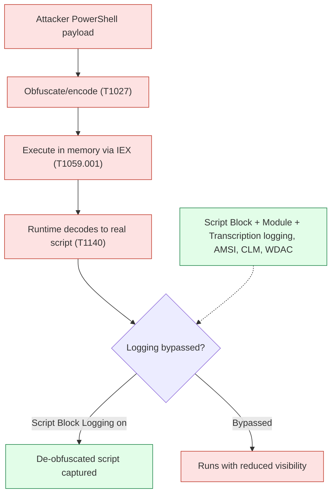

# PowerShell Obfuscation and Logging Bypass

## Summary

PowerShell is a favourite attacker tool because it is built in, powerful, and can run code entirely in memory. To evade detection, attackers obfuscate PowerShell commands (so static and log-based matching fails) and try to suppress or bypass PowerShell's logging (so defenders have no record). This combines command-and-scripting-interpreter abuse (T1059.001) with obfuscation (T1027) and runtime decoding (T1140). The defender's counter is layered logging that captures the de-obfuscated script regardless of how it was encoded.

## Obfuscation and bypass techniques

| Technique | What it does |
|---|---|
| **Encoding** | Base64 (`-EncodedCommand`), compression, string reversal/concatenation |
| **Token/syntax obfuscation** | Splitting cmdlet names, backticks, aliases, variable indirection |
| **In-memory execution** | Download-and-run (`IEX`) so nothing hits disk |
| **Logging bypass** | Disable/evade Script Block Logging, AMSI bypass, downgrade to v2 |
| **Constrained Language Mode evasion** | Techniques to escape CLM restrictions |

The two halves work together: obfuscation hides the content, and logging bypass removes the record — but PowerShell's own instrumentation can defeat both if enabled.

## Attack and defence flow

## Detection

- Script Block Logging (event 4104) capturing the de-obfuscated script, including obfuscation and bypass patterns.
- `-EncodedCommand`, heavy use of `IEX`, string concatenation and reversal, and download cradles.
- Attempts to downgrade to PowerShell v2 (which lacks modern logging), or to disable logging/AMSI.
- Suspicious parent-child chains (Office spawning PowerShell) and network activity from PowerShell.

## Defense

- **Enable PowerShell logging**: Script Block Logging, Module Logging and Transcription — Script Block Logging records the decoded content even when obfuscated.
- **Remove PowerShell v2** so attackers cannot downgrade past logging.
- **Enforce Constrained Language Mode and WDAC** to limit what scripts can do.
- **Keep AMSI effective** and monitor for its bypass.
- **Alert on encoded commands, download cradles and anomalous PowerShell ancestry.**

## ATT&CK mapping

| ID | Name | Tactic |
|---|---|---|
| T1059.001 | Command and Scripting Interpreter: PowerShell | Execution |
| T1027 | Obfuscated Files or Information | Stealth |
| T1140 | Deobfuscate/Decode Files or Information | Stealth |

## Explanation

Attackers love PowerShell because it is already installed and can run code that never lands on disk. To stay hidden they scramble their commands into gibberish (obfuscation) and try to unplug PowerShell's own tape recorder (logging bypass). But PowerShell has a recorder wired deep inside that captures each command after it has been unscrambled, just before it runs — so even perfect gibberish is logged in plain form if that recorder is switched on. The defensive playbook is simple: turn on all the recorders, remove the old version that has none, and fence in what scripts are allowed to do.
