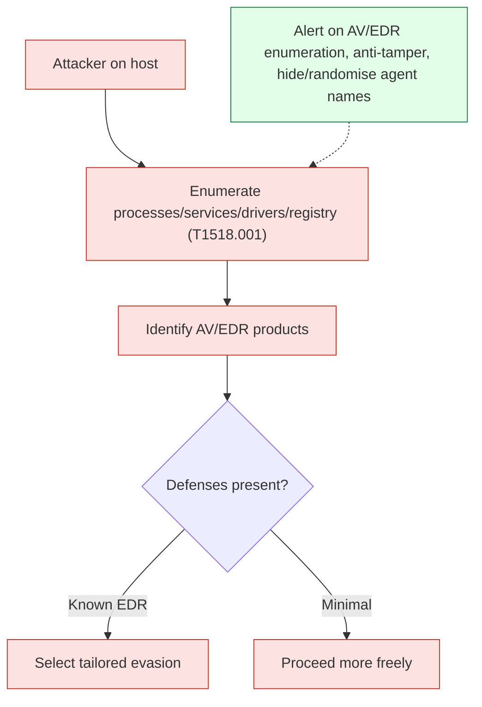

# Security Software Discovery (AV/EDR Fingerprinting)

## Summary

Before acting, attackers often check what defenses are present so they can tailor their tooling — choosing evasions that work against the specific antivirus or EDR, or avoiding noisy actions altogether. Security software discovery enumerates installed protection products from running processes, services, drivers, registry keys and installed programs (software discovery: security software discovery, T1518.001). It is reconnaissance that directly feeds defense evasion, and the enumeration itself is a useful detection opportunity because legitimate software rarely fingerprints the AV/EDR.

## What attackers look for

| Source | Indicator |
|---|---|
| **Processes** | Known AV/EDR process names (e.g. agent and sensor executables) |
| **Services / drivers** | Protection services and kernel driver names |
| **Registry** | Product install keys, AV registration under Security Center |
| **Installed programs** | Enumerated via WMI / uninstall keys |
| **Loaded modules / hooks** | EDR DLLs injected into processes, userland hooks present |
| **Network / management** | Management agents, cloud EDR connectivity |

Having fingerprinted the defenses, the attacker picks a matching bypass (or decides the environment is too monitored and lies low).

## Flow

## Detection

- Enumeration of processes/services/drivers filtered for known security-product names shortly after a foothold.
- WMI queries for installed antivirus (SecurityCenter2) or uninstall registry key sweeps.
- Queries for EDR driver/service names, or attempts to read EDR configuration.
- Reconnaissance activity clustered early in an intrusion, before quieter follow-on actions.

## Defense

- **Alert on security-software enumeration** as an early-intrusion signal; it rarely has a benign reason from non-admin code.
- **Protect the EDR agent** with anti-tamper/PPL so discovery does not lead to easy disablement.
- **Reduce fingerprintability** where practical (though determined attackers will still identify defenses).
- **Correlate** discovery with subsequent evasion or disablement attempts to catch the kill-chain early.
- **Defense in depth**: multiple, independent controls so identifying one does not neutralise all.

## ATT&CK mapping

| ID | Name | Tactic |
|---|---|---|
| T1518.001 | Software Discovery: Security Software Discovery | Discovery |

## Explanation

A careful burglar first notes which alarm company's sticker is on the window, so they can bring the right tools to defeat that specific system. Security software discovery is exactly that reconnaissance: the attacker lists what protection is running so they can choose an evasion known to work against it, or decide the place is watched too closely and keep still. The good news for defenders is that this snooping is itself a giveaway — honest programs do not go around checking which alarm company you use — so catching the fingerprinting early can reveal an intruder before they strike.
