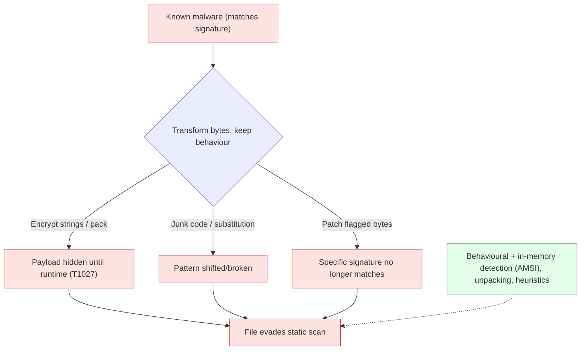

# Static Signature Evasion (Obfuscation, Junk Code, Binary Patching)

## Summary

Static signature detection matches malware against known byte patterns in files on disk. Static signature evasion changes those bytes without changing behaviour, so the same malware no longer matches (obfuscated files or information, T1027). Techniques range from simple string encryption to inserting meaningless junk code, patching specific flagged bytes, and fully packing or encrypting the payload. It is effective against signature-only antivirus, which is why modern defense relies on behavioural and in-memory detection rather than static signatures alone.

## Evasion techniques

| Technique | What it changes |
|---|---|
| **String/encoding obfuscation** | Encrypts or encodes strings so signatured text is absent |
| **Junk code / dead code** | Inserts no-op or irrelevant instructions to shift and break patterns |
| **Instruction substitution** | Replaces instructions with equivalents to alter byte sequences |
| **Binary patching** | Flips the specific bytes a signature keys on, keeping behaviour |
| **Packing / crypting** | Compresses/encrypts the whole payload, unpacked only at runtime |
| **Polymorphism / metamorphism** | Regenerates a different-looking variant each build/run |

All share the principle that a signature is brittle: it matches exact bytes, so any behaviour-preserving transformation of those bytes defeats it until a new signature is written.

## Evasion flow

## Detection

- Entropy and packer indicators (high-entropy sections, known packer stubs) flagging obfuscated files.
- In-memory scanning (AMSI) and unpacking that reveal the true payload once decoded at runtime.
- Behavioural detection: the malware still does the same things, which heuristics and EDR observe.
- Anomalies that survive obfuscation: imports, API call sequences, and runtime behaviour.

## Defense

- **Do not rely on static signatures alone**: combine with behavioural detection, in-memory scanning (AMSI), and heuristics.
- **Unpack and scan at runtime**, where the decoded payload is exposed regardless of on-disk obfuscation.
- **Use entropy/packer heuristics** to prioritise suspicious files for deeper analysis.
- **Application control (WDAC)** to allow only trusted code, sidestepping the signature arms race.
- **EDR behavioural telemetry**, since obfuscation changes appearance, not actions.

## ATT&CK mapping

| ID | Name | Tactic |
|---|---|---|
| T1027 | Obfuscated Files or Information | Stealth |

## Explanation

A static signature is a wanted poster showing an exact face. Signature evasion is the fugitive changing their appearance — a wig, a fake beard, padding under the coat — while remaining the same person who commits the same crime. It reliably beats the poster, because the poster only knows the old face, until someone draws a new one. That is why modern defence stops relying on the poster and instead watches for the behaviour: the fugitive still picks the same locks the same way (behavioural and in-memory detection), no matter how they have disguised their face on paper.
