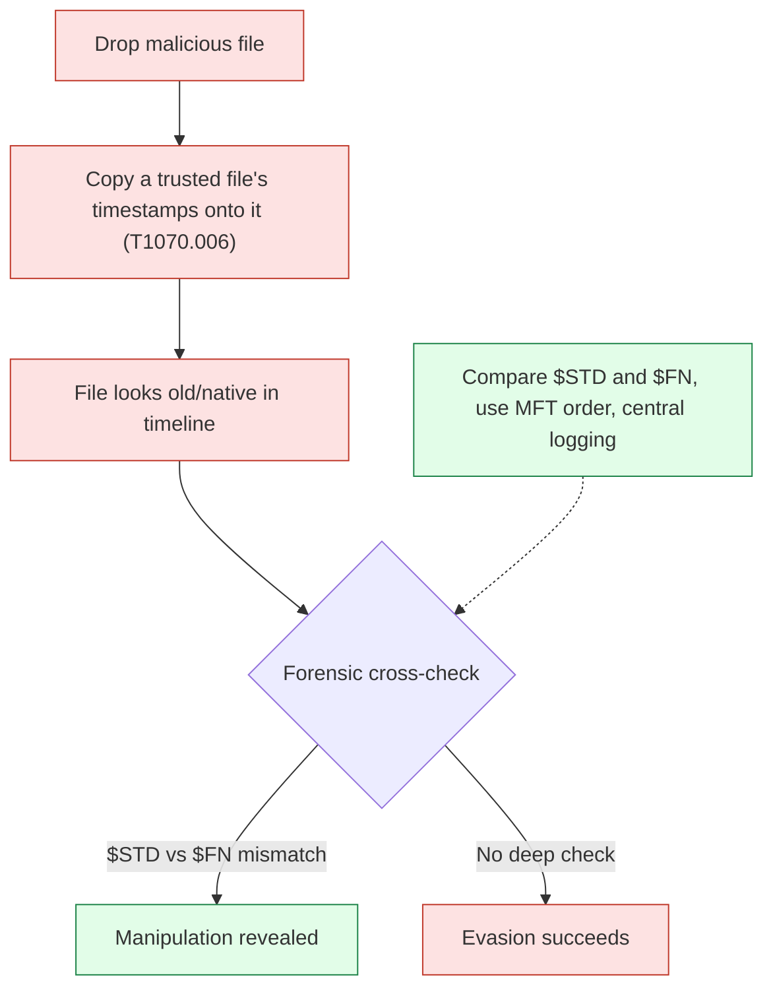

# Timestomping

## Summary

Timestomping is altering a file's timestamps to hide when it was created or modified, so a malicious file blends in with legitimate ones and evades timeline-based detection (indicator removal: timestomp, T1070.006). An attacker typically copies the timestamps of a trusted system file onto their payload, making it look old and native. On NTFS, the trick has a weakness: there are two sets of timestamps, and inconsistencies between them often reveal the manipulation to a careful investigator.

## How it works, and its tell

| Aspect | Detail |
|---|---|
| **The goal** | Make a malicious file's MACB times match benign neighbours |
| **The method** | Set `$STANDARD_INFORMATION` times via APIs (`SetFileTime`) or tools |
| **Two timestamp sets** | NTFS keeps `$STANDARD_INFORMATION` (easily set) and `$FILE_NAME` (set by the OS on operations) |
| **The tell** | `$FILE_NAME` times often do not match stomped `$STANDARD_INFORMATION` times |
| **Other tells** | Sub-second precision zeroed out; times inconsistent with MFT entry number ordering |

Because most tools and attackers only change `$STANDARD_INFORMATION`, forensic comparison with `$FILE_NAME` (and the MFT record sequence) exposes the forgery.

## Flow

## Detection

- Discrepancies between `$STANDARD_INFORMATION` and `$FILE_NAME` timestamps in the MFT.
- Timestamps that predate the OS install, zeroed sub-second fields, or times inconsistent with the MFT entry's sequence number.
- Files whose timestamps match a system file exactly but whose location/behaviour is anomalous.
- Creation events in central logs (which attackers cannot retroactively change) contradicting on-disk times.

## Defense

- **Forensic timestamp analysis**: compare both NTFS timestamp sets and use MFT record ordering, which resist naive stomping.
- **Central, tamper-resistant logging** (EDR, SIEM) records real creation times independent of the file's on-disk metadata.
- **File-integrity monitoring** on sensitive directories to catch introduced files regardless of their timestamps.
- **Correlate** on-disk times with log evidence during investigations rather than trusting file metadata alone.
- **Application control** to reduce the chance of the malicious file running at all.

## ATT&CK mapping

| ID | Name | Tactic |
|---|---|---|
| T1070.006 | Indicator Removal: Timestomp | Stealth |

## Explanation

Investigators often reconstruct an intrusion by lining up files in time, so a fresh, out-of-place file stands out. Timestomping is back-dating the malicious file — copying an old, trusted file's "born on" date onto it — so it sinks into the crowd of legitimate files. But NTFS keeps two clocks on every file, and attackers usually only reset the one that is easy to reach. A careful examiner checks the second clock (and the order files were filed in) and finds it does not agree with the forged date — the lie exposed by the detail the forger overlooked.
