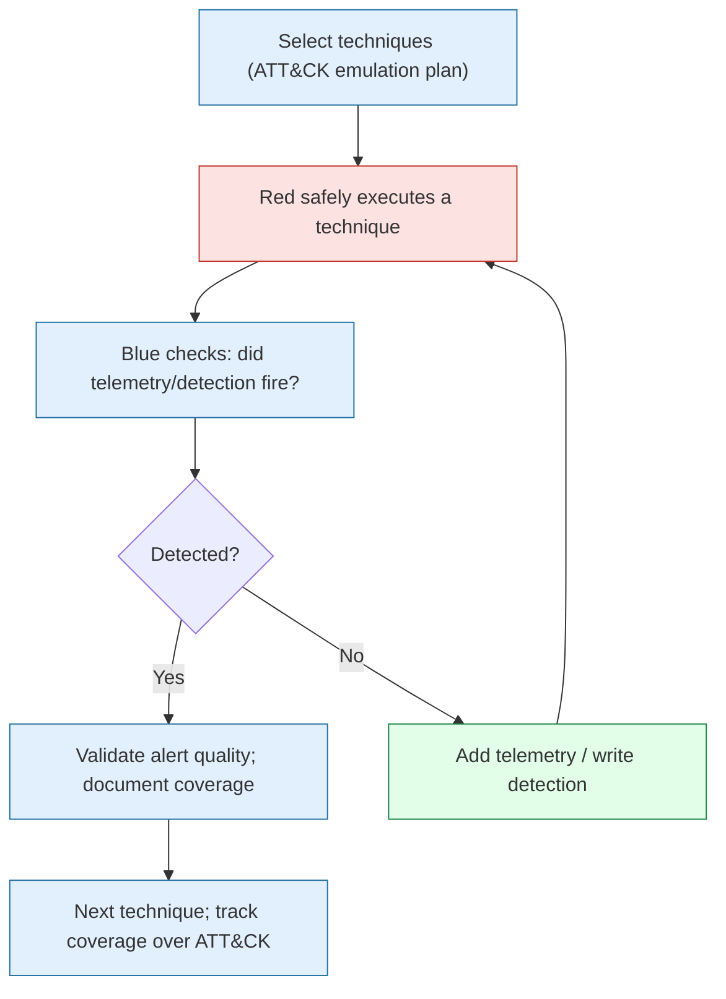

# Adversary Emulation and Purple Teaming

## Summary

Adversary emulation is the disciplined replay of real attacker behaviour — specific techniques, ideally sequenced the way a known threat actor operates — to test whether an organisation can prevent, detect, and respond to it. **Purple teaming** is doing this collaboratively: the offensive side (red) executes techniques while the defensive side (blue) watches their telemetry and detections in real time, closing gaps together rather than keeping score. Unlike a black-box penetration test, the point is not merely to "get in" but to measure detection coverage technique by technique (usually against MITRE ATT&CK) and to improve it. Frameworks like ATT&CK emulation plans and atomic-test libraries make this repeatable. The result is evidence-based detection engineering: you know what you can catch because you tried it.

## How it works

| Element | Role |
|---|---|
| **Emulation plan** | Techniques to run, modelled on real adversary TTPs (ATT&CK-mapped) |
| **Atomic tests** | Small, discrete technique executions for coverage testing |
| **Red execution** | Safely runs the techniques in scope |
| **Blue observation** | Checks telemetry/detections fired as expected |
| **Gap closure** | Missing coverage becomes new telemetry/detections |

The defining difference from a pentest: success is measured by **detection coverage**, not just by access gained, and findings feed straight back into detections.

## Purple-team loop

## Defensive value

- **Measures real detection coverage** per technique, replacing assumptions with evidence.
- **Closes gaps immediately** through collaboration, not weeks later via a report.
- **Validates telemetry and tooling** (is Sysmon/EDR actually capturing what's needed?).
- **Trains responders** on real attacker behaviour and the alerts it produces.
- **Prioritises defence** against techniques relevant to the organisation's threat model.

## Practices

- **Scope safely**: run in controlled environments or with careful production guardrails.
- **Map everything to ATT&CK** and track coverage over time.
- **Use repeatable tests** (atomic tests, emulation plans) for regression as defences change.
- **Feed results into detection engineering** and retest to confirm closure.
- **Rotate techniques** to cover the matrix, not just favourites.

## ATT&CK mapping

No single ATT&CK technique; adversary emulation exercises the full ATT&CK matrix to measure and improve detection.

## Explanation

A fire drill tells you far more than a fire-safety brochure, because it reveals what actually happens when the alarm sounds — which doors stick, who freezes, whether the sprinklers work. Adversary emulation is a fire drill for cyber attacks: instead of assuming your detections work, you light controlled, realistic fires (run genuine attacker techniques) and check whether the alarms go off. Purple teaming makes it cooperative — the people lighting the fire and the people watching the smoke detectors stand in the same room, so the instant a detector stays silent they fix it on the spot. The scoreboard isn't "did the red team get in," which they usually can; it's "how much of what they did could we see," and every blind spot found becomes a new detector installed before the real fire arrives.
