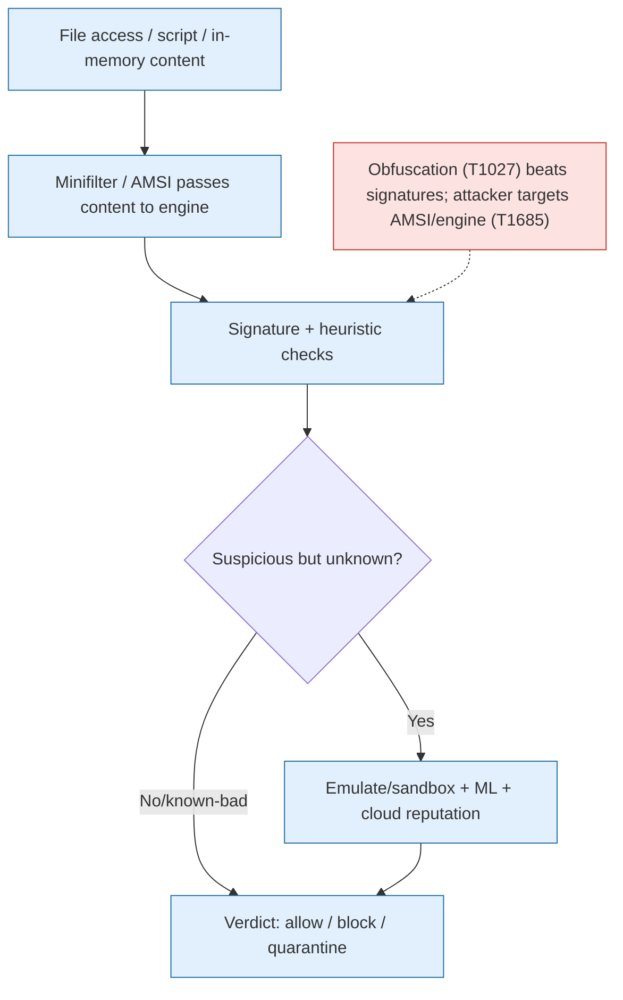

# Antivirus Engine Architecture

## Summary

An antivirus (AV) engine decides whether a file or behaviour is malicious using several layered techniques: **signature matching** (known-bad patterns/hashes), **heuristics** (suspicious structure or characteristics), **behavioural monitoring** (what the code does at runtime), **emulation/sandboxing** (running the sample in a safe virtual environment to see its true behaviour), and increasingly **machine learning** and **cloud reputation**. On Windows, the engine hooks into the system through a filesystem minifilter (real-time scanning on file access) and the **Antimalware Scan Interface (AMSI)**, which lets it inspect script and in-memory content after it is decoded — closing the gap that pure file scanning leaves. Understanding this layering explains both why obfuscation (T1027) defeats signatures but not behaviour, and why attackers attack the engine itself (disable or modify tools, T1685).

## Detection layers

| Layer | Strength | Weakness |
|---|---|---|
| **Signatures** | Fast, precise for known malware | Trivially bypassed by changing bytes |
| **Heuristics** | Catches variants by structure | False positives; tunable by attackers |
| **Behavioural monitoring** | Catches novel/fileless by actions | Needs runtime; evadable with care |
| **Emulation / sandbox** | Reveals unpacked/true behaviour | Sandbox-evasion checks; time limits |
| **ML / cloud reputation** | Scales, catches unknowns | Needs data; adversarial evasion |
| **AMSI integration** | Sees decoded scripts / in-memory content | Attackers target AMSI to blind it |

No single layer is sufficient, which is exactly why engines stack them: what defeats one (obfuscation vs signatures) is caught by another (behaviour/AMSI).

## Scanning pipeline

## Detection / defensive value

- Layered engines catch a wide range: known malware (signatures), variants (heuristics/ML), and fileless/obfuscated activity (behaviour/AMSI).
- AMSI exposes decoded script content that static file scanning never sees.
- Cloud reputation and ML extend coverage to never-before-seen samples.

## Defense

- **Keep AV/EDR fully enabled** with real-time protection, cloud-delivered protection, and AMSI active.
- **Enable tamper protection** so the engine can't be silently disabled (T1685).
- **Layer with EDR, app control, and ASR** so engine evasion isn't fatal.
- **Keep engine and definitions current**; use behavioural/cloud features, not signatures alone.
- **Monitor AV health and AMSI** for tampering or being bypassed.

## ATT&CK mapping

| ID | Name | Tactic |
|---|---|---|
| T1027 | Obfuscated Files or Information | Stealth |
| T1685 | Disable or Modify Tools | Defense Impairment |

(These are techniques used against AV; the engine itself is a defensive capability.)

## Explanation

An antivirus engine is less a single guard than a security checkpoint with several stations in a row. The first station holds a book of mugshots (signatures) and waves through anyone not pictured — fast, but useless against a new face. The next looks for suspicious traits regardless of identity (heuristics). A further station actually opens the suspicious package in a blast-proof room to watch what it does (emulation and behaviour), and a back office checks the traveller against a global reputation database. AMSI is a clever addition: it insists that even messages written in code get read aloud *after* being decoded, so a disguise that fooled the mugshot book is exposed once it has to speak plainly. Because each station covers another's blind spot, the attacker's real prize isn't slipping past one station — it's switching the whole checkpoint off, which is why protecting the engine from tampering matters as much as the scanning itself.
