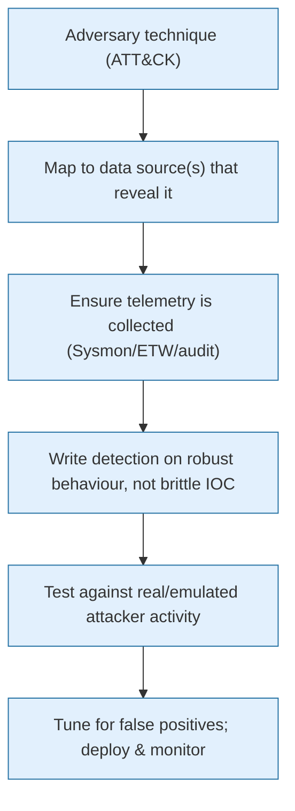

# Detection Engineering and Data Sources (Sysmon, ETW)

## Summary

Detection engineering is the practice of building reliable, maintainable detections for adversary behaviour — and it starts with having the right telemetry. Windows exposes rich data through **Event Tracing for Windows (ETW)**, the low-level tracing framework that underlies most high-fidelity telemetry, and **Sysmon**, a free Sysinternals driver that logs high-value events (process creation with hashes, network connections, image loads, remote-thread creation, registry and file changes) in a consistent, detection-friendly form. Good detection engineering maps each adversary technique to the data source that reveals it (per MITRE ATT&CK data sources), writes detections against robust behaviours rather than brittle indicators, and tests them against real attacker activity. Without the right data, even the best analytics are blind.

## Key data sources

| Source | Reveals |
|---|---|
| **Sysmon** | Process creation (Event 1, with hashes/command line), network (3), image load (7), remote thread (8), registry (12-14), file create (11), WMI events (19-21) |
| **ETW** | Low-level traces: PowerShell, .NET, kernel, AMSI, DNS, and more |
| **Security event log** | Logons, privilege use, account/service/task changes, log clearing |
| **PowerShell logging** | Script-block and module logging (post-deobfuscation content) |
| **EDR telemetry** | Correlated process/memory/network behaviour |

The craft is matching technique to source: process injection shows in Sysmon Event 8 (remote thread) and memory telemetry; persistence shows in registry/service/task events; obfuscated scripts show in AMSI/script-block logs after they decode.

## From behaviour to detection

## Practices

- **Map detections to ATT&CK** and track coverage gaps by technique and data source.
- **Deploy Sysmon with a curated config** (e.g. a well-maintained community baseline) and collect ETW where it adds fidelity.
- **Prefer behavioural detections** (relationships, sequences) over single static indicators that attackers trivially change.
- **Test and tune**: validate against emulated attacks; measure false-positive rate.
- **Forward everything to a SIEM** for correlation and retention.

## Defensive value

- Turns raw activity into actionable alerts aligned to real adversary behaviour.
- Exposes coverage gaps so telemetry and detections can be prioritised.
- Supports hunting and incident response with consistent, correlatable data.

## ATT&CK mapping

No single ATT&CK technique; this is the detection-engineering foundation that maps telemetry to the techniques documented throughout this knowledge base (see MITRE ATT&CK data sources).

## Explanation

You cannot catch what you cannot see, so detection engineering begins not with clever rules but with wiring up the right sensors. ETW is the building's deep electrical sensing — it can feel almost anything happening in the wiring — and Sysmon is a well-placed set of cameras that record the events defenders care about most, in a tidy, searchable format: who launched what, what called home, what got injected where. With good sensors in place, the real skill is writing alarms that trigger on what an intruder must do (break in, move around, phone out) rather than on easily-changed trivia like a specific filename. Then you rehearse break-ins to check the alarms actually fire, and tune them so they don't scream at the cat. Sensors first, smart alarms second, constant rehearsal throughout.
