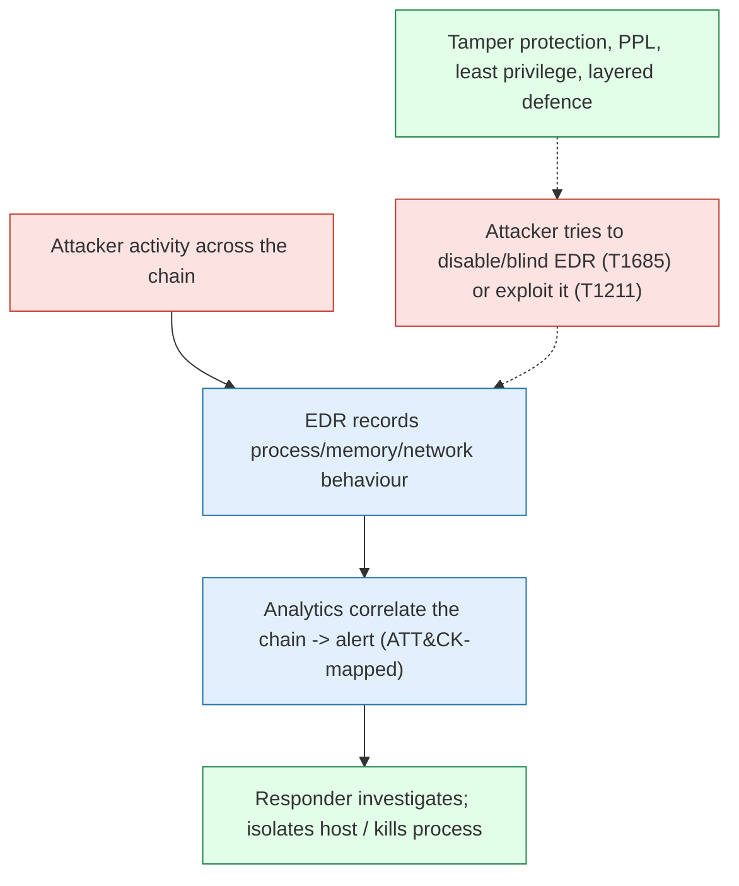

# Endpoint Detection and Response (EDR)

## Summary

Endpoint Detection and Response (EDR) is the modern successor to signature antivirus: an agent on each endpoint that continuously records rich behavioural telemetry (process, memory, file, registry, and network activity), applies analytics to detect adversary behaviour, and gives responders the ability to investigate and remediate remotely (isolate a host, kill a process, collect artefacts). Unlike static AV, EDR focuses on **behaviour over the whole attack chain**, which is why it catches fileless malware, injection, and living-off-the-land activity that signature matching misses. Because EDR is the defenders' primary visibility, attackers target it — trying to disable or blind it (disable or modify tools, T1685) or exploit it (exploitation for stealth, T1211) — which is why tamper protection and layered defence matter.

## What EDR provides

| Capability | Value |
|---|---|
| **Continuous behavioural telemetry** | Full process trees, memory/injection, network, registry |
| **Analytics & ML detection** | Behaviour-based alerts mapped to ATT&CK |
| **Investigation tooling** | Timelines, process graphs, threat-intel enrichment |
| **Response actions** | Host isolation, process termination, remote collection, remediation |
| **Threat hunting** | Query historical telemetry across the fleet |

EDR's strength is correlation across the chain: a single event may be benign, but "document → PowerShell → injected code → outbound beacon" is a clear attack story the agent can see end-to-end.

## EDR in the attack chain

## Detection / value

- Catches **behavioural** attacks (fileless, injection, LOLBins) that signature AV misses.
- Provides the **telemetry and timelines** that make hunting and IR possible.
- Enables **fast containment** (isolate/kill/remediate) to limit blast radius.
- Flags **tampering** with itself (a strong compromise signal).

## Defense

- **Deploy EDR broadly with tamper protection enabled**; run it as a protected process where supported.
- **Combine with least privilege and app control** so attackers can't easily reach kernel/disable tooling (BYOVD).
- **Tune and hunt**: reduce false positives and proactively query telemetry.
- **Monitor EDR health**: agents going silent or being disabled is itself an alert.
- **Integrate with SIEM/XDR** for cross-source correlation.

## ATT&CK mapping

| ID | Name | Tactic |
|---|---|---|
| T1685 | Disable or Modify Tools | Defense Impairment |
| T1211 | Exploitation for Stealth | Stealth |

(These are techniques adversaries use against EDR; EDR itself is a defensive capability.)

## Explanation

Old antivirus was a bouncer with a book of mugshots, checking faces at the door and then losing interest. EDR is a full security operation: cameras in every room recording what everyone actually does, an analyst watching the feeds for suspicious sequences of behaviour, and a response team that can lock a single room the instant trouble appears. That shift from "recognise the face" to "watch the behaviour" is why EDR catches intruders who wear no known face at all — fileless attackers, people misusing legitimate tools. Naturally, a smart intruder's first move is to try to blind the cameras or bribe the guard, so the operation protects its own eyes and ears above all, and treats a camera suddenly going dark as an alarm rather than a glitch.
