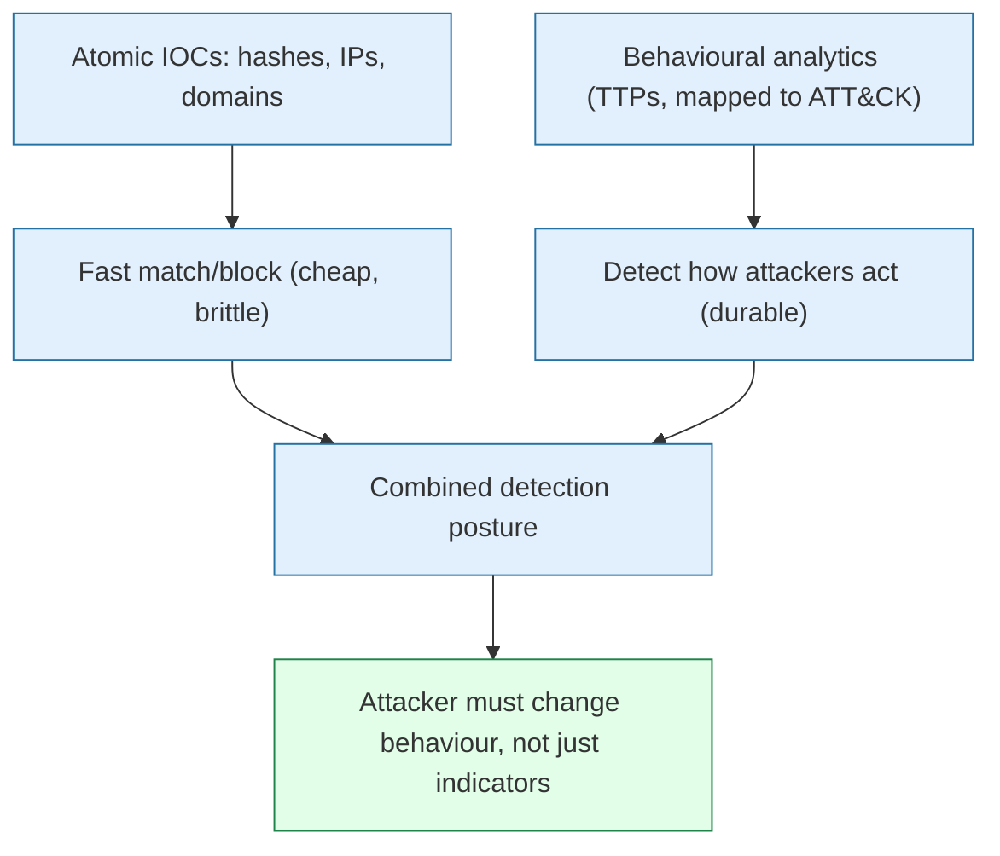

# Indicators of Compromise and Detection Logic

## Summary

An Indicator of Compromise (IOC) is an observable sign that an intrusion has occurred — a malicious hash, domain, IP, filename, registry key, or mutex. IOCs are cheap to share and easy to match, but they are also the most brittle layer of detection because attackers change them trivially between operations. The "Pyramid of Pain" captures why: blocking hashes or IPs barely inconveniences an adversary, while detecting their tools and especially their behaviours (TTPs) forces real, costly change. Good detection logic therefore layers atop IOCs: durable behavioural analytics (often written as Sigma rules mapped to ATT&CK) that survive an attacker swapping indicators. The goal is to raise the cost of evasion, not just to blocklist yesterday's artefacts.

## The Pyramid of Pain (bottom = easy for attacker to change)

| Level | Indicator | Pain to attacker |
|---|---|---|
| **Hash values** | File hashes | Trivial (recompile/repack) |
| **IP addresses** | C2 IPs | Easy (rotate) |
| **Domain names** | C2 domains | Moderate |
| **Network/host artefacts** | User-agents, registry keys, named pipes | Annoying |
| **Tools** | Specific malware/utilities | Hard |
| **TTPs (behaviour)** | How they operate | Very hard |

The lesson: IOCs are necessary for fast blocking and sharing, but detection that targets tools and behaviours is what actually drives adversaries off, because changing *how they operate* is far costlier than changing a hash.

## Layered detection

## Practices

- **Consume IOC feeds** for fast blocking, but treat them as perishable and time-bound.
- **Write behavioural detections** (e.g. Sigma rules) mapped to ATT&CK techniques for durability.
- **Prioritise higher-pyramid detection** (tools, TTPs) to impose real cost on adversaries.
- **Contextualise alerts**: an IOC hit plus corroborating behaviour is far stronger than either alone.
- **Retire stale IOCs** to control false positives and noise.

## Defensive value

- Enables rapid response to known threats (IOC matching) while behavioural logic catches variants.
- Focuses engineering effort where it hurts adversaries most.
- Shareable detection content (Sigma/ATT&CK mapping) improves the whole community's coverage.

## ATT&CK mapping

No single ATT&CK technique; this describes detection strategy across all techniques, emphasising behaviour (TTPs) over atomic indicators.

## Explanation

An IOC is a wanted poster showing a specific disguise: this exact hat, this exact coat. It's useful — if the suspect wears that outfit again, you grab them instantly — but changing a hat is effortless, so the poster goes stale the moment they do. The Pyramid of Pain is the insight that disguises are cheap and habits are expensive. You can swap a hat, a coat, even the car (hashes, IPs, domains) without breaking stride, but changing *how you case a building and crack a safe* (your behaviour) means retraining, which hurts. So mature defence keeps the wanted posters for quick wins but invests most in recognising the method — the TTPs — because that's the one thing an adversary can't change without genuinely slowing down.
