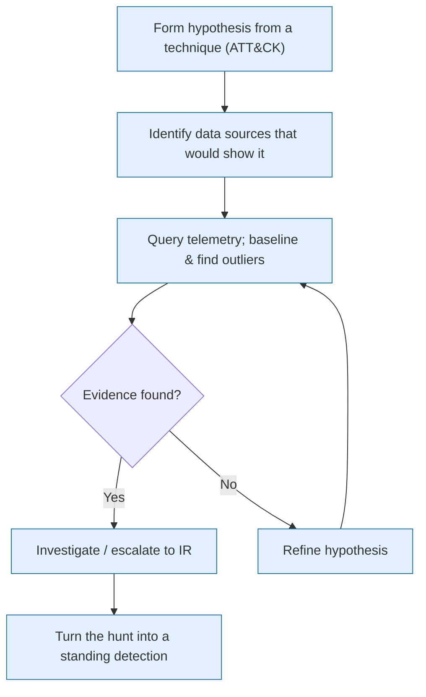

# Threat Hunting on Windows

## Summary

Threat hunting is the proactive search for adversaries that have evaded automated detection — assuming a breach may already exist and going looking for it, rather than waiting for an alert. On Windows it draws on the same telemetry as detection engineering (Sysmon, ETW, security logs, EDR) but applies human-driven hypotheses: "if an attacker used technique X, what traces would it leave here?" Effective hunting is structured around adversary behaviour (commonly MITRE ATT&CK), uses the fact that attackers must do certain noisy things (execute, persist, move laterally, exfiltrate), and turns successful hunts into permanent detections. The mindset is the opposite of alert-chasing: start from a technique and hunt its evidence across the estate.

## Hunting approaches

| Approach | Basis |
|---|---|
| **Hypothesis-driven** | Pick a technique (ATT&CK) and hunt its expected artefacts |
| **IOC / intel-driven** | Search for indicators from threat intelligence |
| **Anomaly/baseline** | Find deviations from known-good (rare processes, odd parents) |
| **Crown-jewel focused** | Hunt around the assets attackers most want |

A productive principle is "stacking" or frequency analysis: across many hosts, the rare is suspicious — a binary that appears on one machine, an unusual parent-child pair, a single host beaconing — because attacker tooling is uncommon relative to normal software.

## Hunt loop

## Common hunts

- **Execution anomalies**: LOLBins, scripting hosts, or interpreters with unusual parents (Office → PowerShell) or network behaviour.
- **Persistence sweep**: new autostart entries, services, scheduled tasks, WMI subscriptions across hosts.
- **Credential access**: LSASS access patterns, suspicious logon types/sources.
- **Lateral movement**: remote service/task creation, unusual admin logons, SMB/WMI/WinRM patterns.
- **C2**: rare outbound destinations, beacon-like regularity, trusted-service abuse.

## Defensive value

- Finds dwell-time threats that slipped past automated detection.
- Converts human findings into durable, automated detections (closing gaps).
- Improves telemetry and baselines as a by-product.
- Builds analyst understanding of normal vs abnormal in the environment.

## ATT&CK mapping

No single ATT&CK technique; hunting is a proactive detection practice structured around the full ATT&CK matrix.

## Explanation

Most security tools are smoke alarms: they wait for something to catch fire and then go off. Threat hunting is the fire marshal who walks the building on a quiet day, assuming a smouldering problem might already exist and deliberately looking for the first wisp of smoke the alarms haven't caught. The marshal doesn't wander aimlessly; they reason from how fires start — "if someone's been careless near the wiring, I'd expect scorch marks here" — and go check. A powerful trick is comparing rooms: if one office has an odd smell that a hundred identical offices don't, that's where to look, because attacker tools are rare against the backdrop of normal software. And every real find makes the building safer permanently, because the marshal installs a new alarm wherever they discovered the alarms were blind.
