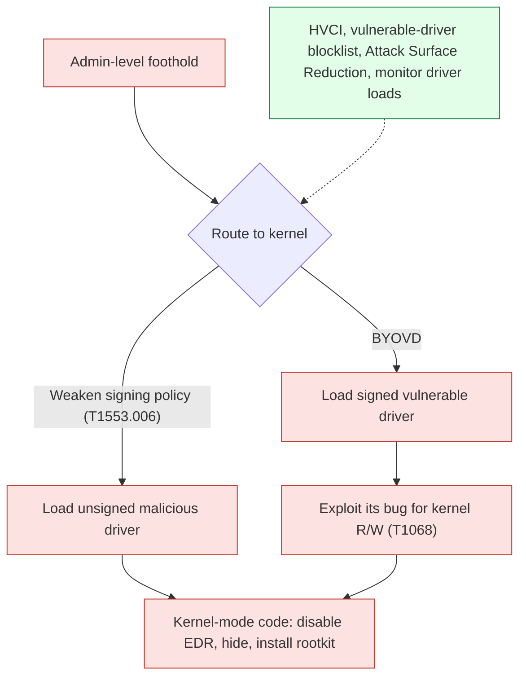

# Driver Signature Enforcement and BYOVD

## Summary

Kernel drivers run with the highest privilege on Windows, so **Driver Signature Enforcement (DSE)** requires them to be signed before the kernel will load them. Attackers who want kernel access take two main routes. They subvert the policy that enforces signing (code signing policy modification, T1553.006) — for example by disabling or weakening DSE — or, far more commonly today, they use **Bring Your Own Vulnerable Driver (BYOVD)**: load a *legitimately signed* but vulnerable driver and exploit its bug to gain kernel read/write, bypassing the need to sign their own malicious driver (exploitation for privilege escalation, T1068; exploitation of a vulnerable driver). Kernel access from BYOVD lets attackers disable security products, hide processes, and install rootkits, which is why blocking known-vulnerable drivers has become a priority defence.

## The two routes to kernel code

| Route | Mechanism |
|---|---|
| **Weaken DSE (T1553.006)** | Disable/modify the signing policy so unsigned/self-signed drivers load |
| **BYOVD** | Load a signed-but-vulnerable driver and exploit it for kernel read/write |
| **Kernel exploit (T1068/T1211)** | Exploit a bug in an already-present driver or the kernel |
| **Outcome** | Kernel-mode code execution: disable EDR, hide artefacts, load rootkits |

BYOVD is attractive precisely because the driver is validly signed — it passes DSE — so the attacker never needs their own signature; the vulnerability does the privilege work.

## Attack flow

## Detection

- Loading of known-vulnerable drivers (match against vulnerable-driver blocklists) or rarely-seen signed drivers.
- New kernel driver/service installs, especially from unusual paths or by non-admin tooling.
- Security products being tampered with or stopped shortly after a driver load (classic BYOVD "kill EDR").
- Changes to DSE/test-signing/boot configuration that would weaken driver signing.

## Defense

- **Enable HVCI (memory integrity)** and the **Microsoft vulnerable-driver blocklist** to stop known-bad signed drivers loading.
- **WDAC driver policies** to allow only approved drivers.
- **Keep Secure Boot and DSE enabled**; alert on test-signing or DSE-disabling changes.
- **Monitor driver loads and service installs**, and protect EDR with tamper protection.
- **Patch/retire vulnerable drivers** in your environment.

## ATT&CK mapping

| ID | Name | Tactic |
|---|---|---|
| T1068 | Exploitation for Privilege Escalation | Privilege Escalation |
| T1553.006 | Subvert Trust Controls: Code Signing Policy Modification | Defense Impairment |
| T1211 | Exploitation for Stealth | Stealth |

## Explanation

The kernel only admits drivers that carry a valid signature, like a club that only lets in guests on a signed list — and drivers, once inside, can do absolutely anything. Forging your way onto the list is hard, so attackers found a cleverer move: bring a guest who is genuinely on the list but happens to have a pickable lock in their pocket (a legitimately signed driver with a known bug). The bouncer waves them in because the signature is real, and once inside the attacker picks that lock to reach full kernel power — enough to switch off the security cameras (EDR) and hide. The modern defence doesn't just check signatures; it keeps a blocklist of these known-pickable guests and enforces memory integrity so that even inside the club, tampering is far harder.
