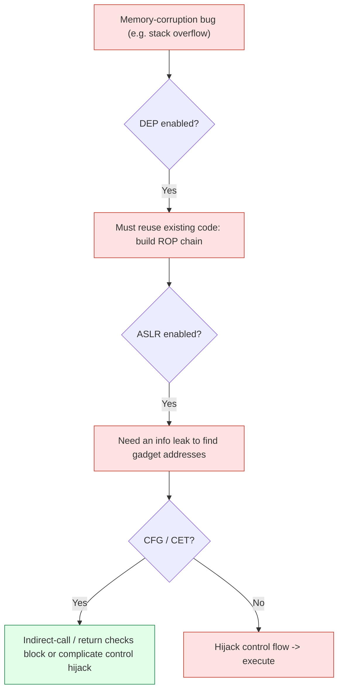

# Exploit Mitigations (DEP, ASLR, CFG, CET)

## Summary

Windows ships a stack of exploit mitigations that raise the cost of turning a memory-corruption bug into reliable code execution. **DEP/NX** marks data memory non-executable, so an attacker cannot simply write shellcode to the stack and run it. **ASLR** randomises where modules and allocations load, so the addresses an exploit needs are unpredictable. **CFG** (Control Flow Guard) validates indirect call targets, blunting hijacked function pointers, and hardware **CET** shadow stacks protect return addresses. None is a complete defence alone — attackers answer DEP with code reuse (ROP), ASLR with info leaks, and so on — but together, and with modern additions, they make exploitation substantially harder. Understanding what each stops explains the techniques (ROP, info-leak chaining) that exist to defeat them.

## The mitigations

| Mitigation | What it stops | Typical bypass it forces |
|---|---|---|
| **DEP / NX** | Executing data pages (stack/heap shellcode) | Code reuse: ROP/JOP using existing executable code |
| **ASLR** | Hardcoded addresses (modules/stack/heap randomised) | Information leak to discover a base address |
| **CFG** | Indirect calls to invalid targets (hijacked pointers) | Target-validation gaps, return-address abuse, data-only attacks |
| **CET (shadow stack)** | Corrupted return addresses (ROP) | Harder; pushes attackers to non-return techniques |
| **Mandatory ASLR / force integrity (Exploit Protection)** | Legacy modules opting out of ASLR | — |

The pattern: each mitigation removes one easy primitive, so modern exploitation chains several bypasses (e.g. a leak to beat ASLR, then ROP to beat DEP).

## How mitigations interact with an exploit

## Defense

- **Enable all available mitigations broadly**: DEP, system-wide and high-entropy ASLR, CFG, and CET on supported hardware.
- **Use Exploit Protection (and mandatory ASLR)** to force mitigations on legacy apps that opt out.
- **Compile with modern flags** (`/DYNAMICBASE`, `/HIGHENTROPYVA`, `/guard:cf`, CET-compatible) for in-house software.
- **Reduce memory-unsafe code** where feasible, and patch promptly to remove the underlying bugs.
- **Layer with WDAC/EDR** so even a successful exploit faces further barriers.

## ATT&CK mapping

No single ATT&CK technique; these mitigations defend against exploitation for privilege escalation / client execution (T1068 and related), and the ROP and buffer-overflow files describe the offensive side.

## Explanation

Think of a memory bug as a crack in a wall an attacker wants to climb through. Each mitigation nails a different board over the crack. DEP says "you may scribble on this wall but you can't make it a door" — so writing code where data lives no longer works. ASLR shuffles the whole building's room numbers each day, so a map drawn yesterday is useless. CFG and CET post guards who check that anyone moving between rooms is using a legitimate doorway and returning the way they came. Any one board can be pried off with enough effort — which is why real exploits are now long chains of clever bypasses — but nailing up all of them turns a quick climb into an expensive, fragile operation, which is exactly the point.
