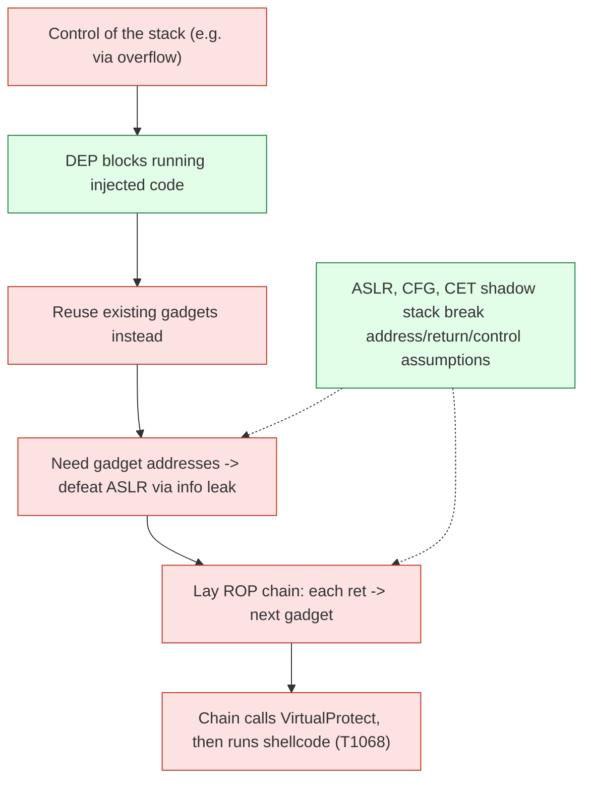

# Return-Oriented Programming (ROP)

## Summary

Return-Oriented Programming is the standard answer to DEP. When data pages cannot be executed, an attacker cannot run injected shellcode — so instead they reuse code that is already executable: short instruction sequences ending in `ret`, called **gadgets**, found in the program and its loaded libraries. By overwriting the stack with a chain of gadget addresses, each `ret` jumps to the next gadget, stitching existing snippets into a new program that performs the attacker's goal (typically marking memory executable, then running real shellcode) — all without ever executing data (exploitation for privilege escalation, T1068). ROP is why DEP alone is not enough, and why ASLR, CFG, and CET shadow stacks were introduced to attack the technique directly. This is a conceptual explanation, not an exploit recipe.

## Key ideas

| Concept | Meaning |
|---|---|
| **Gadget** | A short existing instruction sequence ending in `ret` |
| **ROP chain** | A stack layout of gadget addresses the CPU executes via successive returns |
| **Why it beats DEP** | Only existing executable code runs; no data is executed |
| **Common goal** | Call `VirtualProtect`/`VirtualAlloc` to make a region executable, then run shellcode |
| **What breaks it** | ASLR (unknown gadget addresses), CFG (indirect-call checks), CET shadow stack (return-address integrity) |

ROP needs to know where gadgets live, so it depends on defeating ASLR first (usually via an information leak) — which is why modern exploits chain a leak, then ROP, then payload.

## ROP flow and defences

## Detection

- Post-exploitation behaviour: a process suddenly calling `VirtualProtect`/`VirtualAlloc` to create executable memory, then executing it.
- CET shadow-stack violations and CFG check failures (mitigated-exploit telemetry).
- Crash-then-anomalous-behaviour sequences surfaced by EDR.
- Exploit-Protection events indicating ROP-style mitigation triggers.

## Defense

- **ASLR (high-entropy, mandatory)** so gadget addresses are unknown without a leak.
- **CFG** to validate indirect-call targets and **CET shadow stacks** to protect return addresses — aimed squarely at ROP.
- **Reduce info-leak bugs** (they are the enabler) and patch memory-corruption primitives.
- **EDR behavioural detection** of the make-memory-executable-then-run pattern.
- **Layer defences**: ROP depends on several assumptions holding at once, so breaking any of them helps.

## ATT&CK mapping

| ID | Name | Tactic |
|---|---|---|
| T1068 | Exploitation for Privilege Escalation | Privilege Escalation |

## Explanation

When DEP forbade attackers from bringing their own instructions, they switched to a ransom-note trick: instead of writing new words, cut existing words out of the program's own pages and paste them into a new order. Each snippet ends with "return," which conveniently flips to the next snippet in the list the attacker laid on the stack, so a careful arrangement of borrowed fragments performs a brand-new task — usually "make this area runnable, then run my real code." The catch for the attacker is that you must know exactly where each fragment sits, which is why address randomisation (ASLR) hurts so much, and why newer guards that check every jump and every return (CFG and CET) were built specifically to spoil this cut-and-paste technique.
