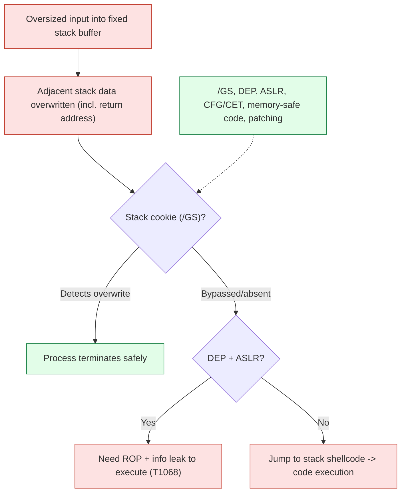

# Stack Buffer Overflows

## Summary

A stack buffer overflow happens when a program writes more data into a fixed-size stack buffer than it can hold, overwriting adjacent stack memory — including saved control data like the return address. Because the return address tells the CPU where to continue when a function finishes, an attacker who can overwrite it can redirect execution to code of their choosing, classically leading to arbitrary code execution and, where the vulnerable code runs privileged, to escalation (exploitation for privilege escalation, T1068). This is the canonical memory-corruption bug and the starting point for understanding modern exploitation and the mitigations (stack cookies, DEP, ASLR, CFG) built to stop it. This file explains the mechanism and the defences conceptually; it is not an exploit tutorial.

## Mechanism and defences

| Element | Role |
|---|---|
| **Vulnerable copy** | Unbounded/incorrectly-bounded write into a stack buffer |
| **Saved return address** | Control data on the stack an overflow can overwrite |
| **Stack cookie (/GS)** | A random canary checked before return; detects overwrite |
| **DEP/NX** | Stops executing injected shellcode on the stack (forces ROP) |
| **ASLR** | Randomises addresses so overwrite targets are unknown |
| **CFG/CET** | Validate indirect calls and protect return addresses |

The defences stack up: a cookie catches many overwrites outright; even if bypassed, DEP and ASLR mean an attacker cannot just run stack shellcode at a known address, and must chain further techniques.

## Exploitation and defense flow

## Detection

- Application crashes with access violations at suspicious addresses (possible exploitation attempts).
- Stack-cookie (`/GS`) failure / `__fastfail` terminations and Windows Error Reporting crash telemetry.
- EDR detection of post-exploitation behaviour (ROP, injected code, anomalous child processes) following a crash.
- Exploit-Protection events for mitigated exploitation attempts.

## Defense

- **Write memory-safe code**: bounded copies, safe string functions, and memory-safe languages where possible.
- **Compile with mitigations**: stack cookies (`/GS`), DEP, ASLR (`/DYNAMICBASE`, `/HIGHENTROPYVA`), CFG (`/guard:cf`), CET.
- **Enable Exploit Protection** system-wide and per-app for legacy software.
- **Patch promptly** to remove the underlying vulnerabilities.
- **EDR** to catch post-corruption behaviour even if a bug is exploited.

## ATT&CK mapping

| ID | Name | Tactic |
|---|---|---|
| T1068 | Exploitation for Privilege Escalation | Privilege Escalation |

## Explanation

Picture a form with a box that fits ten characters, but the clerk never checks and keeps writing whatever you dictate, spilling past the box and over the notes beside it — including the instruction that says "when done, go back to desk 5." Overwrite that instruction and you can send the clerk anywhere you like. That is a stack overflow: too much input runs past its buffer and clobbers the "where to go next" value, letting an attacker hijack the program. Decades of defences now sit on top of this: a tamper-evident seal on the critical notes (the stack cookie), a rule that scribbled-on areas can't be treated as instructions (DEP), and daily reshuffling of all the desk numbers (ASLR). The bug still matters, but turning it into a working attack now takes far more than one oversized form.
