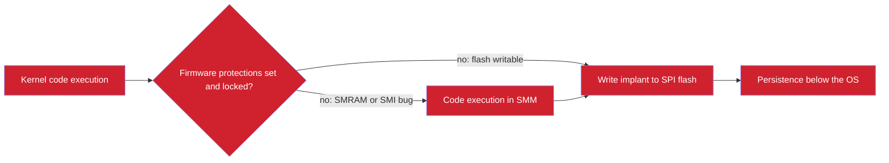

# UEFI Firmware Vulnerabilities (SMM, S3 Boot Script, SPI Flash, Intel ME)

## Summary

Platform firmware is large, privileged code written by several parties (silicon vendor, firmware vendor, OEM), and it has its own bug classes. The prize for an attacker is code that runs **below** the operating system and hypervisor: in System Management Mode (SMM), or persisted in the SPI flash so it runs on every boot (T1542.001). Most of these weaknesses come down to a protection the firmware should have set and locked at boot, but didn't. That is good news for defenders, because it can be checked from software, and **CHIPSEC** has a test module for most of the classes below.

## Vulnerability classes

| Class | What goes wrong | CHIPSEC check |
|---|---|---|
| **BIOS write protection** | BIOS region of flash is writable from the OS. Protection relies on the BIOS Control register: BIOS Write Enable (BIOSWE) must be clear and locked with BIOS Lock Enable (BLE); because of a race condition, SMM BIOS Write Protection (SMM_BWP, also called EISS) must also be set so only SMM can write. Alternatively, SPI Protected Range registers (PR0-PR4) must cover the whole BIOS region. | `common.bios_wp` |
| **SPI controller not locked** | If the flash controller configuration (including PR0-PR4) is not locked with FLOCKDN, it can be reprogrammed to bypass protections | `common.spi_lock` |
| **Unprotected NVRAM / Secure Boot keys** | If firmware data such as the Platform Key is not write-protected, malware can overwrite it and disable Secure Boot | `common.secureboot.variables` |
| **SMRAM not locked** | When `D_LCK` is not set, SMRAM can be accessed outside SMM, so ring 0 code can modify SMM code and data | `common.smm` |
| **SMM call-outs** | SMM code calls or jumps outside SMRAM into memory the OS controls. `SMM_CODE_CHK_EN` makes such execution raise a machine check, and must be set and locked | `common.smm_code_chk` |
| **SMI handler pointer bugs** | SMI handlers trust pointers supplied by the OS, letting an attacker make SMM read or write arbitrary memory | `tools.smm.smm_ptr` (fuzzing tool) |
| **S3 resume boot script** | The script the firmware replays when resuming from sleep is stored where the OS can modify it, so an attacker can undo protections on resume (CERT VU#976132) | `common.uefi.s3bootscript` |
| **Intel ME left in manufacturing mode** | The Management Engine is still in its factory configuration mode on a shipped system | `common.me_mfg_mode` |

Note that every path starts with an attacker who already has kernel-level code execution; firmware bugs are about **persistence and stealth**, not initial access.

## Mitigations

- **Patch firmware**: most of these are fixed in OEM updates. Treat BIOS/UEFI updates as security updates.
- **Audit with CHIPSEC**: run `chipsec_main` on representative hardware models and act on failed modules.
- **Enable platform protections** offered by your hardware, such as verified boot features, and keep Secure Boot on with an up-to-date dbx.
- **Limit who can get kernel code execution**: driver blocklists and memory integrity (HVCI) reduce the first step.

## ATT&CK mapping

- **T1542.001 System Firmware**: the persistence these bugs enable.
- **T1068 Exploitation for Privilege Escalation**: escalation from kernel to SMM.

See also [BIOS/UEFI Firmware Forensics](../forensics/bios-uefi-firmware-forensics.md) and [UEFI Rootkits and Firmware Implants](../rootkits/uefi-rootkits-and-firmware-implants.md).

## Explanation

The firmware locks are like the lock on a building's foundation hatch. The builder is supposed to lock it and throw away the key before the tenants move in. If they forget, any tenant with a screwdriver (kernel access) can climb down and hide something that no future renovation will find. CHIPSEC walks around checking that every hatch was actually locked.
