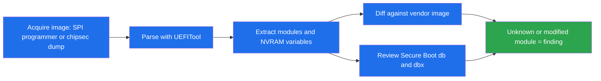

# BIOS/UEFI Firmware Forensics

## Summary

A firmware implant lives in the SPI flash chip on the motherboard, not on the disk. It survives an OS reinstall and even a disk replacement, and it runs before the OS and its security tools (T1542.001 System Firmware). The only way to find one is to **acquire the firmware image and inspect it**. The workflow mirrors disk forensics: acquire a trustworthy image, parse it into its components, then analyse each component and compare with a known-good reference.

## Acquisition: software or hardware

| Approach | How | Trust |
|---|---|---|
| **Software** | Read the flash from the running OS, e.g. `chipsec_util spi dump rom.bin` | Convenient, but a compromised system could feed you a clean-looking image |
| **Hardware** | Attach an SPI programmer to the flash chip with the machine powered off and read it directly | More effort, but does not depend on the possibly compromised platform |

On a system you genuinely suspect, prefer a hardware read for evidence; use a software dump for triage and fleet checks.

## Parsing and analysis

- **UEFITool** parses a UEFI firmware image into a tree of volumes, files and sections and verifies its integrity, so you can browse components and pull out individual modules.
- **CHIPSEC** is Intel's open-source platform security framework. Its utility commands dump the SPI flash and work with UEFI variables, for example `chipsec_util uefi var-list` to list variables and `chipsec_util uefi var-list-spi rom.bin` to list them from a dumped image.
- Extracted executable modules (PEI and DXE drivers) go into a disassembler; variables can be read in a hex editor.
- **Compare against the vendor's image** for the same model and version. Extra or modified modules are the red flag.

## Secure Boot variables

Secure Boot policy lives in UEFI variables, which makes them high-value evidence:

| Variable | Role (Microsoft's description) |
|---|---|
| **PK** (Platform Key) | Trust relationship between the platform owner and the firmware |
| **KEK** (Key Exchange Keys) | Trust relationship between the OS and the firmware |
| **db** (authorized database) | Public keys and certificates of trusted firmware components and OS loaders |
| **dbx** (forbidden signature database) | Hashes of malicious and vulnerable components that must not run |

Check db for unexpected certificates, and dbx for missing revocations. CHIPSEC's `common.secureboot.variables` module checks that the Secure Boot key variables are authenticated and protected from unauthorised modification.

## A caution

The same tooling that reads firmware can also write it. CHIPSEC includes modules that deliberately try to modify protected variables, so run write-capable tests only on lab hardware.

## ATT&CK mapping

- **T1542.001 System Firmware**: implants in BIOS/UEFI.
- **T1495 Firmware Corruption**: destructive overwrites of firmware.

See also [UEFI Rootkits and Firmware Implants](../rootkits/uefi-rootkits-and-firmware-implants.md) and [Secure Boot and UEFI Security](../rootkits/secure-boot-and-uefi-security.md).

## Explanation

Disk forensics examines the house. Firmware forensics examines the foundations, which nobody looks at because they're under the floor. If someone has buried something in the foundations, repainting every room (reinstalling Windows) changes nothing; you have to dig down and compare against the architect's original plans.
