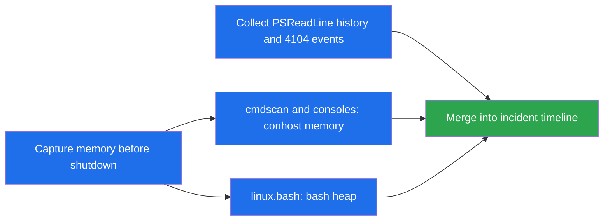

# Command History Recovery

## Summary

Hands-on-keyboard attackers type commands, and those commands are some of the most valuable evidence in an investigation: they show intent, tools, targets and mistakes. Attackers know this, so they disable or wipe history files (T1070.003 Clear Command History). But a shell has to keep its history somewhere while it runs, and that somewhere is **process memory**. A memory image captured during incident response can recover commands that never reached disk, or that were deleted from it.

## Windows

| Source | Where it lives | How to recover |
|---|---|---|
| **cmd.exe history** | In the memory of the console host process, `conhost.exe` | Volatility 3 `windows.cmdscan` looks for command history lists; `windows.consoles` looks for console screen buffers, which also show command **output** |
| **PowerShell (PSReadLine) history file** | `$($Host.Name)_history.txt` under `$Env:APPDATA\Microsoft\Windows\PowerShell\PSReadLine` (one file per PowerShell host) | Collect from disk during triage |
| **PowerShell script block logs** | Event ID 4104 when Script Block Logging is enabled | Collect the `Microsoft-Windows-PowerShell/Operational` log |
| **PowerShell process memory** | Memory of `powershell.exe` / `pwsh.exe` | Strings and object analysis of the process dump |

The console-buffer approach is especially useful: it can show what the attacker *saw*, such as the output of `whoami`, `net group` or a credential dump.

## Linux

Bash keeps its history in the heap of each running `bash` process. Volatility 3's `linux.bash` plugin recovers bash command history from process memory, with timestamps. This works even if `.bash_history` was deleted or history writing was turned off, as long as the shell process was still alive when memory was captured.

## Practical rules

- **Capture memory before powering off.** Closing a terminal or rebooting destroys in-memory history.
- Collect on-disk history files as well; they may hold older sessions.
- Treat a missing or empty history file on an active admin account as a possible sign of wiping.
- Turn on PowerShell Script Block Logging so you are not relying on memory alone.

## ATT&CK mapping

- **T1059.003 Windows Command Shell**, **T1059.001 PowerShell**, **T1059.004 Unix Shell**: the activity being reconstructed.
- **T1070.003 Clear Command History**: the anti-forensic step this technique often defeats.

See also [Memory Forensics and Volatility](memory-forensics-and-volatility.md).

## Explanation

Deleting a history file is like shredding the minutes of a meeting. But while the meeting is still going, the people in the room still remember what was said. A memory capture interviews them before they go home.
